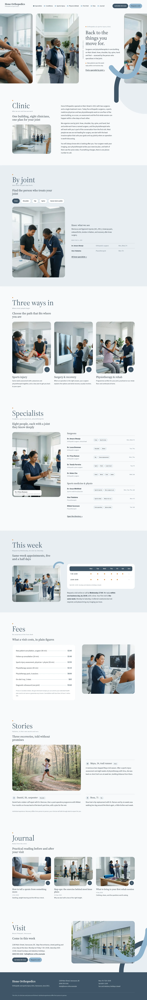

# Hone Orthopedics

A calm block theme (type health) for an orthopedic and sports injury clinic. Home page (English) in this release; inner pages and other languages follow.

## Signature
- Tall rounded portrait strip: the outer photos bleed off both viewport edges, radius 24 px.
- A thick round-capped ribbon over a pale disc and a dark arc, crossing the photo edge; reprised in "This week" and the closing section.
- 3:4 photo cards with a ground-coloured notch holding an arrow circle.
- Big light section labels with a small caption and an orange dot.

## Patterns
- `front-clinic`
- `front-close`
- `front-fees`
- `front-hero`
- `front-joint`
- `front-journal`
- `front-specialists`
- `front-stories`
- `front-ways`
- `front-week`

## Fonts
Source Serif 4 and Source Sans 3 (SIL OFL 1.1, licences in assets/fonts).

## Images (AI-generated for this theme, no text or logos; assets/images/)
- assets/images/p1.webp
- assets/images/p2.webp
- assets/images/p3.webp
- assets/images/p4.webp
- assets/images/p5.webp
- assets/images/p6.webp
- assets/images/p7.webp
- assets/images/p8.webp
- assets/images/p9.webp
- assets/images/p10.webp
- assets/images/p11.webp
- assets/images/p12.webp
- assets/images/p13.webp
- assets/images/p14.webp
- assets/images/p15.webp
- assets/images/p16.webp

## Notes
The clinic, its clinicians, addresses and prices are fictional. Works without any plugin; WooCommerce is not needed.

<!-- screenshots:start -->
## Screenshots

<table>
<tr>
<td valign="top"></td>
<td valign="top"></td>
</tr>
</table>

- Specialists: [desktop](screenshots/specialists-desktop.webp) · [mobile](screenshots/specialists-mobile.webp)
- Conditions: [desktop](screenshots/conditions-desktop.webp) · [mobile](screenshots/conditions-mobile.webp)
- Sports injury: [desktop](screenshots/sports-injury-desktop.webp) · [mobile](screenshots/sports-injury-mobile.webp)
- Physiotherapy: [desktop](screenshots/physiotherapy-desktop.webp) · [mobile](screenshots/physiotherapy-mobile.webp)
- First visit: [desktop](screenshots/first-visit-desktop.webp) · [mobile](screenshots/first-visit-mobile.webp)
- Fees: [desktop](screenshots/fees-desktop.webp) · [mobile](screenshots/fees-mobile.webp)
- Stories: [desktop](screenshots/stories-desktop.webp) · [mobile](screenshots/stories-mobile.webp)
- Book: [desktop](screenshots/book-desktop.webp) · [mobile](screenshots/book-mobile.webp)
- About: [desktop](screenshots/about-desktop.webp) · [mobile](screenshots/about-mobile.webp)
- News: [desktop](screenshots/news-desktop.webp) · [mobile](screenshots/news-mobile.webp)
- Article: [desktop](screenshots/article-desktop.webp) · [mobile](screenshots/article-mobile.webp)
- Category: [desktop](screenshots/category-desktop.webp) · [mobile](screenshots/category-mobile.webp)
- Tag: [desktop](screenshots/tag-desktop.webp) · [mobile](screenshots/tag-mobile.webp)
- Newsletter: [desktop](screenshots/newsletter-desktop.webp) · [mobile](screenshots/newsletter-mobile.webp)
- Contact: [desktop](screenshots/contact-desktop.webp) · [mobile](screenshots/contact-mobile.webp)
- Journal: [desktop](screenshots/journal-desktop.webp) · [mobile](screenshots/journal-mobile.webp)
- Other languages (home page): [zh-TW](screenshots/zh-TW/home-desktop.webp) · [ja](screenshots/ja/home-desktop.webp) · [fr](screenshots/fr/home-desktop.webp) · [de](screenshots/de/home-desktop.webp)
<!-- screenshots:end -->
