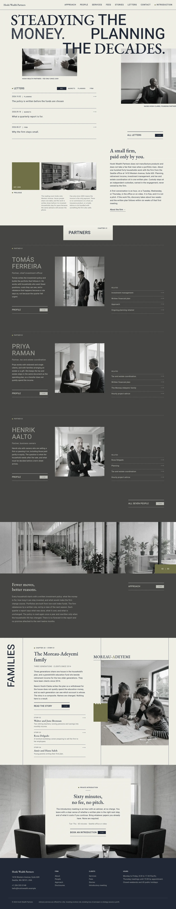

# Hoshi Wealth Partners

A WordPress block theme for a fee-only wealth-management firm in Seattle (founded 2009). The demo firm is fictional; people, places and fees are written down in [`brand.md`](brand.md). Type: business. Sample content is in English; other languages follow in later versions.

## Concept: a firm told through its advisers

- **Palette.** Grain-paper ground `#F2F2E9`, ink `#212836`, dark band `#40403D`, stone `#B7B7B1`; sea pine `#6B6A3E` only on dots, a tile, a chip, a block and one letter. First screen saturated pixels about 0%.
- **Type.** EB Garamond and Heebo (OFL-1.1), Latin WOFF2 subsets bundled.
- **Photographs.** Sixteen near-monochrome film-grain photographs from one shared style string, none repeated on a page.
- **Signature.** Mixed serif and grotesque uppercase headline overlapping two photographs; ruled partner rows on a dark band with a sticky chapter card; a framed family portrait with a vertical word, sea-pine block and sprocket dots.
- **Motion.** `sp-scroll` (reveal, stagger, parallax); respects `prefers-reduced-motion`, content visible without JavaScript.

## Front page

1. Headline, two photographs and captions.
2. Letters (latest three posts).
3. Prologue.
4. Partners on a dark band.
5. Parallax strip and the investment approach.
6. Framed family story and three more stories.
7. Introductory meeting panel.

## Stage-2 fixes (home)

- Grain-clipped "MONEY." (SVG noise), serif words scaled 1.06em on phones, family name no longer hides the rule.
- Prologue spacing and column widths tightened; mobile meeting photo crops to the two armchairs; one quiet one-to-one photograph replaces the open-office portrait (P05).
- Main menu links go to real inner pages (approach, people, services, fees, stories, letters, contact, introductory meeting). Inner pages and the four other languages follow.

## Inner pages (stage 2)

About the firm, People, Approach, Services, Fees, Stories, Introductory meeting, Contact, Disclosures, Letters (index, archive, single article). Mixed-type headline, dark-band rows and framed portrait continue on them; the importer is idempotent (re-run does not duplicate pages or posts).

<!-- screenshots:start -->
## Screenshots

<table>
<tr>
<td valign="top"></td>
<td valign="top"></td>
</tr>
</table>

- About: [desktop](screenshots/about-desktop.webp) · [mobile](screenshots/about-mobile.webp)
- News: [desktop](screenshots/news-desktop.webp) · [mobile](screenshots/news-mobile.webp)
- Article: [desktop](screenshots/article-desktop.webp) · [mobile](screenshots/article-mobile.webp)
- Category: [desktop](screenshots/category-desktop.webp) · [mobile](screenshots/category-mobile.webp)
- Tag: [desktop](screenshots/tag-desktop.webp) · [mobile](screenshots/tag-mobile.webp)
- Newsletter: [desktop](screenshots/newsletter-desktop.webp) · [mobile](screenshots/newsletter-mobile.webp)
- Contact: [desktop](screenshots/contact-desktop.webp) · [mobile](screenshots/contact-mobile.webp)
- People: [desktop](screenshots/people-desktop.webp) · [mobile](screenshots/people-mobile.webp)
- Approach: [desktop](screenshots/approach-desktop.webp) · [mobile](screenshots/approach-mobile.webp)
- Services: [desktop](screenshots/services-desktop.webp) · [mobile](screenshots/services-mobile.webp)
- Fees: [desktop](screenshots/fees-desktop.webp) · [mobile](screenshots/fees-mobile.webp)
- Stories: [desktop](screenshots/stories-desktop.webp) · [mobile](screenshots/stories-mobile.webp)
- Introductory meeting: [desktop](screenshots/introductory-meeting-desktop.webp) · [mobile](screenshots/introductory-meeting-mobile.webp)
- Disclosures: [desktop](screenshots/disclosures-desktop.webp) · [mobile](screenshots/disclosures-mobile.webp)
- Other languages (home page): [zh-TW](screenshots/zh-TW/home-desktop.webp) · [ja](screenshots/ja/home-desktop.webp) · [fr](screenshots/fr/home-desktop.webp) · [de](screenshots/de/home-desktop.webp)
<!-- screenshots:end -->
