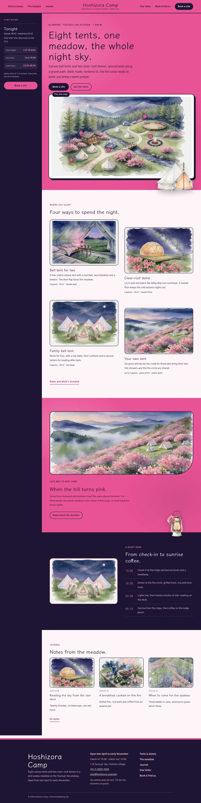
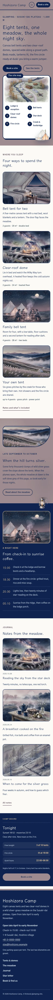

# Hoshizora Camp

Hoshizora Camp — a glamping-site theme laid out like an app: under a full top header, a deep-navy sidebar holds the synced camp board (tonight's sky, free tents, the fire circle, quiet hours and a Book a site button) beside the scrolling page. Hatobanezumi, the dove mauve-grey of traditional Japanese dyeing (#9E8B8E), is the main colour: the header, the hero, every page head and the silver-grass band are dove-grey fields with nōkon deep-navy type, on an unbleached kinari ground with pale shirafuji wisteria panels, keshimurasaki muted-purple links and small touches of kōiro incense gold and geppaku moon white on navy. The header splits the menu around the centred camp name, with the Book a site button at its end. The hero is a scene map: a watercolour map of the camp in a white frame with numbered pins for the lodge, tents, domes, star deck, fire circle and creek, and a cut-out bell tent that steps out of the frame and over the hero edge; a cut-out camp lantern hangs over the night band. Every picture is a watercolour illustration. Klee One for display, Gothic A1 for reading. The sample content comes in English, Traditional Chinese, Japanese, French and German; vertical labels only in Chinese and Japanese. WCAG AA colours; no entrance animations.

- Design plan row b3-21: sidebar-app, scene-map hero, split nav, full-illustration, watercolour, hatobanezumi #9E8B8E (recoloured in v1.0.2), Klee One + Gothic A1.
- Sample content languages: en, zh-TW, ja, fr, de.
- Contrast: nōkon navy #0F2350 on hatobanezumi #9E8B8E 4.75:1 (all text on the dove-grey header, hero, page heads and silver-grass band); navy on kinari paper #FBFAF5 14.6:1; keshimurasaki #594255 on paper 8.6:1 (links, labels); paper on keshimurasaki 8.6:1; keshimurasaki on shirafuji #DBD0E6 6.1:1; aisabi #455765 on paper 7.2:1 (secondary text); aisabi on shirafuji 5.1:1; navy on shirafuji 10.3:1; kōiro gold #EFCD9A on navy 10.1:1 (labels, times, prices on the sidebar and night band); geppaku #EAF4FC on navy 13.7:1; paper on navy 14.6:1; hatobanezumi on navy 4.75:1 (sidebar button, footer rule); navy on the white map frame 15.3:1; white on hatobanezumi only 3.2:1, never used for text.

## Templates and patterns

Every template is the app shell: the header, the page column and the night sidebar with the synced camp board, then the footer. Page bodies come from patterns (home-hero with the site-map, home-stays, home-meadow, home-night, home-journal, rooms-*, about-*, letter-*, contact-*); template headings come from tpl-* patterns so they follow the content language.

<!-- screenshots:start -->
## Screenshots

<table>
<tr>
<td valign="top"></td>
<td valign="top"></td>
</tr>
</table>

- Rooms: [desktop](screenshots/rooms-desktop.webp) · [mobile](screenshots/rooms-mobile.webp)
- About: [desktop](screenshots/about-desktop.webp) · [mobile](screenshots/about-mobile.webp)
- News: [desktop](screenshots/news-desktop.webp) · [mobile](screenshots/news-mobile.webp)
- Article: [desktop](screenshots/article-desktop.webp) · [mobile](screenshots/article-mobile.webp)
- Category: [desktop](screenshots/category-desktop.webp) · [mobile](screenshots/category-mobile.webp)
- Tag: [desktop](screenshots/tag-desktop.webp) · [mobile](screenshots/tag-mobile.webp)
- Newsletter: [desktop](screenshots/newsletter-desktop.webp) · [mobile](screenshots/newsletter-mobile.webp)
- Contact: [desktop](screenshots/contact-desktop.webp) · [mobile](screenshots/contact-mobile.webp)
- Search: [desktop](screenshots/search-desktop.webp) · [mobile](screenshots/search-mobile.webp)
- Other languages (home page): [zh-TW](screenshots/zh-TW/home-desktop.webp) · [ja](screenshots/ja/home-desktop.webp) · [fr](screenshots/fr/home-desktop.webp) · [de](screenshots/de/home-desktop.webp)
<!-- screenshots:end -->
