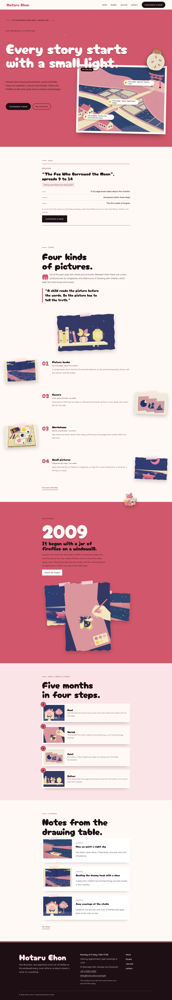

# Hotaru Ehon

Hotaru Ehon — a picture-book illustrator theme set like a poster: under a formal top header (studio name, menu and the Commission a book button in one bar, a full-screen imayo overlay on phones and tablets) the home page opens with the title in giant type across the whole width, and a picture-book map of the riverside village overlapping it with three glowing firefly pins, the places where books began. Imayo (#D0576B), the old Japanese "fashionable" pink, is the main colour: the hero, the story band and every page head are imayo fields set in dark ink. The hero breaks the frame: a cut-out firefly jar (transparent WebP) breaks out of the map frame over its top edge and into the giant title; a cut-out fox with a picture book breaks over the story band and every page head. Every picture is a flat 2D illustration in imayo pink, indigo night, cream and firefly yellow. Cherry Bomb One for display (with a Zen Maru Gothic kanji subset in Japanese), Quicksand for reading, Noto Sans TC for Traditional Chinese headings. Sample content in English, Traditional Chinese, Japanese, French and German. WCAG AA colours; no entrance animations.

- Design plan row b4-16: poster-typographic, scene-map hero, top-bar nav, cutout-break-frame (flat 2D), imayo #D0576B, Cherry Bomb One + Quicksand.
- Sample content languages: en, zh-TW, ja, fr, de.
- Contrast: ink #1F0F14 on imayo #D0576B 4.63:1 (all text on the hero, the story band, every page head and the imayo overlay menu); paper #FFF8F6 on imayo 3.81:1 only for the giant hero title and the giant opening year (large text); paper on ink buttons 17.6:1; ink on paper 17.6:1 and on pale imayo #FBE4E6 15.3:1; deep imayo #9C2E43 on paper 6.9:1 and on mist 6.0:1 (links, labels, eyebrows, facts); plum grey #5E4248 on paper 8.5:1 and on mist 7.4:1 (secondary text); paper on ink 17.6:1 and petal #FFE1E6 on ink 15.1:1 (footer); imayo on paper 3.81:1 only for large type (studio name, chapter numbers, drop caps); ink on firefly yellow #FFE9A0 15.3:1 (map pins).
- Break-frame: the cut-out firefly jar (transparent WebP) breaks out of the map frame over its top edge and into the giant hero title; the cut-out fox breaks over the top edge of the story band and the bottom edge of every page head.

<!-- screenshots:start -->
## Screenshots

<table>
<tr>
<td valign="top"></td>
<td valign="top"></td>
</tr>
</table>

- Services: [desktop](screenshots/services-desktop.webp) · [mobile](screenshots/services-mobile.webp)
- About: [desktop](screenshots/about-desktop.webp) · [mobile](screenshots/about-mobile.webp)
- News: [desktop](screenshots/news-desktop.webp) · [mobile](screenshots/news-mobile.webp)
- Article: [desktop](screenshots/article-desktop.webp) · [mobile](screenshots/article-mobile.webp)
- Category: [desktop](screenshots/category-desktop.webp) · [mobile](screenshots/category-mobile.webp)
- Tag: [desktop](screenshots/tag-desktop.webp) · [mobile](screenshots/tag-mobile.webp)
- Newsletter: [desktop](screenshots/newsletter-desktop.webp) · [mobile](screenshots/newsletter-mobile.webp)
- Contact: [desktop](screenshots/contact-desktop.webp) · [mobile](screenshots/contact-mobile.webp)
- Search: [desktop](screenshots/search-desktop.webp) · [mobile](screenshots/search-mobile.webp)
- Other languages (home page): [zh-TW](screenshots/zh-TW/home-desktop.webp) · [ja](screenshots/ja/home-desktop.webp) · [fr](screenshots/fr/home-desktop.webp) · [de](screenshots/de/home-desktop.webp)
<!-- screenshots:end -->
