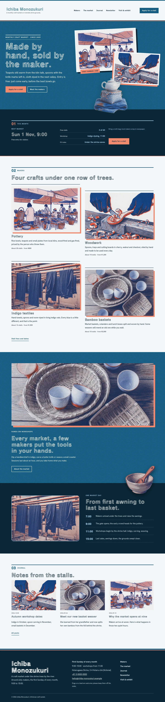
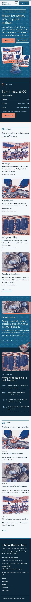

# Ichiba Monozukuri

Ichiba Monozukuri — a monthly craft market theme laid out like a printed market magazine: a masthead top bar with the market name, a horizontal menu and a Visit button. Ai indigo (#165E83) is the main colour: the hero, every page head and the season band are indigo fields with white type. The hero is a stacked collage of two risograph prints (stalls under awnings, hands carving a spoon) with a cut-out still life of a teapot, basket and indigo cloth breaking out of the collage and over the hero edge; a cut-out bowl breaks over the market-day band. Every picture is a two-ink risograph illustration (indigo and vermilion, halftone grain, slight misregistration). Train One for display, Hanken Grotesk for reading. Sample content in English, Traditional Chinese, Japanese, French and German; vertical labels only in Chinese and Japanese. WCAG AA colours; no entrance animations.

- Design plan row b3-23: editorial-magazine, stacked-collage hero, top-bar nav, cutout-break-frame, risograph, ai indigo #165E83, Train One + Hanken Grotesk.
- Sample content languages: en, zh-TW, ja, fr, de.
- Contrast: white #FFFFFF on ai indigo #165E83 7.1:1 (all text on the hero, page heads and season band); paper #F2F6F9 on ai indigo 6.5:1; night #0D2738 on paper #F2F6F9 14.2:1; deep indigo #13506F on paper 8.0:1 (links, labels); slate #46555F on paper 7.1:1 (secondary text); sky #A9D3EC on night 9.7:1 (labels on the board and market-day band); night on riso vermilion #F08A6E 6.3:1 (buttons, collage label); night on pale indigo #D9E8F1 12.3:1; vermilion on ai indigo only 2.9:1 and night on ai indigo 2.2:1, never used for text.

## Templates and patterns

Every template is the masthead header (top-bar menu), the page column and the footer. Page bodies come from patterns (home-hero with the stacked collage and cut-out still life, home-week with the synced market board, home-stays, home-meadow, home-night, home-journal, rooms-*, about-*, letter-*, contact-*); template headings come from tpl-* patterns so they follow the content language.

<!-- screenshots:start -->
## Screenshots

<table>
<tr>
<td valign="top"></td>
<td valign="top"></td>
</tr>
</table>

- Makers: [desktop](screenshots/makers-desktop.webp) · [mobile](screenshots/makers-mobile.webp)
- About: [desktop](screenshots/about-desktop.webp) · [mobile](screenshots/about-mobile.webp)
- News: [desktop](screenshots/news-desktop.webp) · [mobile](screenshots/news-mobile.webp)
- Article: [desktop](screenshots/article-desktop.webp) · [mobile](screenshots/article-mobile.webp)
- Category: [desktop](screenshots/category-desktop.webp) · [mobile](screenshots/category-mobile.webp)
- Tag: [desktop](screenshots/tag-desktop.webp) · [mobile](screenshots/tag-mobile.webp)
- Newsletter: [desktop](screenshots/newsletter-desktop.webp) · [mobile](screenshots/newsletter-mobile.webp)
- Contact: [desktop](screenshots/contact-desktop.webp) · [mobile](screenshots/contact-mobile.webp)
- Search: [desktop](screenshots/search-desktop.webp) · [mobile](screenshots/search-mobile.webp)
- Other languages (home page): [zh-TW](screenshots/zh-TW/home-desktop.webp) · [ja](screenshots/ja/home-desktop.webp) · [fr](screenshots/fr/home-desktop.webp) · [de](screenshots/de/home-desktop.webp)
<!-- screenshots:end -->
