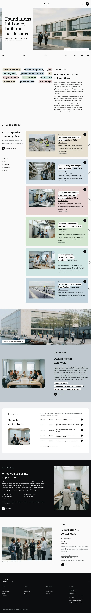

# Ishizue Holdings

Ishizue Holdings is a business theme for Ishizue Holdings B.V., the privately held group founded in Rotterdam in 1962 by Kenzo Ishizue and Anneke de Vries. It presents the six group companies, the long ownership record, investor notices and the shared-services fees in calm, specific English. Figures, dates and the head-office address at Maaskade 41 stay in euros and in the form the group publishes.

## Structure
- `patterns/front-*.php`: the eight home sections (tagline and rounded photo with timeline line, bracket-phrase marquee, sticky stack of company cards, quay photograph with parallax, governance band, investor panel, owners band, visit close).
- `templates/`: front page, page, wide page, single, archive, search and 404.
- `parts/`: centred wordmark header with the Menu circle, and the ink footer.
- `demo-content.json`: sample content (English); `inc/demo-import.php` creates it on activation.
- `assets/sp-scroll.css`, `assets/sp-scroll.js`: scroll reveals, marquee and parallax (class names only; no dependencies).
- Photos: `assets/images/` (AI-generated, GPL-2.0-or-later / CC0). See `readme.txt` for the list.

Design notes: `brand.md`, `brand/design-spec.md`, `brand/reference.md`.

License: GPL-2.0-or-later.

<!-- screenshots:start -->
## Screenshots

<table>
<tr>
<td valign="top"></td>
<td valign="top"></td>
</tr>
</table>

- History: [desktop](screenshots/history-desktop.webp) · [mobile](screenshots/history-mobile.webp)
- Companies: [desktop](screenshots/companies-desktop.webp) · [mobile](screenshots/companies-mobile.webp)
- Leadership: [desktop](screenshots/leadership-desktop.webp) · [mobile](screenshots/leadership-mobile.webp)
- Governance: [desktop](screenshots/governance-desktop.webp) · [mobile](screenshots/governance-mobile.webp)
- Investors: [desktop](screenshots/investors-desktop.webp) · [mobile](screenshots/investors-mobile.webp)
- Sustainability: [desktop](screenshots/sustainability-desktop.webp) · [mobile](screenshots/sustainability-mobile.webp)
- Owners: [desktop](screenshots/owners-desktop.webp) · [mobile](screenshots/owners-mobile.webp)
- Shared services: [desktop](screenshots/shared-services-desktop.webp) · [mobile](screenshots/shared-services-mobile.webp)
- About: [desktop](screenshots/about-desktop.webp) · [mobile](screenshots/about-mobile.webp)
- News: [desktop](screenshots/news-desktop.webp) · [mobile](screenshots/news-mobile.webp)
- Article: [desktop](screenshots/article-desktop.webp) · [mobile](screenshots/article-mobile.webp)
- Category: [desktop](screenshots/category-desktop.webp) · [mobile](screenshots/category-mobile.webp)
- Tag: [desktop](screenshots/tag-desktop.webp) · [mobile](screenshots/tag-mobile.webp)
- Newsletter: [desktop](screenshots/newsletter-desktop.webp) · [mobile](screenshots/newsletter-mobile.webp)
- Contact: [desktop](screenshots/contact-desktop.webp) · [mobile](screenshots/contact-mobile.webp)
- Search: [desktop](screenshots/search-desktop.webp) · [mobile](screenshots/search-mobile.webp)
- Other languages (home page): [zh-TW](screenshots/zh-TW/home-desktop.webp) · [ja](screenshots/ja/home-desktop.webp) · [fr](screenshots/fr/home-desktop.webp) · [de](screenshots/de/home-desktop.webp)
<!-- screenshots:end -->
