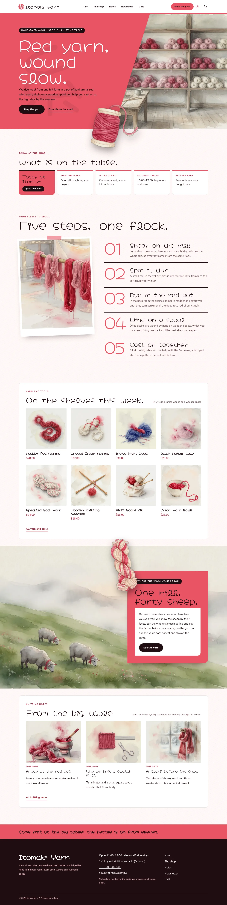
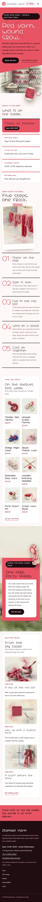

# Itomaki Yarn

Itomaki Yarn — a WooCommerce store theme for a small yarn shop in an old merchant house, set like a poster. A formal white top header carries the shop name on the left, the main menu centred and the Shop the yarn button, account and cart on the right (a full-screen red menu on phones). Kankurenai red (#E95464) is the main colour: the hero field, every page head, the shop-board card, the farm card and the footer strip are red fields with plum-black ink type on rose-white paper. The hero is a diagonal split: a red field cut on a diagonal over a watercolour of the shop, the shop line set as a giant poster headline (a vertical line beside it in Chinese and Japanese), and a cut-out spool of red yarn (transparent WebP) sitting on the seam and breaking over the hero's bottom edge. Five steps from fleece to spool stand as giant red numerals; a full-bleed watercolour of the hill farm carries a red card that a cut-out skein breaks out of. Soft watercolour illustrations throughout. Hachi Maru Pop for display, Nunito for reading. Sample content and products in English, Traditional Chinese, Japanese, French and German; vertical lines only in Chinese and Japanese. Works without WooCommerce. WCAG AA colours; no entrance animations.

- Design plan row b4-6: poster-typographic, diagonal-split hero, centered nav, cutout-break-frame, watercolour, kankurenai #E95464, Hachi Maru Pop + Nunito.
- Sample content languages: en, zh-TW, ja, fr, de.
- Contrast: plum-black ink #200C10 on kankurenai #E95464 5.3:1 (all text on the red hero field, page heads, the board card, the farm card, the header button and the footer strip); white on kankurenai 3.5:1 only for the giant hero headline (large text, 3:1 rule); ink on rose-white paper #FFF8F7 17.9:1, on white 18.7:1 and on blush #FCE6E8 15.7:1; deep madder #A8243A on paper 6.7:1, on white 7.1:1 and on blush 5.9:1 (links, prices, labels; white on deep 7.1:1); mauve grey #6A474D on paper 7.6:1 and on white 8.0:1 (secondary text); white on ink 18.7:1 and pale rose #F7C3C9 on ink 12.1:1 (buttons, chips, footer); kankurenai on paper 3.4:1 only for the giant step numerals (large text); deep madder on kankurenai 2.0:1, never used for text.
- Break-frame: the cut-out spool of red yarn (transparent WebP) sits on the diagonal seam between the red field and the shop watercolour and breaks over the hero's bottom edge into the shop board; a cut-out skein breaks out of the red card over the top edge of the full-bleed hill-farm band; the spool also breaks over the diagonal bottom edge of every page head.

## Templates and patterns

Every template is the header (the shop name on the left, the main menu centred, the Shop the yarn button, account and cart on the right; a full-screen red menu on small screens), the page column and the footer. Page bodies come from patterns: home-hero (diagonal-split poster hero with the cut-out spool), home-board (synced shop board), home-waters (five steps from fleece to spool with giant numerals), home-shelf (yarn and tools; WooCommerce products, pictures without it), home-break (full-bleed hill-farm band with a red card and the cut-out skein), home-journal (knitting notes), and the page heads and bodies of Yarn, The shop, Newsletter and Visit. WooCommerce templates (shop, product, cart, checkout, account, order confirmation, product search) use tpl-* patterns for their text.

<!-- screenshots:start -->
## Screenshots

<table>
<tr>
<td valign="top"></td>
<td valign="top"></td>
</tr>
</table>

- Shop: [desktop](screenshots/shop-desktop.webp) · [mobile](screenshots/shop-mobile.webp)
- Product: [desktop](screenshots/product-desktop.webp) · [mobile](screenshots/product-mobile.webp)
- About: [desktop](screenshots/about-desktop.webp) · [mobile](screenshots/about-mobile.webp)
- Contact: [desktop](screenshots/contact-desktop.webp) · [mobile](screenshots/contact-mobile.webp)
- News: [desktop](screenshots/news-desktop.webp) · [mobile](screenshots/news-mobile.webp)
- Article: [desktop](screenshots/article-desktop.webp) · [mobile](screenshots/article-mobile.webp)
- Category: [desktop](screenshots/category-desktop.webp) · [mobile](screenshots/category-mobile.webp)
- Tag: [desktop](screenshots/tag-desktop.webp) · [mobile](screenshots/tag-mobile.webp)
- Newsletter: [desktop](screenshots/newsletter-desktop.webp) · [mobile](screenshots/newsletter-mobile.webp)
- Search: [desktop](screenshots/search-desktop.webp) · [mobile](screenshots/search-mobile.webp)
- Other languages (home page): [zh-TW](screenshots/zh-TW/home-desktop.webp) · [ja](screenshots/ja/home-desktop.webp) · [fr](screenshots/fr/home-desktop.webp) · [de](screenshots/de/home-desktop.webp)
<!-- screenshots:end -->
