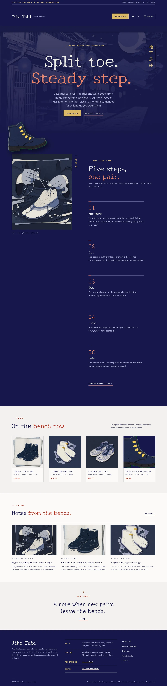
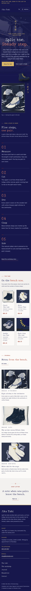

# Jika Tabi

Jika Tabi — a store theme for a split-toe tabi and jika-tabi work-boot maker, with WooCommerce templates styled to match. Tetsukon iron navy (#17184B) is the main colour: the header, the hero, the sticky making story, every page head, the bands and the footer are navy fields with washi-white type, kohaze-brass labels and vermilion numbers; New Tegomin for display and Lexend for reading. A centred giant-type hero sits over a full layered paper-cut illustration, with a vertical Japanese label at the edge and a cut-out boot that steps out over the hero into the next section; the menu always opens as a full-screen overlay. Below, a sticky-media story pins the paper-cut picture while the five making steps scroll past, then the tabi, the journal and the shop letter. All illustrations are generated in one layered paper-cut (kirie) style. The shop details and the cloth-and-care notes each live in one synced pattern (WooCommerce optional: without it the tabi show as static cells and orders go by email).

- Design plan row: b3-17 (sticky-media archetype, centered-giant-type hero, overlay nav, full-illustration images, paper-cut illustration, tetsukon #17184B, New Tegomin + Lexend).
- Header: a tetsukon navy header with a note strip, the shop name and tag, Shop the tabi, account and cart, and a Menu button; the primary menu always opens as a full-screen navy overlay.
- Hero: a centred giant headline over a full paper-cut street illustration, with a vertical Japanese label (lang="ja") at the edge.
- Break-frame: the cut-out jika-tabi boot steps out over the bottom edge of the hero into the sticky story below.
- Sticky media: on Home and The workshop the paper-cut picture stays pinned while numbered steps scroll past it.
- Synced: shop details (footer, Contact) and cloth and care (product pages, Contact); cloth and clasps per product from its attributes.
- Contrast: washi white #EFEDE6 on tetsukon #17184B 14.1:1 (all text on the navy header, hero, sticky story, page heads, bands and footer); pale indigo #B4B8D6 on tetsukon 8.5:1; kohaze brass #D9B866 on tetsukon 8.7:1 (labels, buttons, vertical labels; tetsukon on brass buttons 8.7:1); vermilion #EC8266 on tetsukon 6.3:1 (numbers and emphasis); tetsukon on paper #F2F1EE 14.7:1; deep red links #9C2A1C on paper 6.7:1; quiet #4F5170 on paper 6.8:1; red #B83A2A on paper 5.1:1.

<!-- screenshots:start -->
## Screenshots

<table>
<tr>
<td valign="top"></td>
<td valign="top"></td>
</tr>
</table>

- Shop: [desktop](screenshots/shop-desktop.webp) · [mobile](screenshots/shop-mobile.webp)
- Product: [desktop](screenshots/product-desktop.webp) · [mobile](screenshots/product-mobile.webp)
- About: [desktop](screenshots/about-desktop.webp) · [mobile](screenshots/about-mobile.webp)
- Contact: [desktop](screenshots/contact-desktop.webp) · [mobile](screenshots/contact-mobile.webp)
- News: [desktop](screenshots/news-desktop.webp) · [mobile](screenshots/news-mobile.webp)
- Article: [desktop](screenshots/article-desktop.webp) · [mobile](screenshots/article-mobile.webp)
- Category: [desktop](screenshots/category-desktop.webp) · [mobile](screenshots/category-mobile.webp)
- Tag: [desktop](screenshots/tag-desktop.webp) · [mobile](screenshots/tag-mobile.webp)
- Newsletter: [desktop](screenshots/newsletter-desktop.webp) · [mobile](screenshots/newsletter-mobile.webp)
- Search: [desktop](screenshots/search-desktop.webp) · [mobile](screenshots/search-mobile.webp)
<!-- screenshots:end -->
