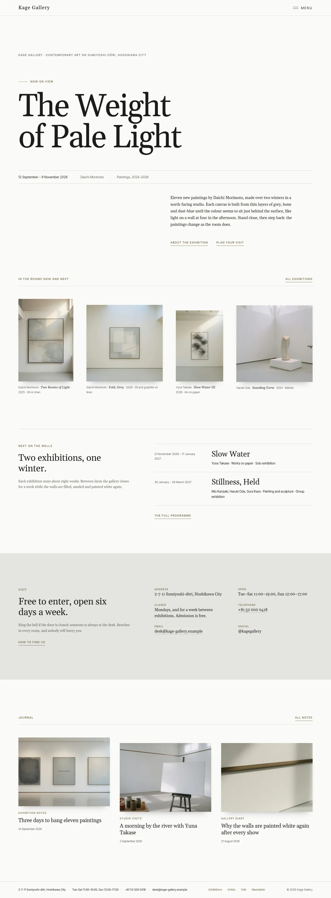
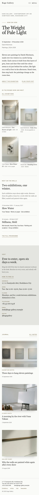

# Kage Gallery

A quiet, typographic portfolio theme for a **small contemporary art gallery** showing painting, works on paper and small sculpture.

*Kage* is shadow, and the shape something leaves behind. The demo gallery is a fictional white room in a former print shop on Sumiyoshi-dōri, a quiet riverside street in Hoshikawa City, opened in 2014 by curator Reiko Asano. It shows four or five solo and group exhibitions a year by artists who work slowly: the painter Daichi Morimoto (on view now), Yuna Takase (works on paper), Mio Kanzaki (still life), Haruki Oda (stone) and Sora Ihara (landscape). It is a portfolio theme, not a shop: no WooCommerce templates or products (and nothing breaks if WooCommerce is active).

## Concept: a white cube, oversized quiet type, shadow edges and wall labels

- **Palette.** Wall white `#FAFAF8` ground, stone grey `#E4E4E0` panels, charcoal `#1C1C1B` text (16.3:1 on wall, 13.4:1 on stone). Muted bronze `#8B7B5C` is 3.95:1 on wall and 3.24:1 on stone, so it is kept to large marks: the line before the "Now on view" badge, the underline of the current menu item and the footer dots. Deep bronze `#6B5C3F` carries links, labels and keys (6.2:1 / 5.1:1), quiet grey `#64645F` secondary text, dates and wall labels (5.7:1 / 4.7:1), and hairline `#D3D2CC` the rules (decorative only). No bright colour.
- **Type.** Gelasio (oversized exhibition titles, headings, menu items, text) and Inter Tight (dates, wall labels, keys, the Menu button, footer). Both OFL-1.1 without a Reserved Font Name, bundled locally as Latin WOFF2.
- **Motif: shadow edge + wall label.** Every work, journal picture and installation view carries a very fine shadow under its bottom edge, like a framed work on a lit wall (`is-style-hung` on the Image block, CSS only). Small Inter Tight wall labels (artist · *title* · year · medium) sit under the works (`is-style-wall-label` on the Paragraph block). A shadow-edge separator is available too. Lots of white space; no entrance animations.

## Header, footer, layout (ROADMAP codes)

- **H4 hamburger only + full-screen overlay**: a white-cube bar with a hairline bottom rule, the "Kage Gallery" wordmark in Gelasio (slight tracking) and a "Menu" button (two frame hairlines + Inter Tight label). The core Navigation overlay opens full screen on the pale wall; the header hairline continues across it, menu items are large Gelasio, the current page has a bronze shadow-edge underline, and the synced visit details sit in a small column beside them. Focus trap and Escape come from core; the button's aria-expanded follows the overlay. One line at 390 px.
- **F3 one-line footer**: one hairline row on the wall: the synced visit details (address · hours · telephone · email), slim links (Exhibitions, Artists, Visit, Newsletter) and a quiet copyright. Under 1100 px the visit details take their own line; on phones it stacks into a few short lines.
- **L9 oversized quiet typography**: the home page opens on a small Inter Tight line naming the gallery, then the current exhibition title in Gelasio at up to ~9 rem over white space, a ruled line of dates, artist and medium, and the wall text set to the right half. No hero photograph. Then a calm row of four works hung at one height with wall labels, the next exhibitions, the visit band on stone and the journal.

## One source for shared details

- **Visit details** (synced pattern): address, opening hours, closing days and free admission, telephone, email, social handle; in the full-screen menu, the footer, Home, Visit and Contact.
- **Current exhibition** (synced pattern): the "Now on view" badge (editable text), title, dates, artist, medium and wall text; on Home (oversized) and Exhibitions.
- **Upcoming exhibitions** (synced pattern): dates, title, artists and a note; on Home (notes hidden) and Exhibitions (full).
- Created once by `inc/shared-info.php` from `inc/info/*.html`; the demo import (`inc/demo-import.php`) is idempotent and never overwrites user content.

## Pages and templates

Home; Exhibitions (now on view with an installation view and two works, upcoming, past exhibitions with photographs); Artists (five artists with a portrait or a work, wall label and short biography, then studio visits); Visit (visit details, how to arrive in plain words, a soft painted map of the district, the front desk, access notes); About (story, street door, the curator, the rooms); Journal (posts page); Newsletter; Contact (a short form that writes an email in the visitor's email app, plus the visit details); article, category, tag, search and 404 templates. Six journal posts in three categories (Exhibition notes, Studio visits, Gallery diary) with six tags.

## Licence

Theme code GPL-2.0-or-later. Fonts OFL-1.1 (see `assets/fonts/`). Photographs AI-generated for this theme, released under GPL-2.0-or-later / CC0. See `readme.txt`.

<!-- screenshots:start -->
## Screenshots

<table>
<tr>
<td valign="top"></td>
<td valign="top"></td>
</tr>
</table>

- Exhibitions: [desktop](screenshots/exhibitions-desktop.webp) · [mobile](screenshots/exhibitions-mobile.webp)
- Artists: [desktop](screenshots/artists-desktop.webp) · [mobile](screenshots/artists-mobile.webp)
- Visit: [desktop](screenshots/visit-desktop.webp) · [mobile](screenshots/visit-mobile.webp)
- About: [desktop](screenshots/about-desktop.webp) · [mobile](screenshots/about-mobile.webp)
- News: [desktop](screenshots/news-desktop.webp) · [mobile](screenshots/news-mobile.webp)
- Article: [desktop](screenshots/article-desktop.webp) · [mobile](screenshots/article-mobile.webp)
- Category: [desktop](screenshots/category-desktop.webp) · [mobile](screenshots/category-mobile.webp)
- Tag: [desktop](screenshots/tag-desktop.webp) · [mobile](screenshots/tag-mobile.webp)
- Newsletter: [desktop](screenshots/newsletter-desktop.webp) · [mobile](screenshots/newsletter-mobile.webp)
- Contact: [desktop](screenshots/contact-desktop.webp) · [mobile](screenshots/contact-mobile.webp)
- Search: [desktop](screenshots/search-desktop.webp) · [mobile](screenshots/search-mobile.webp)
<!-- screenshots:end -->
