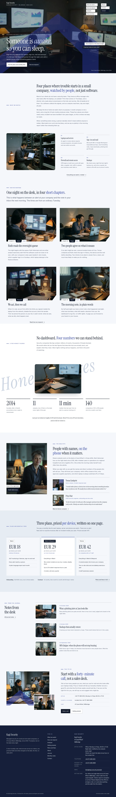

# Kagi Security

A calm, photograph-led block theme for a **managed cybersecurity firm** serving small and mid-sized companies: what is watched, how incidents are handled, the analysts by name, and plans with plain prices.

The demo firm is fictional: Kagi Security, founded in 2014 by Daniel Okafor at 41 Canal Wharf, Millbridge, with Ruth Halvorsen (night desk), Tomas Lindqvist (incident response) and Priya Nair (onboarding), 11 analysts in all and two on the desk every night. See `brand.md`.

## Concept: a security firm that explains itself in plain words

- **Palette.** Cloud-white and pale-mist ground, night-navy text and dark bands, one signal-indigo accent taken from the S5-Style references; calm, never alarming. No red warning colours, no hacker imagery.
- **Type.** Instrument Serif (display) over Inter (text, labels, lists).
- **Photographs.** 18 low-key documentary photographs in one style: the night room, dashboards over a shoulder, hands on keyboards, a server room, client visits, a training session, portraits of four people. Listed in `readme.txt`.

## Front page

Cover, what we watch, the four stages (watch, triage, respond, report), honest figures, analysts, plans, monthly notes and a closing invitation.

## Languages

The sample content and every word the theme shows come in **en, zh-TW, ja, fr and de**, using the mechanism of Hokuto Driving School 1.1.0: the shared importer picks the language (`shippress_demo_lang`, else the site language) and imports `demo-content.<lang>.json`; patterns print their words through `kagi_security_t( 'key' )` from `inc/i18n/<lang>.php` (English fallback), and the synced office card starts from `inc/info/<lang>/office.html`.

The copy is localised, not translated: the firm, its people and Canal Wharf keep the brand, while regulator names (ICO and NCSC in English; TWCERT/CC, IPA and JPCERT/CC, ANSSI and CNIL, BSI), telephone formats and wording follow each market. Prices stay in EUR in every language.

- **Type.** zh-TW headings use a bundled subset of Noto Serif TC, ja headings a bundled subset of Noto Serif JP (Regular), built with fontTools from exactly the characters of that language's sample text. CJK headings run at about three quarters of the English sizes, body line height 1.85.
- **German and French** paragraphs hyphenate (`hyphens: auto`).

## Pages and templates

Home, What we watch, How we respond, Analysts, Getting started, Plans and fees, About, Journal, Monthly notes, Contact; six posts in three categories. Templates: front page, page, wide page, single, archive, category, tag, home (posts), search, 404.

## Licence

GPL-2.0-or-later. Fonts OFL-1.1 (see `assets/fonts/`). Photographs generated with Grok for this theme, released under GPL-2.0-or-later / CC0. All names, the place, the address, telephone numbers and figures are fictional.

<!-- screenshots:start -->
## Screenshots

<table>
<tr>
<td valign="top"></td>
<td valign="top"></td>
</tr>
</table>

- What we watch: [desktop](screenshots/what-we-watch-desktop.webp) · [mobile](screenshots/what-we-watch-mobile.webp)
- How we respond: [desktop](screenshots/how-we-respond-desktop.webp) · [mobile](screenshots/how-we-respond-mobile.webp)
- Analysts: [desktop](screenshots/analysts-desktop.webp) · [mobile](screenshots/analysts-mobile.webp)
- Getting started: [desktop](screenshots/getting-started-desktop.webp) · [mobile](screenshots/getting-started-mobile.webp)
- Plans and fees: [desktop](screenshots/plans-and-fees-desktop.webp) · [mobile](screenshots/plans-and-fees-mobile.webp)
- About: [desktop](screenshots/about-desktop.webp) · [mobile](screenshots/about-mobile.webp)
- News: [desktop](screenshots/news-desktop.webp) · [mobile](screenshots/news-mobile.webp)
- Article: [desktop](screenshots/article-desktop.webp) · [mobile](screenshots/article-mobile.webp)
- Category: [desktop](screenshots/category-desktop.webp) · [mobile](screenshots/category-mobile.webp)
- Tag: [desktop](screenshots/tag-desktop.webp) · [mobile](screenshots/tag-mobile.webp)
- Newsletter: [desktop](screenshots/newsletter-desktop.webp) · [mobile](screenshots/newsletter-mobile.webp)
- Contact: [desktop](screenshots/contact-desktop.webp) · [mobile](screenshots/contact-mobile.webp)
- Search: [desktop](screenshots/search-desktop.webp) · [mobile](screenshots/search-mobile.webp)
- Other languages (home page): [zh-TW](screenshots/zh-TW/home-desktop.webp) · [ja](screenshots/ja/home-desktop.webp) · [fr](screenshots/fr/home-desktop.webp) · [de](screenshots/de/home-desktop.webp)
<!-- screenshots:end -->
