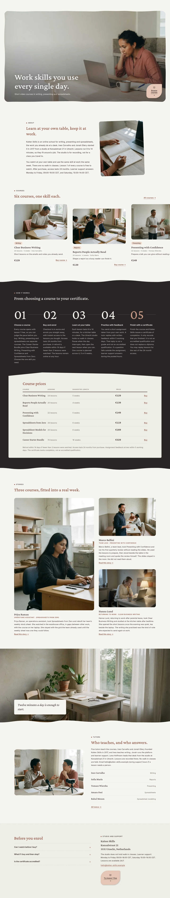
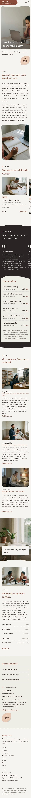

# Kaiten Skills

Kaiten Skills is an online career-skills school for business writing, presenting and spreadsheets, founded in 2017 and taught from a studio in Utrecht. Courses are short video lessons you can buy in euros, with lesson 1 free to watch, 24 months of access and a certificate of completion. This block theme presents the courses, tutors, stories and checkout in a calm stone-and-ink layout.

## Design
A stone ground with ink and one muted bengara accent (#8A4B3A) on small areas only. Crimson Pro for headings and numerals, Inter for text (both OFL, bundled). Signature moves: an inset hand-cut hero photo with a blob plate in the header and a leaf-shaped Browse courses button, a sideways strip of staggered course cards with price and buy, and a wave-edged ink band that carries the horizontal five-step timeline (112 px numerals) and a slanted stone panel with the price table. Every photograph is generated from one style string; no cut-outs.

## Structure
- `patterns/front-*.php`: the eight home sections (hero, intro, courses, steps and prices, stories, interlude, tutors, close); `patterns/header-main.php`, `patterns/footer-main.php`.
- `parts/`, `templates/`: front page, page, index, home, archive, search, tag, category, single, 404.
- `assets/sp-scroll.css|js`: ShipPress scroll effects (reveal, stagger, parallax). `assets/images/`: AI-generated photographs (GPL-2.0-or-later / CC0).

Design notes: `brand.md`, `brand/design-spec.md`, `brand/reference.md`.

License: GPL-2.0-or-later.

<!-- screenshots:start -->
## Screenshots

<table>
<tr>
<td valign="top"></td>
<td valign="top"></td>
</tr>
</table>

- Courses: [desktop](screenshots/courses-desktop.webp) · [mobile](screenshots/courses-mobile.webp)
- How it works: [desktop](screenshots/how-it-works-desktop.webp) · [mobile](screenshots/how-it-works-mobile.webp)
- Pricing: [desktop](screenshots/pricing-desktop.webp) · [mobile](screenshots/pricing-mobile.webp)
- Tutors: [desktop](screenshots/tutors-desktop.webp) · [mobile](screenshots/tutors-mobile.webp)
- Stories: [desktop](screenshots/stories-desktop.webp) · [mobile](screenshots/stories-mobile.webp)
- Contact: [desktop](screenshots/contact-desktop.webp) · [mobile](screenshots/contact-mobile.webp)
- About: [desktop](screenshots/about-desktop.webp) · [mobile](screenshots/about-mobile.webp)
- News: [desktop](screenshots/news-desktop.webp) · [mobile](screenshots/news-mobile.webp)
- Article: [desktop](screenshots/article-desktop.webp) · [mobile](screenshots/article-mobile.webp)
- Category: [desktop](screenshots/category-desktop.webp) · [mobile](screenshots/category-mobile.webp)
- Tag: [desktop](screenshots/tag-desktop.webp) · [mobile](screenshots/tag-mobile.webp)
- Newsletter: [desktop](screenshots/newsletter-desktop.webp) · [mobile](screenshots/newsletter-mobile.webp)
- Other languages (home page): [zh-TW](screenshots/zh-TW/home-desktop.webp) · [ja](screenshots/ja/home-desktop.webp) · [fr](screenshots/fr/home-desktop.webp) · [de](screenshots/de/home-desktop.webp)
<!-- screenshots:end -->
