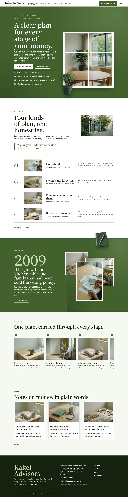
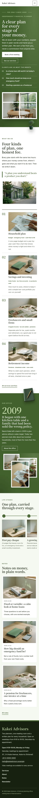

# Kakei Advisors

Kakei Advisors — a theme for an independent, fee-only financial planner, laid out in horizontal strips under a formal white top header (office name, tagline, a Book a first meeting button and a menu button); the menu opens as a full-screen pine-green overlay with large numbered entries at every width. Matsuba pine green (#42602D) is the main colour: the hero, the office band, every page head and the overlay are green fields in white type with a soft wash. The hero is a framed window: the title, lead, buttons and the questions of the month on the left, the meeting room seen through a white window frame with glazing bars on the right, and a cut-out olive tree (transparent WebP) standing over the frame's lower corner and breaking past the hero bottom edge; a cut-out green notebook breaks over the office band and every page head. The services run as ruled horizontal strips (number, photo, title, facts, line) and the life stages as one long sideways-scrolling strip. Every picture is a realistic 35mm film-grain photograph of a modern, international setting. Noto Serif JP for display, Inter for reading, Noto Serif TC for Traditional Chinese headings. Sample content in English, Traditional Chinese, Japanese, French and German; vertical labels only in Chinese and Japanese. WCAG AA colours; no entrance animations.

- Design plan row b5-3: horizontal-strip, framed-window hero, overlay nav, full-illustration, illustration watercolour converted to film-grain photographs, matsuba #42602D, Noto Serif JP + Inter.
- Sample content languages: en, zh-TW, ja, fr, de.
- Contrast: white on matsuba #42602D 7.1:1 (all text on the hero, the office band, every page head, the green overlay menu and green buttons); pale green #C8DDB0 on matsuba 4.9:1 (eyebrows, the issue line, the opening year, overlay numbers); matsuba on white 7.1:1 and on paper #F5F8F1 6.7:1 (strip numbers, the pull quote); ink #17210F on paper 15.5:1 and on white 16.7:1; deep green #2F4A1F on paper 9.2:1 and on mist #E1EAD5 8.0:1 (links, labels, facts); grey green #4C5744 on paper 7.1:1 (secondary text); pale green on ink 11.4:1 and white on ink 16.7:1 (footer, vertical label); ink on matsuba only 2.3:1, never used for text.
- Break-frame: the cut-out olive tree (transparent WebP) breaks out over the hero window frame and the hero bottom edge; the cut-out notebook breaks over the office band and page heads.

<!-- screenshots:start -->
## Screenshots

<table>
<tr>
<td valign="top"></td>
<td valign="top"></td>
</tr>
</table>

- Services: [desktop](screenshots/services-desktop.webp) · [mobile](screenshots/services-mobile.webp)
- About: [desktop](screenshots/about-desktop.webp) · [mobile](screenshots/about-mobile.webp)
- News: [desktop](screenshots/news-desktop.webp) · [mobile](screenshots/news-mobile.webp)
- Article: [desktop](screenshots/article-desktop.webp) · [mobile](screenshots/article-mobile.webp)
- Category: [desktop](screenshots/category-desktop.webp) · [mobile](screenshots/category-mobile.webp)
- Tag: [desktop](screenshots/tag-desktop.webp) · [mobile](screenshots/tag-mobile.webp)
- Newsletter: [desktop](screenshots/newsletter-desktop.webp) · [mobile](screenshots/newsletter-mobile.webp)
- Contact: [desktop](screenshots/contact-desktop.webp) · [mobile](screenshots/contact-mobile.webp)
- Search: [desktop](screenshots/search-desktop.webp) · [mobile](screenshots/search-mobile.webp)
- Other languages (home page): [zh-TW](screenshots/zh-TW/home-desktop.webp) · [ja](screenshots/ja/home-desktop.webp) · [fr](screenshots/fr/home-desktop.webp) · [de](screenshots/de/home-desktop.webp)
<!-- screenshots:end -->
