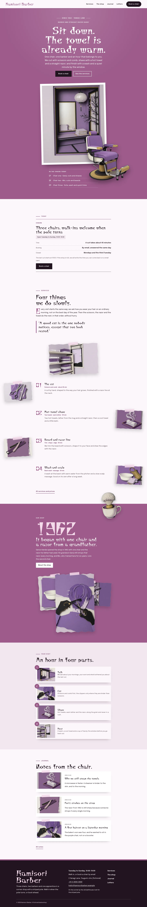

# Kamisori Barber

Kamisori Barber — a barbershop theme read as one long column: under a formal top header (shop name, menu and the Book a chair button in one bar, a full-screen kyo-murasaki overlay on phones and tablets) every section keeps its text in a single centred reading column, and the pictures hang out into the margins as torn, taped paper-cut pieces. Kyo-murasaki (#9D5B8B), the old Kyoto purple, is the main colour: the hero, the story band and every page head are murasaki fields set in white. The hero breaks the frame: a paper-cut picture of the shop in a white window frame, with a cut-out barber chair (transparent WebP) breaking out of the frame and over the hero bottom edge; a cut-out shaving mug and brush breaks over the story band and every page head. Every picture is a layered paper-cut illustration in murasaki, lilac, sumi and muted gold. Chokokutai for display (with a Zen Maru Gothic kanji subset in Japanese), Epilogue for reading, Noto Sans TC for Traditional Chinese headings. Sample content in English, Traditional Chinese, Japanese, French and German. WCAG AA colours; no entrance animations.

- Design plan row b4-14: single-column-longform, cutout-break-frame-object hero, top-bar nav, collage (paper-cut), kyo-murasaki #9D5B8B, Chokokutai + Epilogue.
- Sample content languages: en, zh-TW, ja, fr, de.
- Contrast: white #FFFFFF on kyo-murasaki #9D5B8B 4.9:1 (all text on the hero, the story band, every page head and the murasaki overlay menu); pale lilac #F4D9EA on murasaki 3.7:1 only for the giant opening year (large text); white on aubergine ink #22141F buttons 18.1:1; ink #22141F on lilac paper #FBF7FA 16.7:1 and on pale murasaki #F2E6EF 14.6:1; deep murasaki #6E3561 on paper 8.4:1 and on mist 7.4:1 (links, labels, eyebrows, service facts); plum grey #5C4B57 on paper 7.6:1 and on mist 6.7:1 (secondary text); paper on ink 16.7:1 and pale lilac on ink 13.4:1 (footer); murasaki on paper 4.6:1 (shop name, chapter numbers, drop caps); ink on murasaki only 3.6:1, never used for text.
- Break-frame: the cut-out barber chair (transparent WebP) breaks out of the white window frame and over the bottom edge of the hero; the cut-out shaving mug breaks over the top edge of the story band and the bottom edge of every page head.

<!-- screenshots:start -->
## Screenshots

<table>
<tr>
<td valign="top"></td>
<td valign="top"></td>
</tr>
</table>

- Services: [desktop](screenshots/services-desktop.webp) · [mobile](screenshots/services-mobile.webp)
- About: [desktop](screenshots/about-desktop.webp) · [mobile](screenshots/about-mobile.webp)
- News: [desktop](screenshots/news-desktop.webp) · [mobile](screenshots/news-mobile.webp)
- Article: [desktop](screenshots/article-desktop.webp) · [mobile](screenshots/article-mobile.webp)
- Category: [desktop](screenshots/category-desktop.webp) · [mobile](screenshots/category-mobile.webp)
- Tag: [desktop](screenshots/tag-desktop.webp) · [mobile](screenshots/tag-mobile.webp)
- Newsletter: [desktop](screenshots/newsletter-desktop.webp) · [mobile](screenshots/newsletter-mobile.webp)
- Contact: [desktop](screenshots/contact-desktop.webp) · [mobile](screenshots/contact-mobile.webp)
- Search: [desktop](screenshots/search-desktop.webp) · [mobile](screenshots/search-mobile.webp)
- Other languages (home page): [zh-TW](screenshots/zh-TW/home-desktop.webp) · [ja](screenshots/ja/home-desktop.webp) · [fr](screenshots/fr/home-desktop.webp) · [de](screenshots/de/home-desktop.webp)
<!-- screenshots:end -->
