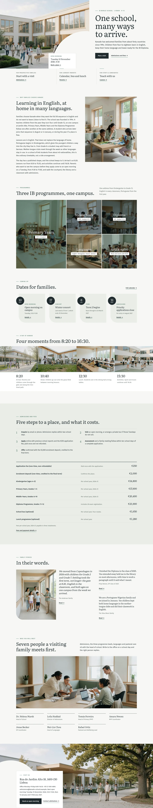

# Kanade International School

A WordPress block theme for an IB World School in Lisbon (founded 1994, ages 4–18, taught in English). The demo school is fictional; people, places, fees and dates are written down in [`brand.md`](brand.md). Type: education. Sample content is in English; other languages follow in later versions.

## Concept: a school that splits visitors at the door

- **Palette.** Off-white ground `#F6F7F4`, stone `#E9ECE7`, ink `#1F2A2E`; celadon `#7FA393` (deep `#4F7465`) appears only on rules and labels. First screen saturated pixels about 3%.
- **Type.** Literata (display) and Fira Sans (text), both OFL-1.1, Latin WOFF2 subsets bundled.
- **Photographs.** Sixteen photographs from one shared style string (high-key documentary daylight, diverse students, no text or logos), none repeated on a page.
- **Signature.** A photo with a curved bite carrying the "Open morning" card (hero and visit), calendar cards with one large rounded corner and a date badge, and a tinted programme mosaic.
- **Motion.** `sp-scroll` (reveal, stagger, parallax); respects `prefers-reduced-motion`, content visible without JavaScript.

## Front page

1. Photo with curved bite, headline, open-morning card and three gateways (families, parents, staff).
2. Why families choose Kanade (three paragraphs beside a photograph).
3. Programme mosaic: Primary, Middle Years, Diploma, Languages, Arts and sport.
4. Calendar cards.
5. A day at Kanade (four photographed moments).
6. Five steps to a place, and the fee list (euros, 2026–27).
7. Family stories, then the people families meet.
8. Visit block with address and hours.

## Pages

Home, Admissions, Fees, Curriculum, Campus life, Calendar, Our people, Parents, Careers, Stories, Contact, Privacy, Safeguarding. The main menu links to these pages; the demo importer creates them. WooCommerce support is declared but not required.

## Screenshot

`screenshot.png` is a 1200×900 capture of the first screen.

<!-- screenshots:start -->
## Screenshots

<table>
<tr>
<td valign="top"></td>
<td valign="top"></td>
</tr>
</table>

- About: [desktop](screenshots/about-desktop.webp) · [mobile](screenshots/about-mobile.webp)
- Admissions: [desktop](screenshots/admissions-desktop.webp) · [mobile](screenshots/admissions-mobile.webp)
- Fees: [desktop](screenshots/fees-desktop.webp) · [mobile](screenshots/fees-mobile.webp)
- Curriculum: [desktop](screenshots/curriculum-desktop.webp) · [mobile](screenshots/curriculum-mobile.webp)
- Campus life: [desktop](screenshots/campus-life-desktop.webp) · [mobile](screenshots/campus-life-mobile.webp)
- Calendar: [desktop](screenshots/calendar-desktop.webp) · [mobile](screenshots/calendar-mobile.webp)
- Our people: [desktop](screenshots/our-people-desktop.webp) · [mobile](screenshots/our-people-mobile.webp)
- Parents: [desktop](screenshots/parents-desktop.webp) · [mobile](screenshots/parents-mobile.webp)
- Careers: [desktop](screenshots/careers-desktop.webp) · [mobile](screenshots/careers-mobile.webp)
- Stories: [desktop](screenshots/stories-desktop.webp) · [mobile](screenshots/stories-mobile.webp)
- News: [desktop](screenshots/news-desktop.webp) · [mobile](screenshots/news-mobile.webp)
- Article: [desktop](screenshots/article-desktop.webp) · [mobile](screenshots/article-mobile.webp)
- Category: [desktop](screenshots/category-desktop.webp) · [mobile](screenshots/category-mobile.webp)
- Tag: [desktop](screenshots/tag-desktop.webp) · [mobile](screenshots/tag-mobile.webp)
- Newsletter: [desktop](screenshots/newsletter-desktop.webp) · [mobile](screenshots/newsletter-mobile.webp)
- Contact: [desktop](screenshots/contact-desktop.webp) · [mobile](screenshots/contact-mobile.webp)
- Privacy: [desktop](screenshots/privacy-desktop.webp) · [mobile](screenshots/privacy-mobile.webp)
- Safeguarding: [desktop](screenshots/safeguarding-desktop.webp) · [mobile](screenshots/safeguarding-mobile.webp)
- Other languages (home page): [zh-TW](screenshots/zh-TW/home-desktop.webp) · [ja](screenshots/ja/home-desktop.webp) · [fr](screenshots/fr/home-desktop.webp) · [de](screenshots/de/home-desktop.webp)
<!-- screenshots:end -->
