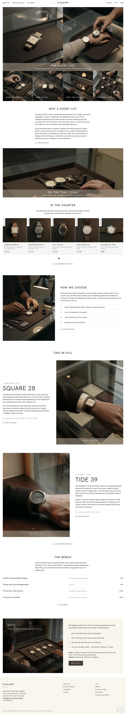
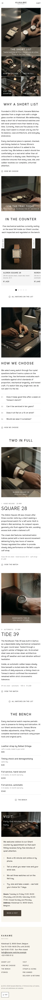

# Kaname Watches

A WooCommerce store theme for a small mechanical-watch shop with one glass counter and a short list of never more than twelve watches. See `readme.txt` for the description and image list, `brand.md` for the brief, `brand/design-spec.md` and `brand/reference.md` for the design notes.

## Structure
- `patterns/front-*.php`: the nine home sections (window, tiles, list, tray, counter, choose, full, bench, visit); `foot-main.php`: footer.
- `templates/`: front-page, page, page-wide, index, single, 404.
- `demo-content.json`: home plus the pages the menu and footer link to (short list, how we choose, the bench, visit, cart, people, straps and sizing, pre-owned, delivery and returns, stories).
- `assets/sp-scroll.css|js`: ShipPress scroll effects (reveal, stagger, parallax), unchanged.
- `assets/images/`: 18 low-key photographs (webp, each under 300 KB). Product packshots p1–p5 are single watches on felt.

## Status
English home page and the linked inner pages as plain text pages. Inner-page layouts, the other four languages and the WooCommerce templates are still to come.

<!-- screenshots:start -->
## Screenshots

<table>
<tr>
<td valign="top"></td>
<td valign="top"></td>
</tr>
</table>

- Shop: [desktop](screenshots/shop-desktop.webp) · [mobile](screenshots/shop-mobile.webp)
- How we choose: [desktop](screenshots/how-we-choose-desktop.webp) · [mobile](screenshots/how-we-choose-mobile.webp)
- The bench: [desktop](screenshots/the-bench-desktop.webp) · [mobile](screenshots/the-bench-mobile.webp)
- Visit: [desktop](screenshots/visit-desktop.webp) · [mobile](screenshots/visit-mobile.webp)
- Cart: [desktop](screenshots/cart-desktop.webp) · [mobile](screenshots/cart-mobile.webp)
- People: [desktop](screenshots/people-desktop.webp) · [mobile](screenshots/people-mobile.webp)
- Straps and sizing: [desktop](screenshots/straps-and-sizing-desktop.webp) · [mobile](screenshots/straps-and-sizing-mobile.webp)
- Pre owned: [desktop](screenshots/pre-owned-desktop.webp) · [mobile](screenshots/pre-owned-mobile.webp)
- Delivery and returns: [desktop](screenshots/delivery-and-returns-desktop.webp) · [mobile](screenshots/delivery-and-returns-mobile.webp)
- Stories: [desktop](screenshots/stories-desktop.webp) · [mobile](screenshots/stories-mobile.webp)
- Product: [desktop](screenshots/product-desktop.webp) · [mobile](screenshots/product-mobile.webp)
- About: [desktop](screenshots/about-desktop.webp) · [mobile](screenshots/about-mobile.webp)
- News: [desktop](screenshots/news-desktop.webp) · [mobile](screenshots/news-mobile.webp)
- Article: [desktop](screenshots/article-desktop.webp) · [mobile](screenshots/article-mobile.webp)
- Category: [desktop](screenshots/category-desktop.webp) · [mobile](screenshots/category-mobile.webp)
- Tag: [desktop](screenshots/tag-desktop.webp) · [mobile](screenshots/tag-mobile.webp)
- Newsletter: [desktop](screenshots/newsletter-desktop.webp) · [mobile](screenshots/newsletter-mobile.webp)
- Contact: [desktop](screenshots/contact-desktop.webp) · [mobile](screenshots/contact-mobile.webp)
- Search: [desktop](screenshots/search-desktop.webp) · [mobile](screenshots/search-mobile.webp)
- Other languages (home page): [zh-TW](screenshots/zh-TW/home-desktop.webp) · [ja](screenshots/ja/home-desktop.webp) · [fr](screenshots/fr/home-desktop.webp) · [de](screenshots/de/home-desktop.webp)
<!-- screenshots:end -->
