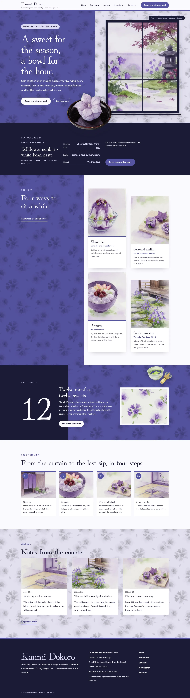
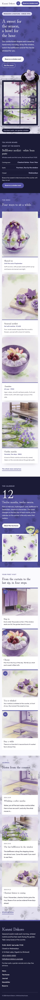

# Kanmi Dokoro

Kanmi Dokoro — a wagashi tea house theme with a formal top bar (tea house name, a one-row menu and a Reserve a window seat button). Kikyo bellflower purple (#5654A2) is the main colour: the hero half, every page head, the menu panel and the calendar band are kikyo fields with a bellflower watercolour multiplied in, set in white. The site is built as split screens: the hero sets the kikyo field beside a paper wall where the garden is framed as an open window, and a cut-out bellflower sweet breaks out of the window frame across the seam; a cut-out matcha bowl breaks over the calendar band and the sweet sits across the seam of every page head. Every picture is a soft watercolour illustration. Hina Mincho for display, Outfit for reading, Noto Serif TC for Traditional Chinese headings. Sample content in English, Traditional Chinese, Japanese, French and German; vertical labels only in Chinese and Japanese. WCAG AA colours; no entrance animations.

- Design plan row b3-27: split-screen, framed-window hero, top-bar nav, full-illustration, watercolour, kikyo #5654A2, Hina Mincho + Outfit.
- Sample content languages: en, zh-TW, ja, fr, de.
- Contrast: white #FFFFFF on kikyo #5654A2 6.6:1 (all text on the hero half, page heads, the menu panel and the calendar band); paper #FAF9FD on kikyo 6.3:1; light kikyo #DCDAF5 on kikyo 4.8:1 (small labels); night ink #1C1B36 on paper 15.9:1; deep kikyo #46448C on paper 8.1:1 and on white 8.5:1 (links, labels, dish facts); plum grey #57546B on paper 6.9:1 (secondary text); ink on pale wisteria #E7E5F4 13.4:1 (prices, details cards); light kikyo on ink 12.2:1 (board labels, footer name); white on ink 16.7:1; matcha #4C6A26 on paper 5.9:1 and on white 6.2:1 (small facts labels); ink on kikyo only 2.5:1 and kikyo on ink 2.5:1, never used for text.
- Break-frame: the cut-out bellflower sweet (transparent WebP) breaks out of the framed garden window, across the split-screen seam into the kikyo field and over the hero bottom edge; the cut-out matcha bowl breaks over the calendar band's top edge; the sweet sits across the seam of every split page head.

## Templates and patterns

Every template is the top-bar header, the page column and the footer. Page bodies come from patterns (home-hero with the split screen, the framed window and the cut-out sweet, home-board with the synced tea house board, home-works as a split screen with the kikyo panel and four dishes, home-serial with the calendar band and the cut-out matcha bowl, home-process, home-journal, and a split page head per page). The tea house board, details and menu prices are synced patterns.

<!-- screenshots:start -->
## Screenshots

<table>
<tr>
<td valign="top"></td>
<td valign="top"></td>
</tr>
</table>

- Classes: [desktop](screenshots/classes-desktop.webp) · [mobile](screenshots/classes-mobile.webp)
- About: [desktop](screenshots/about-desktop.webp) · [mobile](screenshots/about-mobile.webp)
- News: [desktop](screenshots/news-desktop.webp) · [mobile](screenshots/news-mobile.webp)
- Article: [desktop](screenshots/article-desktop.webp) · [mobile](screenshots/article-mobile.webp)
- Category: [desktop](screenshots/category-desktop.webp) · [mobile](screenshots/category-mobile.webp)
- Tag: [desktop](screenshots/tag-desktop.webp) · [mobile](screenshots/tag-mobile.webp)
- Newsletter: [desktop](screenshots/newsletter-desktop.webp) · [mobile](screenshots/newsletter-mobile.webp)
- Contact: [desktop](screenshots/contact-desktop.webp) · [mobile](screenshots/contact-mobile.webp)
- Search: [desktop](screenshots/search-desktop.webp) · [mobile](screenshots/search-mobile.webp)
- Other languages (home page): [zh-TW](screenshots/zh-TW/home-desktop.webp) · [ja](screenshots/ja/home-desktop.webp) · [fr](screenshots/fr/home-desktop.webp) · [de](screenshots/de/home-desktop.webp)
<!-- screenshots:end -->
