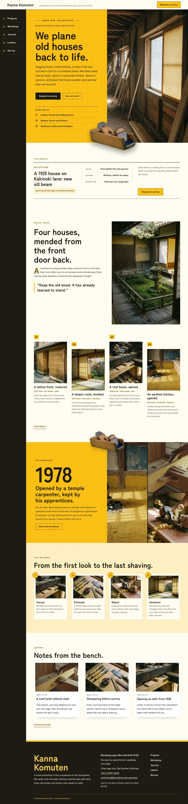

# Kanna Komuten

Kanna Komuten — a machiya renovation carpenter theme built on split screens, with a formal top header: the workshop name and tagline on the left, the Request a survey button on the right, and on wide screens the menu as a fixed sumi-ink side rail of numbered entries down the left edge (an overlay menu on phones and tablets). Ukon turmeric yellow (#FABF14) is the main colour: the hero half, the workshop band, every page head and the overlay menu are solid turmeric fields set in sumi ink. The hero is a full-bleed 35mm film photograph of a machiya under renovation running edge to edge, with the left half covered by the turmeric text panel; a cut-out hand plane sits on the seam and breaks out over the photograph and the hero bottom edge. Split-screen layout throughout: recent work as a text half beside a tall photograph, the workshop band as a turmeric half with the founding year in giant type beside a half of three photographs, projects as split rows, and every page head as a turmeric half beside a full-height photograph. Every picture is a photorealistic film-grain photograph (50mm, natural side light, fine grain, faded colour graded toward turmeric). Zen Kaku Gothic Antique for display, Schibsted Grotesk for reading, Noto Sans TC for Traditional Chinese headings. Sample content in English, Traditional Chinese, Japanese, French and German; vertical labels only in Chinese and Japanese. WCAG AA colours; no entrance animations.

- Design plan row b4-4: split-screen, full-bleed hero (film photograph), side-rail nav, real-photography, film-grain, ukon #FABF14, Zen Kaku Gothic Antique + Schibsted Grotesk.
- Sample content languages: en, zh-TW, ja, fr, de.
- Contrast: sumi brown-black ink #1E1A12 on ukon #FABF14 10.3:1 (all text on the hero half, the workshop band, every page head, the header button, project numbers, step badges and the overlay menu); ink on warm white #FFFCF2 16.9:1; deep ochre #7A5400 on warm white 6.6:1, on white 6.8:1 and on pale turmeric #FEF0C2 6.0:1 (links, labels, drop caps); smoked brown #574F3E on warm white 7.9:1 and on pale turmeric 7.1:1 (secondary text); ink on pale turmeric 15.2:1 (price guide, details, steps band); warm white on ink 16.9:1 (side rail, footer, letter card); light turmeric #FBD25A on ink 11.9:1 (rail numbers, footer name); deep ochre on ukon only 4.0:1 and white on ukon 1.7:1, never used for text.
- Break-frame: the cut-out hand plane (transparent WebP) sits on the seam between the turmeric hero half and the full-bleed photograph and breaks out over both and over the hero bottom edge into the workshop board; the same cut-out breaks over the top edge of the turmeric workshop band on its split seam and over the seam and bottom edge of every page head.

## Templates and patterns

Every template is the top header (with the side-rail menu on wide screens), the page column and the footer. Page bodies come from patterns (home-hero with the turmeric text half over the full-bleed workshop photograph and the cut-out plane, home-board with the synced workshop board, home-works with recent work as a split screen and four projects, home-serial as the split workshop band, home-process with the four working steps, home-journal, and a split page head per page). The workshop board, workshop details and price guide are synced patterns.

<!-- screenshots:start -->
## Screenshots

<table>
<tr>
<td valign="top"></td>
<td valign="top"></td>
</tr>
</table>

- Projects: [desktop](screenshots/projects-desktop.webp) · [mobile](screenshots/projects-mobile.webp)
- About: [desktop](screenshots/about-desktop.webp) · [mobile](screenshots/about-mobile.webp)
- News: [desktop](screenshots/news-desktop.webp) · [mobile](screenshots/news-mobile.webp)
- Article: [desktop](screenshots/article-desktop.webp) · [mobile](screenshots/article-mobile.webp)
- Category: [desktop](screenshots/category-desktop.webp) · [mobile](screenshots/category-mobile.webp)
- Tag: [desktop](screenshots/tag-desktop.webp) · [mobile](screenshots/tag-mobile.webp)
- Newsletter: [desktop](screenshots/newsletter-desktop.webp) · [mobile](screenshots/newsletter-mobile.webp)
- Contact: [desktop](screenshots/contact-desktop.webp) · [mobile](screenshots/contact-mobile.webp)
- Search: [desktop](screenshots/search-desktop.webp) · [mobile](screenshots/search-mobile.webp)
- Other languages (home page): [zh-TW](screenshots/zh-TW/home-desktop.webp) · [ja](screenshots/ja/home-desktop.webp) · [fr](screenshots/fr/home-desktop.webp) · [de](screenshots/de/home-desktop.webp)
<!-- screenshots:end -->
