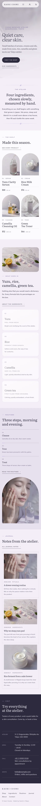

# Kaori Cosme

An elegant, restrained block theme for a **small clean-skincare atelier** in Tokyo: serums, creams, cleansing oil, toner, mist and balm sold as WooCommerce products, an ingredients page and a routines page. A ShipPress **store** theme: WooCommerce templates styled to match, eight sample products, and a shop page that still works without WooCommerce.

*Kaori* means fragrance. The demo atelier, **Kaori Cosme**, is a fictional one-room workshop in Kagurazaka run by Mio Tanabe (founder, formulator), Ren Okada (founder, scent) and Hana Iwasaki (atelier and consultations).

## Concept: quiet care, clear skin

- **Lilac-grey, paper, ink violet.** Lilac-grey `#F3EEF7` pages, paper-white `#FCFBFD` and lilac-haze `#E7E0EF` panels, ink-violet `#2D2A3E` for text and the dark visit band. Muted lilac `#B7A6D9` only for fine lines, the glass-drop marks and small accents (never text); lilac accent text uses `#65568F` (5.6:1), quiet text `#5E5873` (5.9:1). No bright colours, no poster look.
- **Type.** Literata (light 300 for display, 400) for headings, product names and prices; Mulish for text, spaced-capital labels, the menu and buttons. Both OFL, static Latin subsets bundled (no CDN).
- **Signature: glass-drop reflections.** Product photos, ingredient cells and note cells carry a soft white highlight across the top-left and a lit lilac hairline edge, like light through frosted glass; dividers are a fine lilac hairline with one small lit droplet at the centre. All pure CSS gradients. The highlight drifts slightly on hover; under `prefers-reduced-motion` nothing moves.
- No entrance animations, no hand-drawn illustrations.

## Header, footer, layout (ROADMAP codes)

- **Header H10: floating pill nav.** A frosted, centred pill (backdrop blur, lilac hairline) holds the name and the menu and stays at the top while scrolling. With WooCommerce, the account link and mini cart join the pill (Block Hooks). On phones the menu opens the core overlay on the lilac-grey ground.
- **Footer F3: one-line minimal.** The name, the menu and a short credit on one line above a lilac hairline.
- **Layout L1: full-bleed photo hero.** The home page opens on a full-bleed photograph of a serum bottle on pale stone, the words laid over its quiet left side, then the welcome, the shelf, the four ingredients, the routine, the journal and the visit band.
- The H10 + F3 + L1 combination is not used by any other theme (H10 is Kami Salon with F1/L8 and Fuji Shinkyu with F11/L6; neighbours #15 Undo Ba is H8/F7/L12 and #17 Tabi Note H9/F6/L10).

## Deviation from the plan

None in palette, fonts, style tags or codes (ROADMAP batch 1 #16). Kept quiet at the user's request: the lilac accent is limited to lines and small marks; a paper white and a lilac haze were added for panels, and a deeper lilac for accent text (AA). Recorded in `theme-meta.json` ("deviation").

## One source for shared details

| Synced pattern | Source | Shown on |
|---|---|---|
| Atelier address, hours, phone and email | `inc/info/atelier.html` | home (visit band), about, contact |
| The shelf: four featured products, prices and the "Most loved" badge | `inc/info/shelf.html` | home, shop (without WooCommerce) |

Each is a synced pattern (`wp_block`), created on activation by `inc/shared-info.php`, tagged `_kaori_cosme_info` and never created twice. The badge is plain editable text inside the synced shelf.

## Pages and templates

Demo pages (copy in the page content, editable in the page editor): Home, Shop, Ingredients (yuzu, rice, camellia, green tea; what we leave out), Routines (morning and evening steps, small notes), About, Journal (posts page), Newsletter and Contact. Six sample posts in three categories (Rituals, Ingredients, Atelier notes) with six tags.

Templates: front-page, page, page-wide, home, index, single, archive, category, tag, search and 404. For WooCommerce: archive-product (the shop), single-product, page-cart, page-checkout, page-my-account, order-confirmation and product-search-results, plus a checkout header part.

## WooCommerce

The theme declares WooCommerce support. `inc/woo-import.php` creates eight sample products (Yuzu Clarity Serum, Rice Milk Cream, Camellia Cleansing Oil, Green Tea Toner, Morning Mist, Camellia Night Balm, a serum refill and a discovery set) with images, prices, categories and tags, only while WooCommerce is active. Without WooCommerce, the Shop page shows the synced shelf and nothing store-specific loads.

## Demo import

The shared ShipPress importer (`inc/demo-import.php`) is idempotent: running it on activation and again (`wp shippress demo-import` / `wp shippress woo-import`) creates nothing new on the second run. It never overwrites or deletes user content, and trashes WordPress's "Hello world!" only while it is untouched.

## Credits

Photographs: AI-generated for this theme, released under GPL-2.0-or-later / CC0. Fonts: Literata and Mulish, SIL OFL 1.1 (see `readme.txt` and `assets/fonts/OFL-*.txt`).

<!-- screenshots:start -->
## Screenshots

<table>
<tr>
<td valign="top"></td>
<td valign="top"></td>
</tr>
</table>

- About: [desktop](screenshots/about-desktop.webp) · [mobile](screenshots/about-mobile.webp)
- Shop: [desktop](screenshots/shop-desktop.webp) · [mobile](screenshots/shop-mobile.webp)
- Ingredients: [desktop](screenshots/ingredients-desktop.webp) · [mobile](screenshots/ingredients-mobile.webp)
- Routines: [desktop](screenshots/routines-desktop.webp) · [mobile](screenshots/routines-mobile.webp)
- News: [desktop](screenshots/news-desktop.webp) · [mobile](screenshots/news-mobile.webp)
- Article: [desktop](screenshots/article-desktop.webp) · [mobile](screenshots/article-mobile.webp)
- Category: [desktop](screenshots/category-desktop.webp) · [mobile](screenshots/category-mobile.webp)
- Tag: [desktop](screenshots/tag-desktop.webp) · [mobile](screenshots/tag-mobile.webp)
- Newsletter: [desktop](screenshots/newsletter-desktop.webp) · [mobile](screenshots/newsletter-mobile.webp)
- Contact: [desktop](screenshots/contact-desktop.webp) · [mobile](screenshots/contact-mobile.webp)
- Product: [desktop](screenshots/product-desktop.webp) · [mobile](screenshots/product-mobile.webp)
- Search: [desktop](screenshots/search-desktop.webp) · [mobile](screenshots/search-mobile.webp)
<!-- screenshots:end -->
