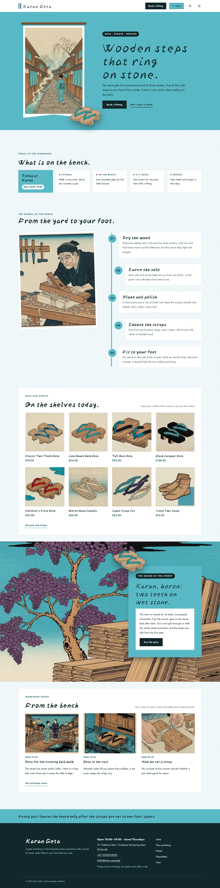
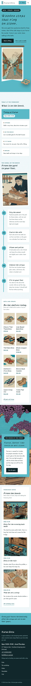

# Karan Geta

Karan Geta — a WooCommerce store theme for a geta (wooden sandal) workshop on a hot-spring street, laid out as a hanging scroll you read from top to bottom. A formal white top header carries the shop name, the Book a fitting button, account and cart; the main menu always opens from a Menu button as a full-screen shinbashi turquoise overlay (set vertically in Chinese and Japanese). Shinbashi turquoise (#59B9C6) is the main colour: the hero field, the menu overlay, the scroll spine, every page head and the footer strip are turquoise fields with sumi blue-black text on pale turquoise washi. The hero is a vertical banner: a tall woodblock print of the hot-spring street hangs like a shop banner from a wooden rod, beside the shop line (a vertical line in Chinese and Japanese); a cut-out pair of geta (transparent WebP) steps off the banner and over the hero's bottom edge. Five workshop steps hang on a turquoise spine, and a full-bleed woodblock band of the paulownia yard carries a turquoise card that a second pair of geta breaks out of. Every picture is a full woodblock-print illustration. Yuji Boku for display, Jost for reading. Sample content and products in English, Traditional Chinese, Japanese, French and German; vertical lines only in Chinese and Japanese. Works without WooCommerce. WCAG AA colours; no entrance animations.

- Design plan row b4-5: tategaki-vertical-scroll, vertical-banner hero, overlay nav, full-illustration, woodblock, shinbashi #59B9C6, Yuji Boku + Jost.
- Sample content languages: en, zh-TW, ja, fr, de.
- Contrast: sumi blue-black #10272B on shinbashi turquoise #59B9C6 6.8:1 (all text on the hero field, the menu overlay, page heads, the board lead card, the scroll numbers, the band card and the footer strip); ink on pale turquoise washi #F1F8F9 14.5:1, on white 15.6:1 and on steam mist #DCEFF2 13.1:1; deep teal #1D5F6A on paper 6.7:1, on white 7.2:1 and on mist 6.1:1 (links, prices, labels; white on deep 7.2:1); slate teal #3E585C on paper 7.1:1 and on white 7.6:1 (secondary text); white on ink 15.6:1 (buttons, chips, footer) and pale turquoise #BEE5EB on ink 11.6:1; cypress wood #7A5233 on paper 6.3:1 (small marks); white on turquoise only 2.3:1 and deep teal on turquoise 3.2:1, never used for text.
- Break-frame: the cut-out pair of geta (transparent WebP) steps off the foot of the hanging street banner and over the turquoise hero's bottom edge into the workshop board; a second cut-out pair breaks out of the turquoise card and over the top edge of the full-bleed paulownia band; the geta also break over the bottom edge of every page head.

## Templates and patterns

Every template is the header (the shop name on the left; the Book a fitting button, account, cart and a Menu button on the right; the menu always opens as a full-screen turquoise overlay), the page column and the footer. Page bodies come from patterns: home-hero (vertical woodblock street banner on the turquoise field, cut-out geta breaking out), home-board (synced workshop board), home-waters (five workshop steps as a vertical scroll on a turquoise spine), home-shelf (geta and straps; WooCommerce products, pictures without it), home-break (full-bleed paulownia illustration band with a turquoise card and the cut-out geta), home-journal (workshop notes), and the page heads and bodies of Geta, The workshop, Newsletter and Visit. WooCommerce templates (shop, product, cart, checkout, account, order confirmation, product search) use tpl-* patterns for their text.

<!-- screenshots:start -->
## Screenshots

<table>
<tr>
<td valign="top"></td>
<td valign="top"></td>
</tr>
</table>

- Shop: [desktop](screenshots/shop-desktop.webp) · [mobile](screenshots/shop-mobile.webp)
- Product: [desktop](screenshots/product-desktop.webp) · [mobile](screenshots/product-mobile.webp)
- About: [desktop](screenshots/about-desktop.webp) · [mobile](screenshots/about-mobile.webp)
- Contact: [desktop](screenshots/contact-desktop.webp) · [mobile](screenshots/contact-mobile.webp)
- News: [desktop](screenshots/news-desktop.webp) · [mobile](screenshots/news-mobile.webp)
- Article: [desktop](screenshots/article-desktop.webp) · [mobile](screenshots/article-mobile.webp)
- Category: [desktop](screenshots/category-desktop.webp) · [mobile](screenshots/category-mobile.webp)
- Tag: [desktop](screenshots/tag-desktop.webp) · [mobile](screenshots/tag-mobile.webp)
- Newsletter: [desktop](screenshots/newsletter-desktop.webp) · [mobile](screenshots/newsletter-mobile.webp)
- Search: [desktop](screenshots/search-desktop.webp) · [mobile](screenshots/search-mobile.webp)
- Other languages (home page): [zh-TW](screenshots/zh-TW/home-desktop.webp) · [ja](screenshots/ja/home-desktop.webp) · [fr](screenshots/fr/home-desktop.webp) · [de](screenshots/de/home-desktop.webp)
<!-- screenshots:end -->
