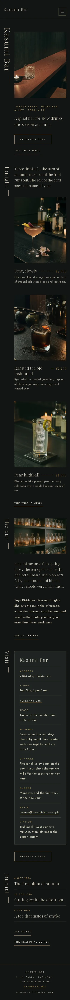

# Kasumi Bar

A quiet, night-dark block theme for a **small reservation-first cocktail bar**: twelve seats down a narrow alley, a short seasonal card, booking by email.

*Kasumi* is a thin spring haze. The demo bar is fictional: number 9 Kiri Alley in Tsukimachi, head bartender Sayo Kirishima with Tomo Hanazawa and Iori Mase.

## Concept: a haze of gold on a dark counter

- **Night, bottle green, parchment, antique gold.** Ground `#121414`, panels `#1E2422`, text parchment `#D8CDB4` (11.7:1), quiet text `#A39D8A` (6.8:1). Antique gold `#A88B55` (5.7:1 on night, 4.9:1 on bottle) for hairlines, leaders, prices and labels. No neon, no bright colour.
- **Type.** Noto Serif Display (Light 300, subset to Latin WOFF2; OFL without a Reserved Font Name) for the name, chapter titles, drink names and prices; Josefin Sans (the official variable TTF, unmodified, because its OFL reserves the font name) for text, labels and the menu.
- **Signature: vertical type.** The bar's name and every chapter title are real headings, in reading order, set with `writing-mode: vertical-rl` beside one sparse column. The menu card has fine gold dotted leaders between each drink and its price. Slow fades only (0.6 s), none with reduced motion; no entrance animations.

## Header, footer, layout (ROADMAP codes)

- **H11 vertical right-edge menu**: from 600px the name and the menu stand in vertical type in a fixed rail on the right edge; the page is padded so the rail never covers content. On phones it becomes a compact bar with the name and a menu button (core Navigation overlay).
- **F3 one-line footer**: one hairline-gold line: name · address · hours · reservations link · copyright. It is the synced visit details pattern, shown as a line; on phones it stacks, centred.
- **L5 vertical type, sparse single column**: the name in large vertical type beside a candle-lit counter, then chapters (Tonight, The bar, Visit, Journal), each with a vertical title.

## One source for shared details and prices

- **Visit details** (address, hours, seats, booking policy, changes, closed days, email, station): synced pattern `Kasumi Bar: visit details`, shown as the footer line and as a card on the home, Contact and Reservations pages.
- **Seasonal drinks** (photos, names, prices): synced pattern `Kasumi Bar: seasonal drinks and prices`, on the home "Tonight" chapter and the Menu page.
- **Menu card** (classics, highballs, without spirit, table charge): synced pattern `Kasumi Bar: menu card and prices` on the Menu page.
- All three are created once by `inc/shared-info.php` from `inc/info/*.html`; pages hold only references. The demo import (`inc/demo-import.php`) is idempotent and never overwrites user content.

## Pages and templates

Home, Menu, Reservations, About, Journal (posts page), Newsletter, Contact; article, category, tag, search and 404 templates. Six journal posts in three categories (Seasons, Craft, The alley) with six tags.

## Licence

GPL-2.0-or-later. Fonts OFL-1.1 (see `assets/fonts/`). Photographs AI-generated for this theme, released under GPL-2.0-or-later / CC0. All names, the address, prices and dates are fictional.

<!-- screenshots:start -->
## Screenshots

<table>
<tr>
<td valign="top"></td>
<td valign="top"></td>
</tr>
</table>

- Menu: [desktop](screenshots/menu-desktop.webp) · [mobile](screenshots/menu-mobile.webp)
- Reservations: [desktop](screenshots/reservations-desktop.webp) · [mobile](screenshots/reservations-mobile.webp)
- About: [desktop](screenshots/about-desktop.webp) · [mobile](screenshots/about-mobile.webp)
- News: [desktop](screenshots/news-desktop.webp) · [mobile](screenshots/news-mobile.webp)
- Article: [desktop](screenshots/article-desktop.webp) · [mobile](screenshots/article-mobile.webp)
- Category: [desktop](screenshots/category-desktop.webp) · [mobile](screenshots/category-mobile.webp)
- Tag: [desktop](screenshots/tag-desktop.webp) · [mobile](screenshots/tag-mobile.webp)
- Newsletter: [desktop](screenshots/newsletter-desktop.webp) · [mobile](screenshots/newsletter-mobile.webp)
- Contact: [desktop](screenshots/contact-desktop.webp) · [mobile](screenshots/contact-mobile.webp)
- Search: [desktop](screenshots/search-desktop.webp) · [mobile](screenshots/search-mobile.webp)
<!-- screenshots:end -->
