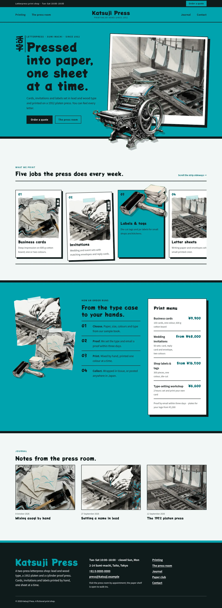
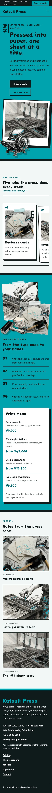

# Katsuji Press

Katsuji Press — A letterpress print shop theme laid out as horizontal strips in asagi light blue-green (#00A3AF), the main colour on the header bar, the hero, the process band and every page head, with sumi ink black, cool cotton paper and deep asagi links; Potta One display over Noto Sans JP. The art is sumi-ink raster illustration (black brush strokes and grey washes with asagi accents) used as collage: torn-edged pieces of paper taped and overlapped, a sideways-scrolling strip of print-menu cards, and a 1952 platen press and an ink brayer as transparent cut-outs that break out of the hero frame, the section edge and a card. A full top header: a sumi strip with an Order a quote button, then the menu split into two halves either side of the centred press name. Vertical Japanese only on Japanese text; English always runs horizontally. The print menu and the press details are synced patterns edited in one place. WCAG AA colours; no entrance animations.

- Design plan row: b3-18 (horizontal-strip archetype, cutout-break-frame-object hero, split nav, collage images, sumi-ink illustration, asagi #00A3AF, Potta One + Noto Sans JP).
- Header: a sumi strip with the opening hours and an Order a quote button, then the full asagi bar with the menu split into two halves either side of the centred press name.
- Break-frame: the cut-out 1952 platen press breaks over the framed press-room picture and the bottom edge of the hero into the strip below; the cut-out brayer leaves its asagi card in the print-menu strip and on The press room.
- Horizontal strip: the print menu is a sideways-scrolling strip of collage cards between two sumi rules; sections run as full-width horizontal bands.
- Collage: sumi-ink pictures cut with torn paper edges, taped and overlapped on the asagi process band.
- Vertical Japanese (hero label, card labels, page-head labels, spines) is lang="ja"; only CJK text runs vertically, English stays horizontal.
- Synced: print menu (home, Printing) and press details (footer, Contact).
- Contrast: sumi ink #101A1C on asagi #00A3AF 5.8:1 (all text on the asagi header bar, hero, process band, cards and page heads); white on sumi 17.7:1; asagi on sumi 5.8:1 (footer name, header strip button); sumi on cotton paper #F2F7F6 16.4:1; deep asagi #00666E on paper 6.2:1 and on white 6.7:1; white on deep asagi 6.7:1; quiet #3D4A4C on paper 8.5:1; sumi on pale #BFE6E8 13.2:1; white never on asagi (3.1:1).

## Templates
front-page, home, index, page, page-wide, single, archive, category, tag, search, 404.

## Patterns
home-hero, home-strip, home-process, home-journal, printing-head, printing-main, about-head, about-main, newsletter-head, newsletter-signup, contact-head, contact-main, prices, details-card, not-found.

<!-- screenshots:start -->
## Screenshots

<table>
<tr>
<td valign="top"></td>
<td valign="top"></td>
</tr>
</table>

- Printing: [desktop](screenshots/printing-desktop.webp) · [mobile](screenshots/printing-mobile.webp)
- About: [desktop](screenshots/about-desktop.webp) · [mobile](screenshots/about-mobile.webp)
- News: [desktop](screenshots/news-desktop.webp) · [mobile](screenshots/news-mobile.webp)
- Article: [desktop](screenshots/article-desktop.webp) · [mobile](screenshots/article-mobile.webp)
- Category: [desktop](screenshots/category-desktop.webp) · [mobile](screenshots/category-mobile.webp)
- Tag: [desktop](screenshots/tag-desktop.webp) · [mobile](screenshots/tag-mobile.webp)
- Newsletter: [desktop](screenshots/newsletter-desktop.webp) · [mobile](screenshots/newsletter-mobile.webp)
- Contact: [desktop](screenshots/contact-desktop.webp) · [mobile](screenshots/contact-mobile.webp)
- Search: [desktop](screenshots/search-desktop.webp) · [mobile](screenshots/search-mobile.webp)
<!-- screenshots:end -->
