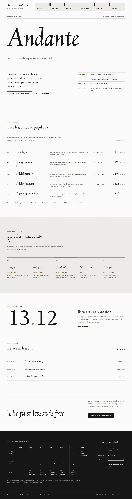
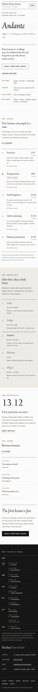

# Kenban Piano School

A quiet, typographic education theme for a **small piano school**.

*Kenban* is the keyboard. The demo school is a fictional piano school in a wooden house on Sakaki Street in Asahara, founded in 2004 by Saeko Mitsuhashi and taught with Ren Ogata and Fumiko Arima: weekly one-to-one lessons in five kinds (First keys, Young pianists, Adult beginners, Adult continuing, Diploma preparation), a free first lesson on Saturdays and two recitals a year. It is an education theme, not a shop: no WooCommerce templates or products.

## Concept: a tempo word, a keyboard and five staff lines

- **Palette.** Paper white `#FBFBFA` ground, ivory `#EDEBE7` for the key row and quiet bands, ebony `#161616` text and footer (17.5:1 on paper, 15.2:1 on ivory). Muted brass `#9A8152` (3.6:1 / 3.1:1, 4.9:1 on ebony) is used only for large type and marks: the five staff lines before every label, the raised key's baseline, the point in the recital date, today's bar in the timetable and the free-first-lesson dot. Deep brass `#6E5A30` carries links and small labels (6.4:1 / 5.6:1), felt grey `#5C5954` secondary text (6.7:1 / 5.9:1), pale brass `#B8A47A` labels on ebony (7.4:1), hairline `#D8D4CC` rules only.
- **Type.** Linden Hill (display, the tempo word, fees, the recital date; Regular and Italic) over Atkinson Hyperlegible (text, menu, timetable, labels; Regular and Bold). Both OFL-1.1 without a Reserved Font Name, subset to Latin WOFF2 (about 98 KB for all four files).
- **Motifs.** Five staff lines (CSS, `repeating-linear-gradient`) before every section label and, very faint and full width, under the tempo word; ruled rows everywhere like a staff; the menu drawn as a keyboard. No photographs on the home page, no entrance animations.

## Header, footer, layout (ROADMAP codes)

- **H6 index tabs / ruled cells**: a row of ruled cells between two ebony rules, read like a keyboard: the wordmark and a one-line descriptor in the first cell, each menu item (core Navigation, editable) an ivory white key with its label at the bottom and short ebony black keys between them in the C–D–E–F–G–A pattern; the current page is a raised paper-white key with a brass baseline. Under 1100 px the wordmark sits above the keys; on phones the wordmark and a ruled "Menu" key share one line and open the core overlay.
- **F11 hours and calendar table**: the weekly lesson timetable on ebony (Monday to Sunday, morning / afternoon / evening, lesson numbers matching the fees, the free first lesson with a brass dot), beside the wordmark and the school details. Today is marked server-side from the site's WordPress timezone (render_block filter, `aria-current="date"`). At 390 px the grid becomes a stacked day list.
- **L9 oversized typography only**: the home page has no pictures. One tempo marking, *Andante*, set very large in Linden Hill Italic on five faint staff lines, a dictionary-style gloss ("at a walking pace"), the intro and the term at a glance; the five lessons and fees as ruled rows; five tempo words from Largo to Allegro telling how a pupil moves through the school (Andante raised in ebony with a brass bar); the next recital date in tall numerals; the journal as text rows; "The first lesson is free." in large italic.

## One source for shared details

- **School details** (address, telephone, email, office hours): footer, The school, Contact.
- **The term at a glance** (term dates, lesson length, free first lesson, next terms): Home, Lessons, Contact.
- **Lessons and fees** (five lessons with ages, length, monthly fee and the editable "Most chosen" badge): Home, Lessons.
- **Weekly lesson timetable**: footer, Lessons.
- Created once by `inc/shared-info.php` from `inc/info/*.html`; the demo import (`inc/demo-import.php`) is idempotent and never overwrites user content. A page that shows the timetable or the details does not repeat them in its footer.

## Pages and templates

Home; Lessons (a lesson photograph, lessons and fees, the term, what a 45-minute lesson holds, the week); Teachers (three teachers with portraits and the lessons they teach, a quote); Recitals (the hall, the next recital with the order of the afternoon, the bow, questions); The school (the studio, the story, the instruments, the details and the way to the door); Journal (posts page, ruled rows with a small photograph); Newsletter; Contact (labelled first-lesson enquiry that composes an email, no backend); article, category, tag, search and 404 ("Tacet.") templates. Six journal posts in three categories (Practice, Instruments, School notes) with seven tags.

## Licence

GPL-2.0-or-later. Fonts OFL-1.1 (see `assets/fonts/`). Photographs AI-generated for this theme, released under GPL-2.0-or-later / CC0. The school, teachers, town, hall, address, phone numbers and fees are fictional.

<!-- screenshots:start -->
## Screenshots

<table>
<tr>
<td valign="top"></td>
<td valign="top"></td>
</tr>
</table>

- Lessons: [desktop](screenshots/lessons-desktop.webp) · [mobile](screenshots/lessons-mobile.webp)
- Teachers: [desktop](screenshots/teachers-desktop.webp) · [mobile](screenshots/teachers-mobile.webp)
- Recitals: [desktop](screenshots/recitals-desktop.webp) · [mobile](screenshots/recitals-mobile.webp)
- About: [desktop](screenshots/about-desktop.webp) · [mobile](screenshots/about-mobile.webp)
- Contact: [desktop](screenshots/contact-desktop.webp) · [mobile](screenshots/contact-mobile.webp)
- News: [desktop](screenshots/news-desktop.webp) · [mobile](screenshots/news-mobile.webp)
- Article: [desktop](screenshots/article-desktop.webp) · [mobile](screenshots/article-mobile.webp)
- Category: [desktop](screenshots/category-desktop.webp) · [mobile](screenshots/category-mobile.webp)
- Tag: [desktop](screenshots/tag-desktop.webp) · [mobile](screenshots/tag-mobile.webp)
- Newsletter: [desktop](screenshots/newsletter-desktop.webp) · [mobile](screenshots/newsletter-mobile.webp)
- Search: [desktop](screenshots/search-desktop.webp) · [mobile](screenshots/search-mobile.webp)
<!-- screenshots:end -->
