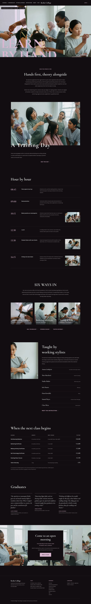

# Kesho College

A hairdressing and beauty college theme (ShipPress, `kesho-college` 1.0.0). English home page plus eleven inner pages (About, Courses, Hairdressing Diploma, A Training Day, Tuition & Intakes, Instructors, Student Salon, Graduate Stories, Admissions, FAQ, Visit), a Journal page and one sample article; the main menu and footer link to them.

- Three techniques from the reference (yoiku-salon.com, S5-Style #8997): flush 2:3 portrait panels drifting left under a giant clipped word; a centred concept block then a wide photo with an overlapping oversized caption; square tiles with the title inside. Inner pages carry a reduced hero (three flush panels, clipped title).
- Palette: ground `#120E12`, white text, one accent `#D9B6CF`, deep mauve `#6B5A68`. Cormorant Garamond headings, Karla text (theme.json fontFace).
- Scroll effects: `assets/sp-scroll.css` / `.js` (reveal, stagger, parallax on the wide photo and the open-morning cover, marquee on the hero strip).
- Patterns: `front-*` for the home page, `page-*` for the inner pages. Demo content: `demo-content.json`.
- Works without WooCommerce.
- Design notes: `brand/design-spec.md`, `brand/reference.md`, `brand/reference-tokens.md`.

<!-- screenshots:start -->
## Screenshots

<table>
<tr>
<td valign="top"></td>
<td valign="top"></td>
</tr>
</table>

- About: [desktop](screenshots/about-desktop.webp) · [mobile](screenshots/about-mobile.webp)
- Courses: [desktop](screenshots/courses-desktop.webp) · [mobile](screenshots/courses-mobile.webp)
- Hairdressing diploma: [desktop](screenshots/hairdressing-diploma-desktop.webp) · [mobile](screenshots/hairdressing-diploma-mobile.webp)
- A training day: [desktop](screenshots/a-training-day-desktop.webp) · [mobile](screenshots/a-training-day-mobile.webp)
- Tuition and intakes: [desktop](screenshots/tuition-and-intakes-desktop.webp) · [mobile](screenshots/tuition-and-intakes-mobile.webp)
- Instructors: [desktop](screenshots/instructors-desktop.webp) · [mobile](screenshots/instructors-mobile.webp)
- Student salon: [desktop](screenshots/student-salon-desktop.webp) · [mobile](screenshots/student-salon-mobile.webp)
- Graduate stories: [desktop](screenshots/graduate-stories-desktop.webp) · [mobile](screenshots/graduate-stories-mobile.webp)
- Admissions: [desktop](screenshots/admissions-desktop.webp) · [mobile](screenshots/admissions-mobile.webp)
- Faq: [desktop](screenshots/faq-desktop.webp) · [mobile](screenshots/faq-mobile.webp)
- Visit: [desktop](screenshots/visit-desktop.webp) · [mobile](screenshots/visit-mobile.webp)
- Journal: [desktop](screenshots/journal-desktop.webp) · [mobile](screenshots/journal-mobile.webp)
- News: [desktop](screenshots/news-desktop.webp) · [mobile](screenshots/news-mobile.webp)
- Article: [desktop](screenshots/article-desktop.webp) · [mobile](screenshots/article-mobile.webp)
- Category: [desktop](screenshots/category-desktop.webp) · [mobile](screenshots/category-mobile.webp)
- Tag: [desktop](screenshots/tag-desktop.webp) · [mobile](screenshots/tag-mobile.webp)
- Newsletter: [desktop](screenshots/newsletter-desktop.webp) · [mobile](screenshots/newsletter-mobile.webp)
- Contact: [desktop](screenshots/contact-desktop.webp) · [mobile](screenshots/contact-mobile.webp)
- Other languages (home page): [zh-TW](screenshots/zh-TW/home-desktop.webp) · [ja](screenshots/ja/home-desktop.webp) · [fr](screenshots/fr/home-desktop.webp) · [de](screenshots/de/home-desktop.webp)
<!-- screenshots:end -->
