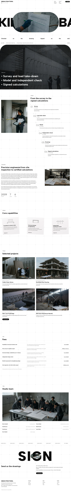

# Kosei Architects

A WordPress block theme for an architecture studio in Brussels (founded 2008). The demo studio is fictional; people, places and fees are written down in [`brand.md`](brand.md). Type: business. Sample content is in English; other languages follow in later versions.

## Pages

The demo import creates Home, Projects (with the child page Harbour Workshops), Workplaces, Housing, Renovation, Services, Process, Fees, Studio and people, About, Journal and Contact, plus one full article ("The model on the table"), so every menu and footer link resolves. Each inner page opens on a reduced framed grid (photo cell with parallax, pale cell with diagonal bands) beside the page title; the numbered index list is the in-page navigation, services and projects are ruled Title / Explanation tables with 3:2 thumbnails, and the notch and arch photographs appear on Housing, Studio, About and Contact. Process and Renovation carry a full-width parallax photograph band.

## Notes

- The home H1 is set at `clamp(2.25rem, 3.7vw, 3.25rem)` (about 52px): the 4.25rem size needs five lines in the 540px hero column. Inner page titles use the `xx-large` size (4.25rem).
- Inactive index rows keep the reference grey `#A6A6A6`; they turn `#222222` on hover and keyboard focus.

## Concept: from a model on the table to buildings in use

- **Palette.** White ground, pale warm greys `#F0EFED` / `#E6E3DF`, ink `#222222`; blue-grey `#5C6A78` only on small marks, one diagonal band and the scroll-top tab.
- **Type.** Source Serif 4 and Source Sans 3 (OFL-1.1), Latin WOFF2 bundled.
- **Photographs.** Eighteen high-key documentary photographs from one shared style string, none repeated on a page.
- **Signature.** Framed 2×2 panel grid with diagonal bands and a ■ index list; ruled Title / Explanation services table; stepped L-notch and arch-topped photographs.
- **Motion.** `sp-scroll` (reveal, wipe, stagger, parallax); respects `prefers-reduced-motion`, content visible without JavaScript.

## Front page

1. Framed grid hero with the timber model and the index list.
2. Case wall: question, work, result.
3. Practice introduction.
4. Ruled services table.
5. Darkened parallax interlude.
6. Process as an index list.
7. Studio with notch and arch photographs.
8. Fees on the ruled grid.
9. Journal.
10. Contact band.

<!-- screenshots:start -->
## Screenshots

<table>
<tr>
<td valign="top"></td>
<td valign="top"></td>
</tr>
</table>

- Projects: [desktop](screenshots/projects-desktop.webp) · [mobile](screenshots/projects-mobile.webp)
- Harbour workshops: [desktop](screenshots/harbour-workshops-desktop.webp) · [mobile](screenshots/harbour-workshops-mobile.webp)
- Workplaces: [desktop](screenshots/workplaces-desktop.webp) · [mobile](screenshots/workplaces-mobile.webp)
- Housing: [desktop](screenshots/housing-desktop.webp) · [mobile](screenshots/housing-mobile.webp)
- Renovation: [desktop](screenshots/renovation-desktop.webp) · [mobile](screenshots/renovation-mobile.webp)
- Services: [desktop](screenshots/services-desktop.webp) · [mobile](screenshots/services-mobile.webp)
- Process: [desktop](screenshots/process-desktop.webp) · [mobile](screenshots/process-mobile.webp)
- Fees: [desktop](screenshots/fees-desktop.webp) · [mobile](screenshots/fees-mobile.webp)
- Studio: [desktop](screenshots/studio-desktop.webp) · [mobile](screenshots/studio-mobile.webp)
- About: [desktop](screenshots/about-desktop.webp) · [mobile](screenshots/about-mobile.webp)
- Journal: [desktop](screenshots/journal-desktop.webp) · [mobile](screenshots/journal-mobile.webp)
- News: [desktop](screenshots/news-desktop.webp) · [mobile](screenshots/news-mobile.webp)
- Article: [desktop](screenshots/article-desktop.webp) · [mobile](screenshots/article-mobile.webp)
- Category: [desktop](screenshots/category-desktop.webp) · [mobile](screenshots/category-mobile.webp)
- Tag: [desktop](screenshots/tag-desktop.webp) · [mobile](screenshots/tag-mobile.webp)
- Newsletter: [desktop](screenshots/newsletter-desktop.webp) · [mobile](screenshots/newsletter-mobile.webp)
- Contact: [desktop](screenshots/contact-desktop.webp) · [mobile](screenshots/contact-mobile.webp)
- Other languages (home page): [zh-TW](screenshots/zh-TW/home-desktop.webp) · [ja](screenshots/ja/home-desktop.webp) · [fr](screenshots/fr/home-desktop.webp) · [de](screenshots/de/home-desktop.webp)
<!-- screenshots:end -->
