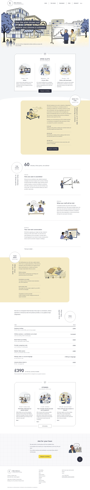

# Kikin Advisors

Kikin Advisors is an independent workplace pension consultation theme for UK employers and fee-only advisers. Built around a calm sixty-minute briefing methodology, it combines hand-drawn line illustrations with clear fee schedules and structured guidance. The theme provides complete editorial clarity for organisations selecting or re-tendering workplace pension schemes.

The theme ships the home page, thirteen inner pages and one sample note in English. The header menu uses the home page anchors (Who, The hour, Takeaway, Fees, Request); the footer links every inner page. Four more languages follow in the next build step. Inner pages carry T1 (ink bar over the skyline strip), T2 (badge and bands) and T3 (notched panels), and the About page adds a full-bleed parallax street band. Signature techniques (from the reference study in brand/): two solid ink label bars that wipe open over a hand-drawn line-art street with the adviser and finance lead sliding in; an outline circle badge with a vertical headline straddling a rounded pale-butter band that bleeds off one edge (mirrored on the second band); a 45°-notched hairline panel with round thumbnails and a pill sitting on its bottom border; and a grid-paper request block with one yellow pill. Scroll effects: sp-parallax (hero street and pair), sp-reveal--up with sp-stagger (card rows, hour rows), sp-reveal--left/right (bands), sp-count (the 60).

All illustrations in assets/images were AI-generated for this theme (CC0). The practice, people, address, telephone number and prices are fictional.

<!-- screenshots:start -->
## Screenshots

<table>
<tr>
<td valign="top"></td>
<td valign="top"></td>
</tr>
</table>

- Briefing: [desktop](screenshots/briefing-desktop.webp) · [mobile](screenshots/briefing-mobile.webp)
- Who its for: [desktop](screenshots/who-its-for-desktop.webp) · [mobile](screenshots/who-its-for-mobile.webp)
- Fees: [desktop](screenshots/fees-desktop.webp) · [mobile](screenshots/fees-mobile.webp)
- Basics: [desktop](screenshots/basics-desktop.webp) · [mobile](screenshots/basics-mobile.webp)
- Member sessions: [desktop](screenshots/member-sessions-desktop.webp) · [mobile](screenshots/member-sessions-mobile.webp)
- Advisers: [desktop](screenshots/advisers-desktop.webp) · [mobile](screenshots/advisers-mobile.webp)
- Stories: [desktop](screenshots/stories-desktop.webp) · [mobile](screenshots/stories-mobile.webp)
- Request: [desktop](screenshots/request-desktop.webp) · [mobile](screenshots/request-mobile.webp)
- About: [desktop](screenshots/about-desktop.webp) · [mobile](screenshots/about-mobile.webp)
- Newsletter: [desktop](screenshots/newsletter-desktop.webp) · [mobile](screenshots/newsletter-mobile.webp)
- Thanks: [desktop](screenshots/thanks-desktop.webp) · [mobile](screenshots/thanks-mobile.webp)
- Privacy: [desktop](screenshots/privacy-desktop.webp) · [mobile](screenshots/privacy-mobile.webp)
- Terms: [desktop](screenshots/terms-desktop.webp) · [mobile](screenshots/terms-mobile.webp)
- Notes: [desktop](screenshots/notes-desktop.webp) · [mobile](screenshots/notes-mobile.webp)
- News: [desktop](screenshots/news-desktop.webp) · [mobile](screenshots/news-mobile.webp)
- Article: [desktop](screenshots/article-desktop.webp) · [mobile](screenshots/article-mobile.webp)
- Category: [desktop](screenshots/category-desktop.webp) · [mobile](screenshots/category-mobile.webp)
- Tag: [desktop](screenshots/tag-desktop.webp) · [mobile](screenshots/tag-mobile.webp)
- Contact: [desktop](screenshots/contact-desktop.webp) · [mobile](screenshots/contact-mobile.webp)
- Other languages (home page): [zh-TW](screenshots/zh-TW/home-desktop.webp) · [ja](screenshots/ja/home-desktop.webp) · [fr](screenshots/fr/home-desktop.webp) · [de](screenshots/de/home-desktop.webp)
<!-- screenshots:end -->
