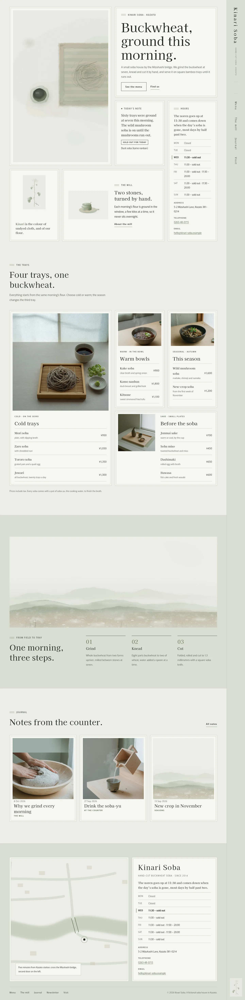
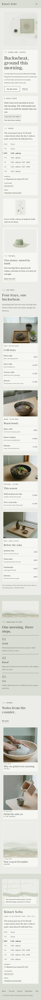

# Kinari Soba

A quiet, serene food-and-drink theme for a **small hand-cut soba house**.

*Kinari* is the colour of undyed cloth, and of fresh buckwheat flour. The demo house is a fictional soba-ya by the Mizuhashi bridge in Kozato, opened in 2014 by the soba maker Noriko Hayase: the buckwheat is ground between stones in the front window every opening morning, kneaded and cut by hand to 1.3 mm, and served on square bamboo seiro trays until it runs out. It is a restaurant theme, not a shop: no WooCommerce templates or products.

## Concept: seiro trays, today's note and watercolour

- **Palette.** Buckwheat grey `#ECEDE8` ground, pale grey-green `#DADDD3` for the rail, the quiet bands and the footer, paper `#F6F6F2` inside the tray frames, ink `#232622` text (13.0:1 / 11.1:1 / 14.1:1). Muted husk green `#6E7A5C` (3.9:1 / 3.3:1 / 4.2:1) is used only for large type and marks: the short slat line before every label, step numerals, the morning's times, today's bar in the week and the dot of today's note. Deep husk `#4E5A3F` carries links and small labels (6.2:1 / 5.3:1 / 6.8:1), quiet grey `#565B52` secondary text (5.9:1 / 5.1:1 / 6.4:1), hairline `#BFC4B6` the tray frames and rules only.
- **Type.** Kaisei HarunoUmi (display: the name, headings, dish names, today's note, the noren line; Regular and Medium) over Murecho (text, the vertical menu, labels, the week, prices; variable weight). Both OFL-1.1 without a Reserved Font Name, subset to Latin WOFF2.
- **Visual style: watercolour.** Under the 2026-10-14 rule (ROADMAP "Visual style per theme"), the hero and the decorations are vector watercolours (SVG, soft translucent washes with dry-brush lines) generated with Grok Build: a seiro tray of soba seen from above, a buckwheat sprig (also at the foot of the menu rail), the stone hand mill, the buckwheat field below the hills and the riverside street map in the footer. The dish photographs on the trays and in the journal stay raster. Each SVG has a raster copy in `assets/images/demo/` for the Media Library.
- **Motif: the seiro frame.** Every tile, tray, card and photograph sits in a square frame of an outer hairline, a strip of paper and an inner hairline, like a bamboo seiro around its slat mat (CSS `box-shadow`, also offered as the "Seiro tray" group style). No rounded tiles, no entrance animations.

## Header, footer, layout (ROADMAP codes)

- **H11 vertical Japanese-type nav on the right edge**: a pale grey-green rail fixed to the right edge from 960 px, the Kaisei HarunoUmi name set vertically at the top, a vertical descriptor, a hairline, then the core Navigation items in vertical type with a husk-green slat line marking the current page, and the watercolour buckwheat sprig resting at the foot. Below 960 px it becomes one grey-green bar with the name and a Menu button that opens the core overlay on grey-green.
- **F6 map + address card**: the watercolour street map of the riverside (bridge, river, the shop's ring) in a seiro frame with a small "how to find us" line, beside a paper card with the name, today's note and the synced hours (the noren line, the week with today marked, address, telephone, email); slim links and the copyright below. On the home page the card leaves out today's note, which the bento already shows.
- **L6 bento grid**: the home page opens with a bento of square tiles in seiro frames: the watercolour tray (2 × 2), the name with "Buckwheat, ground this morning." (2 × 1), today's note, the hours (1 × 2), the buckwheat sprig with a one-line gloss and the stone mill (2 × 1). Then the menu as a second bento of four trays (cold 2 × 2, warm, the season, sake and small plates 2 × 1), the wide watercolour field with the morning's three steps on grey-green, and the journal as three square cards. Two columns on tablets, one on phones.

## One source for shared details

- **Hours and address** (the noren line, the week with today marked from the site timezone, address, telephone, email): footer, home bento, Menu, The mill, Visit.
- **Today's note** (what is sold out for today): home bento, Menu, footer.
- **The menu** (four seiro trays with names, notes and prices): Home, Menu.
- Created once by `inc/shared-info.php` from `inc/info/*.html`; the demo import (`inc/demo-import.php`) is idempotent and never overwrites user content.

## Pages and templates

Home; Menu (today's note beside how a sold-out day works, the four trays, how to eat soba with two photographs, the hours); The mill (the field, the soba maker with her portrait and the stone mill, the morning from seven to half past eleven in three framed photographs, the hours); Journal (posts page, ruled rows with a framed square photograph); Newsletter; Visit (the watercolour map beside the hours and a "Write an email" button, no form backend); article, category, tag, search and 404 ("Sold out.") templates. Five journal posts in three categories (The mill, At the counter, Seasons) with six tags.

## Licence

GPL-2.0-or-later. Fonts OFL-1.1 (see `assets/fonts/`). Illustrations and photographs AI-generated for this theme with Grok Build, released under GPL-2.0-or-later / CC0. The soba house, the people, the town, the address, telephone numbers and prices are fictional.

<!-- screenshots:start -->
## Screenshots

<table>
<tr>
<td valign="top"></td>
<td valign="top"></td>
</tr>
</table>

- Menu: [desktop](screenshots/menu-desktop.webp) · [mobile](screenshots/menu-mobile.webp)
- About: [desktop](screenshots/about-desktop.webp) · [mobile](screenshots/about-mobile.webp)
- Contact: [desktop](screenshots/contact-desktop.webp) · [mobile](screenshots/contact-mobile.webp)
- News: [desktop](screenshots/news-desktop.webp) · [mobile](screenshots/news-mobile.webp)
- Article: [desktop](screenshots/article-desktop.webp) · [mobile](screenshots/article-mobile.webp)
- Category: [desktop](screenshots/category-desktop.webp) · [mobile](screenshots/category-mobile.webp)
- Tag: [desktop](screenshots/tag-desktop.webp) · [mobile](screenshots/tag-mobile.webp)
- Newsletter: [desktop](screenshots/newsletter-desktop.webp) · [mobile](screenshots/newsletter-mobile.webp)
- Search: [desktop](screenshots/search-desktop.webp) · [mobile](screenshots/search-mobile.webp)
<!-- screenshots:end -->
