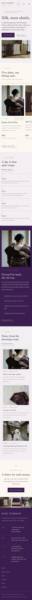

# Kinu Kimono

An elegant, restrained block theme for a **small kimono rental and dressing house** in Kyoto: rental plans, obi, accessories and yukata sold as WooCommerce products, a page on how a rental day works, and a dressing service. A ShipPress **store** theme: WooCommerce templates styled to match, eight sample products, and a shop page that still works without WooCommerce.

*Kinu* means silk. The demo house, **Kinu Kimono**, is a fictional dressing house on Sannen-zaka in Higashiyama, run by Sayo Arima (head dresser), Mei Tachibana (dresser, the silks) and Ren Okabe (hair and photography).

## Concept: silk, worn slowly

- **Plum, mist, ivory, a little gold.** Silk-mist `#F4EEF2` pages, washi-ivory `#FBF8F3` panels and ink `#221A28` text. Deep plum `#3B1F4E` for the menu rail, the dressing-service panels and the footer. Antique gold `#B8924A` only for hairlines, the rack rail, the hanger hooks, the knot mark and small marks; gold text on light grounds uses the deeper `#7E6230` (WCAG AA). No bright colours, no poster look.
- **Type.** Zen Old Mincho for headings, plan names and prices; Zen Kaku Gothic New for text, spaced-capital labels and the vertical menu. Both OFL, Latin subsets bundled (no CDN).
- **Signature: the kimono rack.** The rental plans hang from a thin gold rail, each on a short gold hook, and scroll sideways with CSS scroll-snap. Touch and trackpad scroll it, and Tab moves through the plan links, which brings each one into view. No script, no autoplay, nothing moves by itself; transitions stop under `prefers-reduced-motion`. The "Most chosen" badge is plain editable text inside the synced rack.
- No entrance animations, no hand-drawn illustrations. The only icon is the knot mark (two nested diamonds, a CSS mask), used as a divider and as the WooCommerce loader.

## Header, footer, layout (ROADMAP codes)

- **Header H11: vertical Japanese-type nav on the right edge.** From 960 px up, a deep-plum rail is fixed to the right edge with the house name and the menu set in vertical type (`writing-mode: vertical-rl`), a gold hairline and a gold marker on the current page. With WooCommerce, the account link and mini cart sit at the foot of the rail (Block Hooks). Between 600 and 959 px it is a plain top bar; on phones it shows a menu button that opens a plum overlay (the core navigation overlay, keyboard accessible).
- **Footer F8: photo strip.** A strip of five photographs (a synced pattern) over the plum colophon with the name, the synced house card and the menu.
- **Layout L4: horizontal scroll.** The home page is built around the sideways kimono rack, right after a quiet opening.
- The H11 + F8 + L4 combination is not used by any other theme (H11 is Menya Kaen with F12/L7; F8 is Komugi Pan with H2/L11; L4 is Kiroku Studio with H12/F1).

## Deviation from the plan

Planned (ROADMAP batch 1 #14) as "ornate, festive" with `#3B1F4E #E8B04A #F4E9F2`. At the user's request (elegant, restrained, refined Japanese; no bright colours, no poster look), the bright gold is muted to antique gold **`#B8924A`** and kept to small accents. The ground is silk mist **`#F4EEF2`** with washi ivory **`#FBF8F3`** and ink **`#221A28`**, and the style tags are **elegant + traditional** instead of ornate + festive. Fonts, header, footer and layout are as planned. This is also recorded in `theme-meta.json` ("deviation").

## One source for shared details

Three things appear in more than one place. Each lives in ONE synced pattern (`wp_block`), created on activation by `inc/shared-info.php` from `inc/info/*.html`, tagged `_kinu_kimono_info` and never created twice:

| Synced pattern | Source | Shown on |
|---|---|---|
| House address, hours and phone | `inc/info/house.html` | footer (every page), how it works, contact |
| The kimono rack of plans, with prices and the badge | `inc/info/plans.html` | home, plans, shop (without WooCommerce) |
| Footer photo strip | `inc/info/strip.html` | footer (every page) |

## Pages and templates

Demo pages (copy in the page content, editable in the page editor): Home, Plans, How it works (the day in five steps, the dressing service, questions), Shop, About, Journal (posts page), Newsletter and Contact. There are six sample posts in three categories with six tags.

Templates: front-page, page, page-wide, home, index, single, archive, category, tag, search and 404. For WooCommerce: archive-product (the shop), single-product, page-cart, page-checkout, page-my-account, order-confirmation and product-search-results, plus a checkout header part.

## WooCommerce

The theme declares WooCommerce support. `inc/woo-import.php` creates eight sample products (four rental plans, an obi upgrade, a hair ornament, a bag and zori set on sale, and a yukata to keep) with images, prices, categories and tags, only while WooCommerce is active. Without WooCommerce, the Shop page shows the synced rack of plans and nothing store-specific loads.

## Demo import

The shared ShipPress importer (`inc/demo-import.php`) is idempotent. Running it on activation and again through `wp shippress demo-import` / `wp shippress woo-import` created nothing new on the second run (0 created, 31 + 17 already there). It never overwrites or deletes user content. After an import, WordPress's own "Hello world!" post goes to the trash only while it is untouched (see `functions.php`).

## Credits

Photographs: AI-generated for this theme, released under GPL-2.0-or-later / CC0. Fonts: Zen Old Mincho and Zen Kaku Gothic New, SIL OFL 1.1 (see `readme.txt` and `assets/fonts/OFL-*.txt`).

<!-- screenshots:start -->
## Screenshots

<table>
<tr>
<td valign="top"></td>
<td valign="top"></td>
</tr>
</table>

- About: [desktop](screenshots/about-desktop.webp) · [mobile](screenshots/about-mobile.webp)
- Plans: [desktop](screenshots/plans-desktop.webp) · [mobile](screenshots/plans-mobile.webp)
- How it works: [desktop](screenshots/how-it-works-desktop.webp) · [mobile](screenshots/how-it-works-mobile.webp)
- News: [desktop](screenshots/news-desktop.webp) · [mobile](screenshots/news-mobile.webp)
- Article: [desktop](screenshots/article-desktop.webp) · [mobile](screenshots/article-mobile.webp)
- Category: [desktop](screenshots/category-desktop.webp) · [mobile](screenshots/category-mobile.webp)
- Tag: [desktop](screenshots/tag-desktop.webp) · [mobile](screenshots/tag-mobile.webp)
- Newsletter: [desktop](screenshots/newsletter-desktop.webp) · [mobile](screenshots/newsletter-mobile.webp)
- Contact: [desktop](screenshots/contact-desktop.webp) · [mobile](screenshots/contact-mobile.webp)
- Shop: [desktop](screenshots/shop-desktop.webp) · [mobile](screenshots/shop-mobile.webp)
- Product: [desktop](screenshots/product-desktop.webp) · [mobile](screenshots/product-mobile.webp)
- Search: [desktop](screenshots/search-desktop.webp) · [mobile](screenshots/search-mobile.webp)
<!-- screenshots:end -->
