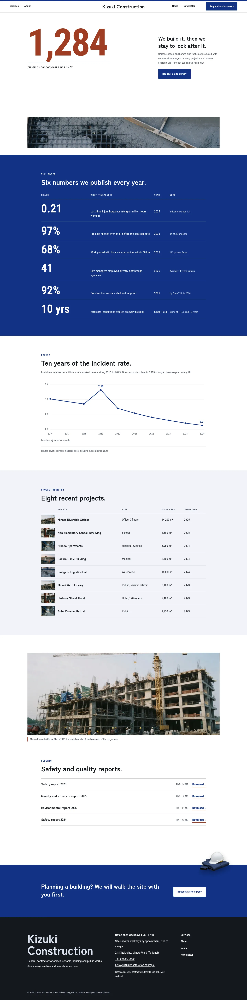
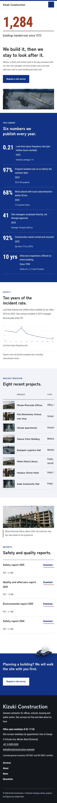

# Kizuki Construction

Kizuki Construction — a theme for a general construction contractor, set as one clean reading column under a formal white split header: the company name in the centre, the menu split two left and two right, and a Request a site survey button at the far right. Konjo navy (#113285) is the main colour: the metrics ledger, the survey call, every page head and the buttons are navy fields in white type. The front page is a metrics ledger: a white first screen on a 12-column grid with a giant handover count (1,284) in bengara Roboto Condensed on the left, the headline, one paragraph and one button on the right and a thin documentary photo strip of a concrete pour along the bottom; then a ledger of six published figures on a navy field, a ten-year safety trend chart, a register of eight recent projects with photo thumbnails, one wide site photograph, report downloads and a navy survey call where a transparent cut-out safety helmet breaks out over the band edge. Photographs are realistic documentary images (35mm wide, available light, handheld, fine grain, graded toward navy). Zen Kaku Gothic Antique for headings, Roboto Condensed for text and figures, Noto Sans TC for Traditional Chinese headings. Sample content in English, Traditional Chinese, Japanese, French and German. WCAG AA colours; no entrance animations.

- Design plan row b5-11: single-column-longform, centered-giant-type, split nav, real-photography, documentary, konjo #113285, Zen Kaku Gothic Antique + Roboto Condensed; first screen giant-metric-left, page structure metrics-ledger.
- Front page blocks: hero-giant-metric, metrics-ledger, safety-trend, project-register, site-photo, reports-downloads, survey-cta.
- Sample content languages: en, zh-TW, ja, fr, de.
- Contrast: white on konjo navy #113285 11.5:1 (ledger, survey call, page heads, buttons); pale navy #DCE3F1 on navy 9.0:1 (ledger notes); bengara #9E3D22 on white 6.7:1 (giant metric, rules); ink #14181F on white 17.8:1 and on navy tint #F1F3F8 16.0:1; navy on tint 10.4:1 (links); quiet #4A5160 on white 8.0:1 and on tint 7.2:1.
- Break-frame: the transparent cut-out safety helmet (WebP) breaks out over the top edge of the navy survey band, and over the page-head edges.

<!-- screenshots:start -->
## Screenshots

<table>
<tr>
<td valign="top"></td>
<td valign="top"></td>
</tr>
</table>

- Services: [desktop](screenshots/services-desktop.webp) · [mobile](screenshots/services-mobile.webp)
- About: [desktop](screenshots/about-desktop.webp) · [mobile](screenshots/about-mobile.webp)
- News: [desktop](screenshots/news-desktop.webp) · [mobile](screenshots/news-mobile.webp)
- Article: [desktop](screenshots/article-desktop.webp) · [mobile](screenshots/article-mobile.webp)
- Category: [desktop](screenshots/category-desktop.webp) · [mobile](screenshots/category-mobile.webp)
- Tag: [desktop](screenshots/tag-desktop.webp) · [mobile](screenshots/tag-mobile.webp)
- Newsletter: [desktop](screenshots/newsletter-desktop.webp) · [mobile](screenshots/newsletter-mobile.webp)
- Contact: [desktop](screenshots/contact-desktop.webp) · [mobile](screenshots/contact-mobile.webp)
- Search: [desktop](screenshots/search-desktop.webp) · [mobile](screenshots/search-mobile.webp)
- Other languages (home page): [zh-TW](screenshots/zh-TW/home-desktop.webp) · [ja](screenshots/ja/home-desktop.webp) · [fr](screenshots/fr/home-desktop.webp) · [de](screenshots/de/home-desktop.webp)
<!-- screenshots:end -->
