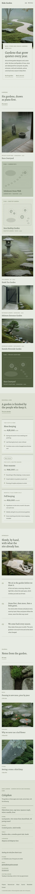

# Koke Garden

A quiet, organic and editorial business theme for a **small Japanese garden design studio** that designs and keeps moss, stone and gravel gardens.

*Koke* is moss. The demo studio is a fictional four-person garden studio in Hinoyama, founded in 2011 by garden designer Sae Morikawa, with garden designer Itsuki Hanazawa and stone setter Gen Ishiyama. It designs private courtyards, tea gardens, entrance gardens, rooftop gardens and riverside gardens, and comes back every season to keep them. It is a business theme, not a shop: no WooCommerce templates or products (and nothing breaks if WooCommerce is active).

## Concept: moss paper, raked gravel and plan sketches

- **Palette.** Pale moss paper `#E8EBE3` ground, lichen `#DCE1D4` for the footer and quiet bands, sage stone `#B9C2AE` stone cards, deep moss ink `#2C3528` text (about 10.6:1 on paper, 6.9:1 on sage). Moss `#6B7A55` is about 3.8:1 on paper, so it is used only for large type (season names, numerals), marks and textures. Deep moss `#4E5A3E` carries small accent text and links (about 6.1:1 on paper, 5.5:1 on lichen) and the moss-coloured plan cards (paper text on it, about 6.1:1). No bright colour, no neon.
- **Type.** Alegreya (display) over Alegreya Sans (text), both OFL-1.1 without a Reserved Font Name, bundled locally as Latin WOFF2.
- **Motifs.** Raked-gravel line textures from CSS repeating gradients (section dividers, the full-screen menu, gravel cards, the chosen care plan), line-drawn plan sketches on the project cards (inline SVG: stones as circles with raked rings, raked lines, a patch of moss and the stepping-stone path), and small stone-dot bullets. No entrance animations; `prefers-reduced-motion` turns off the gentle hover zooms.

## Header, footer, layout (ROADMAP codes)

- **H4 hamburger only + full-screen overlay**: a quiet bar with the "Koke Garden" wordmark and a "Menu" button (three raked lines). The core Navigation overlay opens full screen on pale moss paper with a raked-line texture and one raked circle around a stone in the corner; large Alegreya menu items, and the synced studio details as a small column beside them. Focus trap and Escape come from core; the button's aria-expanded follows the overlay. One line at 390 px.
- **F9 colophon**: set like the colophon page of a book on a light lichen ground with hairline rules: "Colophon" in italic Alegreya, then garden credits in small type (Plants, Stone, Gravel, Tools, Typefaces), the synced studio details in one row, a small menu and the copyright.
- **L8 card mosaic**: the projects as three offset columns of cards with different heights: photo cards in four shapes and plain moss, stone and gravel cards each carrying the plan sketch, project type, place and year. Two columns on tablets, one on phones.

## One source for shared details

- **Studio details** (synced pattern): booking line ("Booking site visits from March 2027"), address, email, telephone, visiting hours; in the full-screen menu, the footer colophon and the Contact page.
- **Care plans** (synced pattern): Moss keeping from ¥38,000 a visit, Four seasons from ¥46,000 a visit ("Most chosen", editable text), Full keeping from ¥29,000 a month; on Home and Seasonal care.
- Created once by `inc/shared-info.php` from `inc/info/*.html`; the demo import (`inc/demo-import.php`) is idempotent and never overwrites user content.

## Pages and templates

Home; Projects (mosaic + index) with six project pages as child pages (brief, site, plants, stone and gravel, plan sketch, care plan, two photographs, next garden); Seasonal care (care calendar for spring, rainy season, summer, autumn and winter, then the care plans); About (studio, approach, team of three shown with working-hands and studio-bench photos instead of portraits); Journal (posts page); Newsletter; Contact (email enquiry with a prefilled form in the visitor's email app, the studio details and a written address block instead of a map); article, category, tag, search and 404 templates. Six journal posts in three categories (Moss, Stone, Seasons) with six tags.

## Licence

GPL-2.0-or-later. Fonts OFL-1.1 (see `assets/fonts/`). Photographs AI-generated for this theme, released under GPL-2.0-or-later / CC0. All names, gardens, the address, phone numbers and prices are fictional.

<!-- screenshots:start -->
## Screenshots

<table>
<tr>
<td valign="top"></td>
<td valign="top"></td>
</tr>
</table>

- Projects: [desktop](screenshots/projects-desktop.webp) · [mobile](screenshots/projects-mobile.webp)
- Case study: [desktop](screenshots/case-study-desktop.webp) · [mobile](screenshots/case-study-mobile.webp)
- Seasonal care: [desktop](screenshots/seasonal-care-desktop.webp) · [mobile](screenshots/seasonal-care-mobile.webp)
- About: [desktop](screenshots/about-desktop.webp) · [mobile](screenshots/about-mobile.webp)
- News: [desktop](screenshots/news-desktop.webp) · [mobile](screenshots/news-mobile.webp)
- Article: [desktop](screenshots/article-desktop.webp) · [mobile](screenshots/article-mobile.webp)
- Category: [desktop](screenshots/category-desktop.webp) · [mobile](screenshots/category-mobile.webp)
- Tag: [desktop](screenshots/tag-desktop.webp) · [mobile](screenshots/tag-mobile.webp)
- Newsletter: [desktop](screenshots/newsletter-desktop.webp) · [mobile](screenshots/newsletter-mobile.webp)
- Contact: [desktop](screenshots/contact-desktop.webp) · [mobile](screenshots/contact-mobile.webp)
- Search: [desktop](screenshots/search-desktop.webp) · [mobile](screenshots/search-mobile.webp)
<!-- screenshots:end -->
