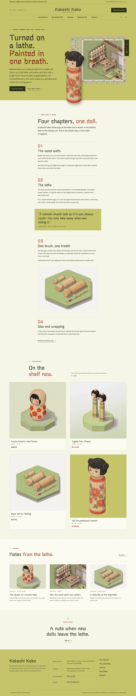
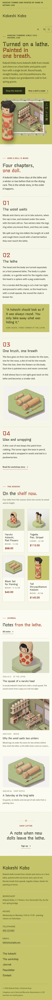

# Kokeshi Kobo

Kokeshi Kobo — a store theme for a kokeshi doll maker, with WooCommerce templates styled to match. Matcha green (#C5C56A) is the main colour: the header, the hero, every page head, the bands, the pull quotes and the footer are matcha fields with sumi-green type, deep-moss labels and lacquer-red numbers; Stick for display and Murecho for reading. The hero puts the headline on the left and, on the right, a 2.5D isometric workshop in a frame on a kokeshi pattern panel, with a cut-out kokeshi that steps out over the frame and the hero edge; the menu sits centred on its own ruled row under the shop name. Below, the making story runs as one single-column long read in four numbered chapters, then the dolls, the journal and the shop letter. The kokeshi pattern texture backs the page heads, bands and footer edge. All illustrations are generated in one 2.5D isometric style. The shop details and the wood-and-care notes each live in one synced pattern (WooCommerce optional: without it the dolls show as static cells and orders go by email).

- Design plan row: b3-20 (single-column-longform archetype, text-left-art-right hero, centered nav, pattern-texture images, 2.5d-isometric illustration, matcha #C5C56A, Stick + Murecho).
- Header: a matcha header with a note strip, an est. line, the shop name centred, Shop the kokeshi, account and cart; the primary menu sits centred on its own ruled row below (a menu button on phones).
- Hero: headline, lead and buttons on the left; on the right a 2.5D isometric workshop framed on the kokeshi pattern panel, with a vertical Japanese label (lang="ja").
- Break-frame: the cut-out kokeshi stands in front of the frame, over its left edge and down past the bottom of the hero into the long read.
- Single column: Home and The workshop tell the story in one narrow measure, with numbered chapters, a matcha pull quote and inline plates.
- Pattern texture: the Grok kokeshi pattern under a matcha wash backs the page heads, bands and the footer edge; text sits on solid matcha panels.
- Synced: shop details (footer, Contact) and wood and care (product pages, Contact); wood and height per product from its attributes.
- Contrast: sumi green #1E2312 on matcha #C5C56A 8.9:1 (all text on the matcha header, hero, page heads, bands, quotes and footer); moss #3A3F1E on matcha 6.1:1 (leads, notes); deep moss #2B3016 on matcha 7.5:1 (labels, buttons; matcha on deep-moss buttons 7.5:1); lacquer red #7A2412 on matcha 5.5:1 (numbers and emphasis); sumi green on paper #F6F5E8 14.7:1; vermilion #A8361E on paper 6.0:1 (chapter numbers, emphasis); deep vermilion links #8A2C17 on paper 7.8:1; moss grey #545938 on paper 6.7:1..

<!-- screenshots:start -->
## Screenshots

<table>
<tr>
<td valign="top"></td>
<td valign="top"></td>
</tr>
</table>

- Shop: [desktop](screenshots/shop-desktop.webp) · [mobile](screenshots/shop-mobile.webp)
- Product: [desktop](screenshots/product-desktop.webp) · [mobile](screenshots/product-mobile.webp)
- About: [desktop](screenshots/about-desktop.webp) · [mobile](screenshots/about-mobile.webp)
- Contact: [desktop](screenshots/contact-desktop.webp) · [mobile](screenshots/contact-mobile.webp)
- News: [desktop](screenshots/news-desktop.webp) · [mobile](screenshots/news-mobile.webp)
- Article: [desktop](screenshots/article-desktop.webp) · [mobile](screenshots/article-mobile.webp)
- Category: [desktop](screenshots/category-desktop.webp) · [mobile](screenshots/category-mobile.webp)
- Tag: [desktop](screenshots/tag-desktop.webp) · [mobile](screenshots/tag-mobile.webp)
- Newsletter: [desktop](screenshots/newsletter-desktop.webp) · [mobile](screenshots/newsletter-mobile.webp)
- Search: [desktop](screenshots/search-desktop.webp) · [mobile](screenshots/search-mobile.webp)
<!-- screenshots:end -->
