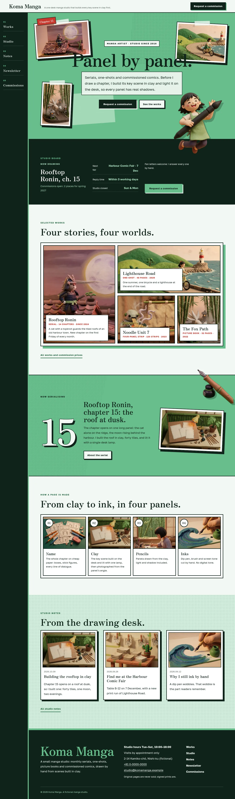
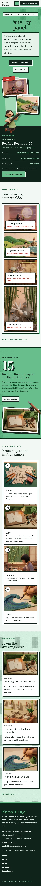

# Koma Manga

Koma Manga — a manga artist portfolio theme set like a poster: a paper header with the studio name and a Request a commission button, whose menu runs down a fixed sumi side rail on wide screens (stacked vertical words in Chinese and Japanese). Wakatake young-bamboo green (#68BE8D) is the main colour: the hero, every page head and the serial band are bamboo-green fields with sumi-ink type. The hero is centred giant type over a collage of tilted clay-diorama panels taped onto screen-tone pieces; a cut-out clay artist leaps out of the collage and over the hero edge, a cut-out dip pen breaks out of the serial band's desk panel and over its top edge, and a clay cat peeks over every page head. Every picture is a 3D clay illustration. Selected works are laid out like a manga page, the process as a four-panel strip. Zen Old Mincho for display, Golos Text for reading. Sample content in English, Traditional Chinese, Japanese, French and German; vertical labels only in Chinese and Japanese. WCAG AA colours; no entrance animations.

- Design plan row b3-24: poster-typographic, centered-giant-type hero, side-rail nav, collage, 3d-clay, wakatake #68BE8D, Zen Old Mincho + Golos Text.
- Sample content languages: en, zh-TW, ja, fr, de.
- Contrast: sumi ink #10231A on wakatake #68BE8D 7.3:1 (all text on the hero, page heads, serial band and the phone menu); ink on paper #F3F8F4 15.3:1; deep bamboo #24653F on paper 6.5:1 (links, labels); moss grey #4A5D52 on paper 6.6:1 (secondary text); ink on pale bamboo #D3EEDD 13.3:1 (price and details cards); sprout #A8DDBC on ink 10.8:1 (board labels); wakatake on ink 7.3:1 (footer name, rail numbers; ink on wakatake buttons 7.3:1); paper on ink 15.3:1 (rail, board, footer); white on ink buttons 16.4:1; seal red #C8372D on paper 4.8:1 and on white 5.2:1 (small bold facts labels); white on seal red 5.2:1 (chapter stamp); white on wakatake only 2.3:1, never used for text.
- Break-frame: the cut-out clay artist (transparent WebP) leaps out of the hero collage, over the giant type's field and across the hero's bottom edge into the studio board; the cut-out dip pen breaks out of the tilted desk panel and over the serial band's top edge; the cut-out clay cat peeks over the bottom edge of every page head.

## Templates and patterns

Every template is the header (with the side-rail menu on wide screens), the page column and the footer. Page bodies come from patterns (home-hero with the giant type, clay collage and cut-out artist, home-board with the synced studio board, home-works as a manga page, home-serial with the cut-out pen, home-process as a four-panel strip, home-journal, works-*, about-*, letter-*, contact-*); template headings come from tpl-* patterns so they follow the content language.

<!-- screenshots:start -->
## Screenshots

<table>
<tr>
<td valign="top"></td>
<td valign="top"></td>
</tr>
</table>

- Projects: [desktop](screenshots/projects-desktop.webp) · [mobile](screenshots/projects-mobile.webp)
- About: [desktop](screenshots/about-desktop.webp) · [mobile](screenshots/about-mobile.webp)
- News: [desktop](screenshots/news-desktop.webp) · [mobile](screenshots/news-mobile.webp)
- Article: [desktop](screenshots/article-desktop.webp) · [mobile](screenshots/article-mobile.webp)
- Category: [desktop](screenshots/category-desktop.webp) · [mobile](screenshots/category-mobile.webp)
- Tag: [desktop](screenshots/tag-desktop.webp) · [mobile](screenshots/tag-mobile.webp)
- Newsletter: [desktop](screenshots/newsletter-desktop.webp) · [mobile](screenshots/newsletter-mobile.webp)
- Contact: [desktop](screenshots/contact-desktop.webp) · [mobile](screenshots/contact-mobile.webp)
- Search: [desktop](screenshots/search-desktop.webp) · [mobile](screenshots/search-mobile.webp)
- Other languages (home page): [zh-TW](screenshots/zh-TW/home-desktop.webp) · [ja](screenshots/ja/home-desktop.webp) · [fr](screenshots/fr/home-desktop.webp) · [de](screenshots/de/home-desktop.webp)
<!-- screenshots:end -->
