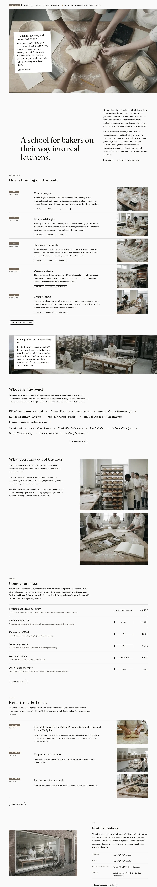

# Komugi School

Komugi School is a quiet, editorial WordPress theme created for professional bakery schools and vocational culinary workshops. Built around structured daily schedule lists, hairline course registries, and documentary imagery, it delivers a calm, print-inspired aesthetic for modern kitchen education. The theme includes full block-editor support, Fraunces serif typography, and clear responsive layouts.

## Home page patterns
`front-bench` (chip bar + bench photograph + schedule card), `front-intro`, `front-week` (Mon-Fri hairline rows), `front-floor` (parallax cover), `front-people` (two tickers), `front-leave`, `front-fees`, `front-journal`, `front-visit`.

## Motion
sp-scroll: `sp-parallax` on the bench photograph and the production floor, `sp-reveal--up` + `sp-stagger` on the day rows, `sp-reveal--wipe` on the info bar and the statement, `sp-marquee` on the two tickers.

<!-- screenshots:start -->
## Screenshots

<table>
<tr>
<td valign="top"></td>
<td valign="top"></td>
</tr>
</table>

- About: [desktop](screenshots/about-desktop.webp) · [mobile](screenshots/about-mobile.webp)
- News: [desktop](screenshots/news-desktop.webp) · [mobile](screenshots/news-mobile.webp)
- Article: [desktop](screenshots/article-desktop.webp) · [mobile](screenshots/article-mobile.webp)
- Category: [desktop](screenshots/category-desktop.webp) · [mobile](screenshots/category-mobile.webp)
- Tag: [desktop](screenshots/tag-desktop.webp) · [mobile](screenshots/tag-mobile.webp)
- Newsletter: [desktop](screenshots/newsletter-desktop.webp) · [mobile](screenshots/newsletter-mobile.webp)
- Contact: [desktop](screenshots/contact-desktop.webp) · [mobile](screenshots/contact-mobile.webp)
- Programme: [desktop](screenshots/programme-desktop.webp) · [mobile](screenshots/programme-mobile.webp)
- Training day: [desktop](screenshots/training-day-desktop.webp) · [mobile](screenshots/training-day-mobile.webp)
- Courses: [desktop](screenshots/courses-desktop.webp) · [mobile](screenshots/courses-mobile.webp)
- Instructors: [desktop](screenshots/instructors-desktop.webp) · [mobile](screenshots/instructors-mobile.webp)
- Admissions: [desktop](screenshots/admissions-desktop.webp) · [mobile](screenshots/admissions-mobile.webp)
- Careers: [desktop](screenshots/careers-desktop.webp) · [mobile](screenshots/careers-mobile.webp)
- Facilities: [desktop](screenshots/facilities-desktop.webp) · [mobile](screenshots/facilities-mobile.webp)
- Faq: [desktop](screenshots/faq-desktop.webp) · [mobile](screenshots/faq-mobile.webp)
- Journal: [desktop](screenshots/journal-desktop.webp) · [mobile](screenshots/journal-mobile.webp)
- Other languages (home page): [zh-TW](screenshots/zh-TW/home-desktop.webp) · [ja](screenshots/ja/home-desktop.webp) · [fr](screenshots/fr/home-desktop.webp) · [de](screenshots/de/home-desktop.webp)
<!-- screenshots:end -->
