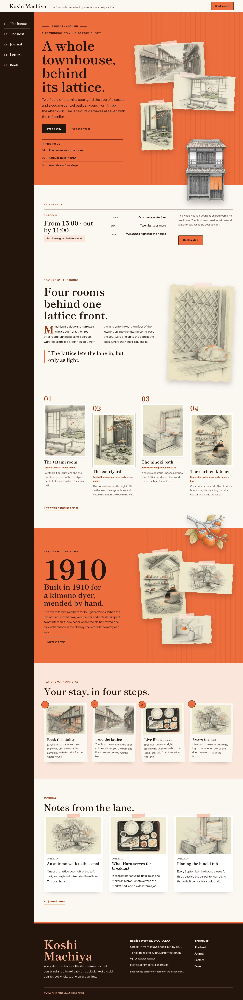

# Koshi Machiya

Koshi Machiya — a machiya townhouse stay theme laid out like a seasonal magazine, with a formal top header: the house name and tagline on the left, the Book a stay button on the right, and on wide screens the menu as a fixed sumi-ink side rail of numbered entries down the left edge (an overlay menu on phones and tablets). Kaki persimmon (#ED6D3D) is the main colour: the cover hero, the story band, every page head and the overlay menu are persimmon fields with a faint koshi-lattice texture, set in sumi ink. The hero is a stacked collage: three torn pencil sketches of the lane, the tatami room and the courtyard, taped and overlapped, with a cut-out townhouse breaking out of the collage and over the hero bottom edge. Editorial layout: an issue line and contents list on the cover, a feature spread with a two-column drop-cap lead and a pull quote, the rooms on a staggered numbered grid, the year 1910 in giant type on the story band, where a cut-out persimmon branch breaks over the top edge. Every picture is a graphite pencil sketch with persimmon coloured-pencil accents. Shippori Mincho B1 for display, Instrument Sans for reading, Noto Serif TC for Traditional Chinese headings. Sample content in English, Traditional Chinese, Japanese, French and German; vertical labels only in Chinese and Japanese. WCAG AA colours; no entrance animations.

- Design plan row b4-2: editorial-magazine, stacked-collage hero, side-rail nav, collage, pencil-sketch, kaki #ED6D3D, Shippori Mincho B1 + Instrument Sans.
- Sample content languages: en, zh-TW, ja, fr, de.
- Contrast: sumi brown-black ink #24140D on kaki #ED6D3D 5.8:1 (all text on the cover hero, the story band, every page head, the header button and the overlay menu); ink on warm paper #FBF7F2 16.7:1; deep persimmon #9C3A12 on paper 6.5:1, on white 6.9:1 and on pale persimmon #FCE6DA 5.8:1 (links, labels, drop caps, room numbers); smoked brown #5E4A40 on paper 7.8:1 (secondary text); ink on pale persimmon 14.8:1 (rates, details, steps band); paper on ink 16.7:1 (side rail, footer, letter card); light persimmon #F7B08F on ink 9.8:1 (rail numbers, footer name); white on kaki only 3.1:1, never used for text.
- Break-frame: the cut-out townhouse (transparent WebP) stands in front of the stacked sketch collage and breaks over the hero bottom edge into the at-a-glance box; the cut-out persimmon branch breaks over the top edge of the persimmon story band and over the bottom edge of every page head.

## Templates and patterns

Every template is the top header (with the side-rail menu on wide screens), the page column and the footer. Page bodies come from patterns (home-hero with the cover text, contents and the stacked collage with the cut-out townhouse, home-board with the synced house board, home-works as the feature spread of the rooms, home-serial as the persimmon story band with the cut-out branch, home-process with the four stay steps, home-journal, and a persimmon page head with a taped sketch per page). The house board, house details and rates are synced patterns.

<!-- screenshots:start -->
## Screenshots

<table>
<tr>
<td valign="top"></td>
<td valign="top"></td>
</tr>
</table>

- Rooms: [desktop](screenshots/rooms-desktop.webp) · [mobile](screenshots/rooms-mobile.webp)
- About: [desktop](screenshots/about-desktop.webp) · [mobile](screenshots/about-mobile.webp)
- News: [desktop](screenshots/news-desktop.webp) · [mobile](screenshots/news-mobile.webp)
- Article: [desktop](screenshots/article-desktop.webp) · [mobile](screenshots/article-mobile.webp)
- Category: [desktop](screenshots/category-desktop.webp) · [mobile](screenshots/category-mobile.webp)
- Tag: [desktop](screenshots/tag-desktop.webp) · [mobile](screenshots/tag-mobile.webp)
- Newsletter: [desktop](screenshots/newsletter-desktop.webp) · [mobile](screenshots/newsletter-mobile.webp)
- Contact: [desktop](screenshots/contact-desktop.webp) · [mobile](screenshots/contact-mobile.webp)
- Search: [desktop](screenshots/search-desktop.webp) · [mobile](screenshots/search-mobile.webp)
- Other languages (home page): [zh-TW](screenshots/zh-TW/home-desktop.webp) · [ja](screenshots/ja/home-desktop.webp) · [fr](screenshots/fr/home-desktop.webp) · [de](screenshots/de/home-desktop.webp)
<!-- screenshots:end -->
