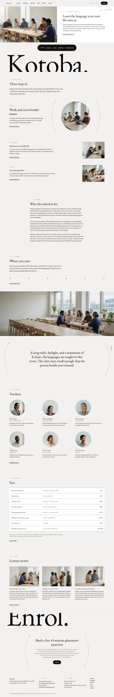

# Kotoba Language

A WordPress block theme for an adult language school in Rotterdam (founded 2016) that serves new arrivals and cross-border teams. The school is fictional; people, places and fees are written down in [`brand.md`](brand.md). Type: education. Sample content is in English; zh-TW, ja, fr and de follow in later versions.

## Concept: a school told through a cropped wordmark and three ways in

- **Palette.** Ground `#F2F1EE`, white panel, ink `#0D0C0A`, pill `#15130F`; mulberry brown `#6E5C4C` only on arcs, the right-edge rail, labels and fee rules. First screen saturated pixels about 4%.
- **Type.** EB Garamond for headings, wordmark and prices; Source Sans 3 for reading (OFL-1.1, Latin WOFF2 subsets bundled). Noto Serif TC/JP subsets are bundled for the later languages.
- **Photographs.** Eighteen high-key photographs from one shared style string, none repeated on a page; teacher portraits are single-person shots on a plain pale wall.
- **Signature.** An oversized `Kotoba.` wordmark cropped by the fold (mirrored by `Enrol.` at the close); mirrored curved arcs with diagonal dots around a circular photograph and the pull-quotes; a fixed right-edge rail whose label swaps from `ENQUIRE` to `PAGE TOP` while scrolling.
- **Motion.** `sp-scroll` (reveal, stagger, wipe, parallax on the hero photograph and the classroom band); respects `prefers-reduced-motion`, content visible without JavaScript.

## Front page

1. Split opening: photograph left, text right, intake-dates pill and the cropped wordmark below.
2. Three pathways (work, settlement, exams) around a circular photograph.
3. The school in three paragraphs.
4. Levels as a CEFR hairline scale.
5. Classroom band (parallax) and pull-quote.
6. Teachers in circular portraits.
7. Fee table in EUR.
8. Learner stories.
9. Enquiry close with the `Enrol.` wordmark.

## Stage-2 fixes (home)

- Intake pill moved to the gap between the photograph row and the wordmark, so it no longer covers the letters.
- Teacher portraits P2, P3, P5 and P6 regenerated on a plain wall with nobody else in frame.
- Editor validation: every full-width group now carries `alignfull`, and the fee table uses core-table markup only (nth-child styling instead of cell classes). All 26 documents parse without invalid blocks.
- Main menu (Courses, Pathways, Teachers, Fees, Stories, Journal) links to real pages. 

## Inner pages (English)

About (cropped `Kotoba.`, parallax classroom band, arc-flanked circle), Courses, three pathway pages (Work, Settlement, Exams; each with a parallax band, arc-flanked circle, fee rows and the named teacher), Teachers (eight circular portraits, 4+4), Levels and placement (CEFR table), Fees and intake (cropped `Fees.`, full-width fee and intake tables), Learner stories, Enquiry and visit (cropped `Hello.`, form), Journal with one sample article, and a 404 page. Tables stack on screens under 782px. The other four languages follow.

<!-- screenshots:start -->
## Screenshots

<table>
<tr>
<td valign="top"></td>
<td valign="top"></td>
</tr>
</table>

- About: [desktop](screenshots/about-desktop.webp) · [mobile](screenshots/about-mobile.webp)
- News: [desktop](screenshots/news-desktop.webp) · [mobile](screenshots/news-mobile.webp)
- Article: [desktop](screenshots/article-desktop.webp) · [mobile](screenshots/article-mobile.webp)
- Category: [desktop](screenshots/category-desktop.webp) · [mobile](screenshots/category-mobile.webp)
- Tag: [desktop](screenshots/tag-desktop.webp) · [mobile](screenshots/tag-mobile.webp)
- Newsletter: [desktop](screenshots/newsletter-desktop.webp) · [mobile](screenshots/newsletter-mobile.webp)
- Contact: [desktop](screenshots/contact-desktop.webp) · [mobile](screenshots/contact-mobile.webp)
- Courses: [desktop](screenshots/courses-desktop.webp) · [mobile](screenshots/courses-mobile.webp)
- Pathways work: [desktop](screenshots/pathways-work-desktop.webp) · [mobile](screenshots/pathways-work-mobile.webp)
- Pathways settlement: [desktop](screenshots/pathways-settlement-desktop.webp) · [mobile](screenshots/pathways-settlement-mobile.webp)
- Pathways exams: [desktop](screenshots/pathways-exams-desktop.webp) · [mobile](screenshots/pathways-exams-mobile.webp)
- Teachers: [desktop](screenshots/teachers-desktop.webp) · [mobile](screenshots/teachers-mobile.webp)
- Levels placement: [desktop](screenshots/levels-placement-desktop.webp) · [mobile](screenshots/levels-placement-mobile.webp)
- Fees intake: [desktop](screenshots/fees-intake-desktop.webp) · [mobile](screenshots/fees-intake-mobile.webp)
- Stories: [desktop](screenshots/stories-desktop.webp) · [mobile](screenshots/stories-mobile.webp)
- Enquiry: [desktop](screenshots/enquiry-desktop.webp) · [mobile](screenshots/enquiry-mobile.webp)
- Journal: [desktop](screenshots/journal-desktop.webp) · [mobile](screenshots/journal-mobile.webp)
- Other languages (home page): [zh-TW](screenshots/zh-TW/home-desktop.webp) · [ja](screenshots/ja/home-desktop.webp) · [fr](screenshots/fr/home-desktop.webp) · [de](screenshots/de/home-desktop.webp)
<!-- screenshots:end -->
