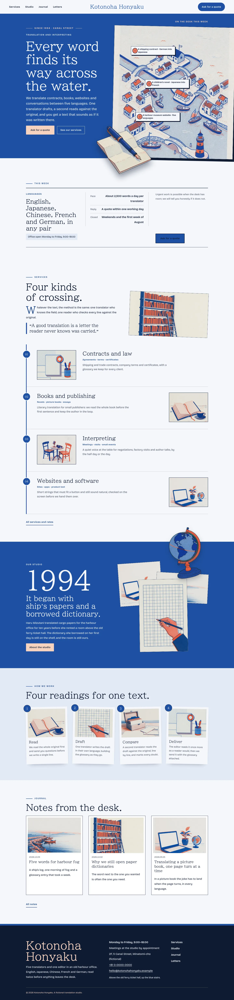
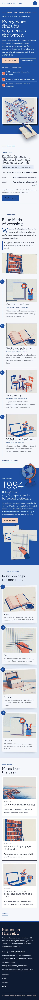

# Kotonoha Honyaku

Kotonoha Honyaku — a translation studio theme read like an unrolled vertical scroll: under a formal top header the page runs top to bottom, the services hang from one long ruri thread as numbered rows, and in Chinese and Japanese every section head becomes a vertical title slip down the right edge (Latin text always stays horizontal). The header splits the menu around the centred studio name, with the Ask for a quote button at its end; phones and tablets get a full-screen ruri overlay. Ruri (#1E50A2), the deep lapis blue of traditional Japanese dyeing, is the main colour: the hero, the story band and every page head are ruri fields set in paper white, with pale shell-pink labels. The hero is a scene map: the title, lead and buttons beside a risograph map of the harbour town in a paper frame, with this week's three jobs pinned on it as numbered labels, and a cut-out fountain pen (transparent WebP) breaking over the frame and the hero bottom edge; a cut-out desk globe breaks over the story band and every page head. Every picture is a two-colour risograph illustration in ruri and soft vermilion. BIZ UDPMincho for display, Bricolage Grotesque for reading, Noto Serif TC for Traditional Chinese headings. Sample content in English, Traditional Chinese, Japanese, French and German. WCAG AA colours; no entrance animations.

- Design plan row b4-12: tategaki-vertical-scroll, scene-map hero, split nav, cutout-break-frame (risograph), ruri #1E50A2, BIZ UDPMincho + Bricolage Grotesque.
- Sample content languages: en, zh-TW, ja, fr, de.
- Contrast: paper #F5F7FB on ruri #1E50A2 7.2:1 (all text on the hero, the story band, every page head and the ruri overlay menu; white on ruri 7.7:1); shell pink #F6D3BE on ruri 5.5:1 (eyebrows, issue line, map legend, labels on ruri); ink #0F1B33 on shell-pink buttons 12.2:1; night ink #0F1B33 on paper 16.0:1 and on mist #E3EAF5 14.2:1; deep ruri #1A4488 on paper 8.8:1 and on mist 7.8:1 (links, labels, service facts); slate #4A5468 on paper 7.1:1 and on mist 6.3:1 (secondary text); paper on night ink 16.0:1 and shell pink on night ink 12.2:1 (footer); ruri on paper 7.2:1 (studio name, header button, service numbers); ink on soft vermilion #E9785F map pins 5.9:1; ink on ruri only 2.2:1, never used for text.
- Break-frame: the cut-out fountain pen (transparent WebP) breaks over the map frame and the bottom edge of the hero; the cut-out desk globe breaks over the top edge of the story band and the bottom edge of every page head.

<!-- screenshots:start -->
## Screenshots

<table>
<tr>
<td valign="top"></td>
<td valign="top"></td>
</tr>
</table>

- Services: [desktop](screenshots/services-desktop.webp) · [mobile](screenshots/services-mobile.webp)
- About: [desktop](screenshots/about-desktop.webp) · [mobile](screenshots/about-mobile.webp)
- News: [desktop](screenshots/news-desktop.webp) · [mobile](screenshots/news-mobile.webp)
- Article: [desktop](screenshots/article-desktop.webp) · [mobile](screenshots/article-mobile.webp)
- Category: [desktop](screenshots/category-desktop.webp) · [mobile](screenshots/category-mobile.webp)
- Tag: [desktop](screenshots/tag-desktop.webp) · [mobile](screenshots/tag-mobile.webp)
- Newsletter: [desktop](screenshots/newsletter-desktop.webp) · [mobile](screenshots/newsletter-mobile.webp)
- Contact: [desktop](screenshots/contact-desktop.webp) · [mobile](screenshots/contact-mobile.webp)
- Search: [desktop](screenshots/search-desktop.webp) · [mobile](screenshots/search-mobile.webp)
- Other languages (home page): [zh-TW](screenshots/zh-TW/home-desktop.webp) · [ja](screenshots/ja/home-desktop.webp) · [fr](screenshots/fr/home-desktop.webp) · [de](screenshots/de/home-desktop.webp)
<!-- screenshots:end -->
