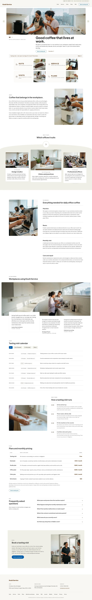

# Kouhi Service

A calm block theme (type landing) for a workplace coffee service. Home page and twelve inner pages plus a journal with one article (English) in this release; other languages follow.

## Signature
- Lifted centre card (with white caption plates) on a curved pale band, with a round cup disc sitting on the band edge.
- Header with a hanging utility tab (languages, hours), an anchor menu and an outline pill button.
- Pill tabs over ruled, dated rows for the tasting-visit calendar.
- Rounded photo banner with a slow two-frame crossfade, a notice strip and 2x2 photo tiles.

## Patterns
- `foot-main`
- `front-book`
- `front-faq`
- `front-hero`
- `front-intro`
- `front-plans`
- `front-run`
- `front-service`
- `front-stories`
- `front-suits`
- `front-tiles`
- `front-visits`
- `head-bar`

## Fonts
Plus Jakarta Sans and DM Sans (SIL OFL 1.1, licences in assets/fonts).

## Scroll effects
Bundled sp-scroll (parallax on the hero and the stories band, staggered reveals); all effects are off with prefers-reduced-motion and in the editor.

## Images (AI-generated for this theme, no text or logos; assets/images/)
- assets/images/p01-hero-a.webp
- assets/images/p02-hero-b.webp
- assets/images/p03-hopper.webp
- assets/images/p04-studio.webp
- assets/images/p05-clinic.webp
- assets/images/p06-accounts.webp
- assets/images/p07-descale.webp
- assets/images/p08-kitchen.webp
- assets/images/p09-cups.webp
- assets/images/p10-case.webp
- assets/images/p11-beans.webp
- assets/images/p12-panel.webp
- assets/images/p13-desk.webp
- assets/images/p14-card.webp

<!-- screenshots:start -->
## Screenshots

<table>
<tr>
<td valign="top"></td>
<td valign="top"></td>
</tr>
</table>

- The service: [desktop](screenshots/the-service-desktop.webp) · [mobile](screenshots/the-service-mobile.webp)
- Tasting visit: [desktop](screenshots/tasting-visit-desktop.webp) · [mobile](screenshots/tasting-visit-mobile.webp)
- Plans and pricing: [desktop](screenshots/plans-and-pricing-desktop.webp) · [mobile](screenshots/plans-and-pricing-mobile.webp)
- Machines and beans: [desktop](screenshots/machines-and-beans-desktop.webp) · [mobile](screenshots/machines-and-beans-mobile.webp)
- Offices we serve: [desktop](screenshots/offices-we-serve-desktop.webp) · [mobile](screenshots/offices-we-serve-mobile.webp)
- About: [desktop](screenshots/about-desktop.webp) · [mobile](screenshots/about-mobile.webp)
- Faq: [desktop](screenshots/faq-desktop.webp) · [mobile](screenshots/faq-mobile.webp)
- Contact: [desktop](screenshots/contact-desktop.webp) · [mobile](screenshots/contact-mobile.webp)
- Newsletter: [desktop](screenshots/newsletter-desktop.webp) · [mobile](screenshots/newsletter-mobile.webp)
- Privacy: [desktop](screenshots/privacy-desktop.webp) · [mobile](screenshots/privacy-mobile.webp)
- Terms: [desktop](screenshots/terms-desktop.webp) · [mobile](screenshots/terms-mobile.webp)
- Thanks: [desktop](screenshots/thanks-desktop.webp) · [mobile](screenshots/thanks-mobile.webp)
- Journal: [desktop](screenshots/journal-desktop.webp) · [mobile](screenshots/journal-mobile.webp)
- News: [desktop](screenshots/news-desktop.webp) · [mobile](screenshots/news-mobile.webp)
- Article: [desktop](screenshots/article-desktop.webp) · [mobile](screenshots/article-mobile.webp)
- Category: [desktop](screenshots/category-desktop.webp) · [mobile](screenshots/category-mobile.webp)
- Tag: [desktop](screenshots/tag-desktop.webp) · [mobile](screenshots/tag-mobile.webp)
- Other languages (home page): [zh-TW](screenshots/zh-TW/home-desktop.webp) · [ja](screenshots/ja/home-desktop.webp) · [fr](screenshots/fr/home-desktop.webp) · [de](screenshots/de/home-desktop.webp)
<!-- screenshots:end -->
