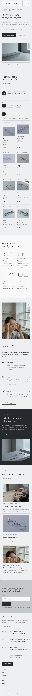

# Kumo Eyewear

A technical, restrained block theme for a **small titanium eyewear atelier** and its online shop. A ShipPress **store** theme: WooCommerce templates styled to match, eight sample frames in shape and material categories, and a shop page that still works without WooCommerce.

*Kumo* (cloud). The demo atelier is a fictional grey room in the small town of Kiri-machi, shared by three makers: Aki Morisawa, Ren Tobita and Yui Kanzaki.

## Concept: drawn to the millimetre

- **Cool greys and one titanium.** Mist ground `#EEEFF0`, card white `#F7F8F8`, cool mid grey `#C4C8CC` (the newsletter band), ink charcoal `#26292C` for text and the dark band. Titanium `#6F7F86` (3.6:1 on mist) is kept to hairlines, the frame mark and line drawings; links and labels use deep titanium `#56656C` (5.3:1), quiet text `#5B6166` (5.5:1).
- **Type.** Red Hat Display (display, text, buttons) and Red Hat Mono (measurements, spec lines, prices, labels). Both OFL-1.1 from google/fonts without a Reserved Font Name, Latin WOFF2 subsets bundled, no CDN.
- **Signature: the measurement line.** Every frame shows `lens □ bridge – temple` in monospace (e.g. `47□21–145`), from the product's `Measurements` attribute (one source). Thin titanium-line drawings of the four frame shapes (inline SVG) explain which faces each suits.
- No entrance animations, no bright colours, no hand-drawn photo illustrations.

## Header, footer, layout (ROADMAP codes)

- **H6 engineering title block.** A paper title block in hairline cells: lens-pair mark + wordmark + "Titanium eyewear atelier", a drawing-number cell (Dwg KU-2026 · Scale 1:1 · Unit mm / Kiri-machi hours), the menu, and a charcoal "Book a fitting" cell. Cells drop away by width; on phones it is mark, name and the menu button.
- **F4 newsletter-led footer.** A full-width cool-grey band leads with the bench notes sign-up, then a three-column colophon (wordmark, the synced atelier card, the index) and a monospace legal line.
- **L14 filter-first directory.** The home page leads with the frame directory: shape / material / fit pill rows over hairline cells, each with a photograph, measurement line, material, fit and price. A small script filters in place; without JavaScript every frame shows. In the WooCommerce shop the same pills link to the category and tag archives. H6 + F4 + L14 is not used by any other theme.

## One source for shared details

| Synced pattern | Source | Shown on |
|---|---|---|
| Atelier address, hours, fitting appointments, phone, email | `inc/info/house.html` | footer (every page), fitting guide, contact |
| The frame directory: eight frames, measurements, prices, the editable "Most fitted" badge | `inc/info/frames.html` | home, shop (without WooCommerce) |

Each is a synced pattern (`wp_block`) created on activation by `inc/shared-info.php`, tagged `_kumo_eyewear_info` and never created twice. With WooCommerce, the measurement line comes from each product's attribute (`functions.php`, `render_block_woocommerce/product-price`).

## Pages and templates

Demo pages: Home, Shop, Fitting guide (the three numbers, four steps, fit sizes, book a fitting), Lens options (lens types and prices, coatings), Atelier, Journal (posts page), Newsletter and Contact. Six sample posts in three categories (At the bench, Materials, Fitting notes) with six tags.

Templates: front-page, page, page-wide, home, index, single, archive, category, tag, search and 404; for WooCommerce archive-product, single-product, page-cart, page-checkout, page-my-account, order-confirmation and product-search-results (search via core/search limited to products), plus a checkout header part.

## WooCommerce

Optional. With it active, `inc/woo-import.php` adds six product categories (four shapes, two materials), four tags (three fits, new this season) and eight frames with photographs, prices and attributes (measurements, shape, material, fit, weight); run twice it creates nothing new. Without it the Shop page shows the synced directory and orders go by email.

## Licence

GPL-2.0-or-later. Fonts OFL-1.1 (see `assets/fonts/`). Photographs AI-generated for this theme, released under GPL-2.0-or-later / CC0.

<!-- screenshots:start -->
## Screenshots

<table>
<tr>
<td valign="top"></td>
<td valign="top"></td>
</tr>
</table>

- Shop: [desktop](screenshots/shop-desktop.webp) · [mobile](screenshots/shop-mobile.webp)
- Product: [desktop](screenshots/product-desktop.webp) · [mobile](screenshots/product-mobile.webp)
- Fitting guide: [desktop](screenshots/fitting-guide-desktop.webp) · [mobile](screenshots/fitting-guide-mobile.webp)
- Lens options: [desktop](screenshots/lens-options-desktop.webp) · [mobile](screenshots/lens-options-mobile.webp)
- About: [desktop](screenshots/about-desktop.webp) · [mobile](screenshots/about-mobile.webp)
- Contact: [desktop](screenshots/contact-desktop.webp) · [mobile](screenshots/contact-mobile.webp)
- News: [desktop](screenshots/news-desktop.webp) · [mobile](screenshots/news-mobile.webp)
- Article: [desktop](screenshots/article-desktop.webp) · [mobile](screenshots/article-mobile.webp)
- Category: [desktop](screenshots/category-desktop.webp) · [mobile](screenshots/category-mobile.webp)
- Tag: [desktop](screenshots/tag-desktop.webp) · [mobile](screenshots/tag-mobile.webp)
- Newsletter: [desktop](screenshots/newsletter-desktop.webp) · [mobile](screenshots/newsletter-mobile.webp)
- Search: [desktop](screenshots/search-desktop.webp) · [mobile](screenshots/search-mobile.webp)
<!-- screenshots:end -->
