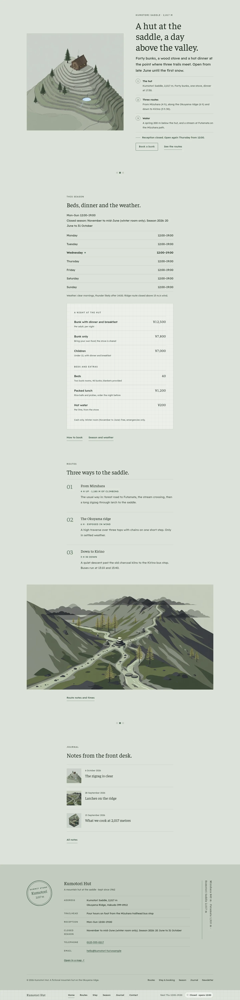
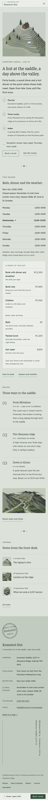

# Kumotori Hut

An organic, serene and technical hospitality theme for a **mountain hut** at a 2,017 m saddle (batch 3 #10).

The demo hut is fictional: forty bunks at Kumotori Saddle on the fictional Okuyama ridge, open from late June to the end of October, reached by three marked routes. It is a hospitality theme, not a shop: no WooCommerce templates or products.

## Concept: the trail map first

- **Palette.** Alpine moss `#DDE2DA` ground, lichen `#C2CBBE` panels and footer, pine ink `#1F2A22` text (11.3:1 on moss). Deep pine `#34503D` for links and buttons (6.8:1 / 5.3:1); quiet moss `#48554B` for secondary text; hut paper `#ECEFE9` for cards. Muted pine `#5C7563` only for numerals, rules and marks.
- **Type.** Faustina (wordmark, headings, numerals, the summit stamp) over Readex Pro (text, bar, labels). Both OFL-1.1, unmodified variable TTFs (Readex Pro carries the RFN "RevReading Lexend").
- **Visual style: 2.5D isometric.** Four raster WebP illustrations from Grok Build image_gen: the saddle as a trail map, the hut, a cutaway bunk room and the ridge routes. No SVG illustration.

## Header, footer, layout (ROADMAP codes)

- **H7 bottom-docked bar**: a slim moss bar at the bottom of the screen like a trail signpost: wordmark, menu (Home, Routes, Stay, Season, Journal, Contact) and a Reception open / Closed chip worked out on the server.
- **F12 summit stamp + vertical text column**: a round, slightly rotated summit stamp (Kumotori · 2,017 m), the address card and a vertical altitude line from the trailhead to the saddle.
- **L10 map / locator first**: the isometric trail map beside the title with a numbered legend (the hut, three routes, water points) and today's reception line, then the season, weather and rates, the three routes and the journal.

## One source for shared details

- **Appearance > Hut details** (`inc/hut-info.php`): reception hours, closed season, weather note, address, trailhead, phone, email.
- **Rates and beds** synced pattern (`inc/shared-info.php`, `inc/info/prices.html`): Home and Stay.
- The demo import (`inc/demo-import.php`) is idempotent and never overwrites user content.

## Pages

Home, Routes, Stay & booking, Season, Journal, Newsletter, Contact; article, category, tag, search and 404 templates. Five journal posts in three categories with six tags.

## Licence

GPL-2.0-or-later. Fonts OFL-1.1 (see `assets/fonts/`). Illustrations AI-generated for this theme, released under GPL-2.0-or-later / CC0. All names, places and rates are fictional.

<!-- screenshots:start -->
## Screenshots

<table>
<tr>
<td valign="top"></td>
<td valign="top"></td>
</tr>
</table>

- Routes: [desktop](screenshots/routes-desktop.webp) · [mobile](screenshots/routes-mobile.webp)
- Stay booking: [desktop](screenshots/stay-booking-desktop.webp) · [mobile](screenshots/stay-booking-mobile.webp)
- Season: [desktop](screenshots/season-desktop.webp) · [mobile](screenshots/season-mobile.webp)
- About: [desktop](screenshots/about-desktop.webp) · [mobile](screenshots/about-mobile.webp)
- News: [desktop](screenshots/news-desktop.webp) · [mobile](screenshots/news-mobile.webp)
- Article: [desktop](screenshots/article-desktop.webp) · [mobile](screenshots/article-mobile.webp)
- Category: [desktop](screenshots/category-desktop.webp) · [mobile](screenshots/category-mobile.webp)
- Tag: [desktop](screenshots/tag-desktop.webp) · [mobile](screenshots/tag-mobile.webp)
- Newsletter: [desktop](screenshots/newsletter-desktop.webp) · [mobile](screenshots/newsletter-mobile.webp)
- Contact: [desktop](screenshots/contact-desktop.webp) · [mobile](screenshots/contact-mobile.webp)
- Search: [desktop](screenshots/search-desktop.webp) · [mobile](screenshots/search-mobile.webp)
<!-- screenshots:end -->
