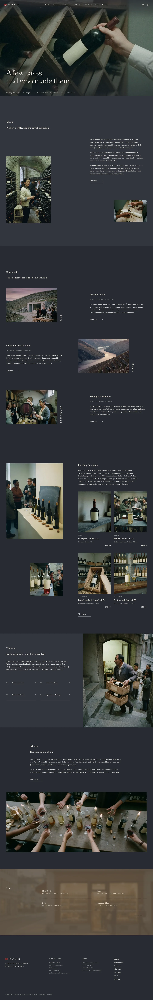

# Kura Wine

WooCommerce store theme for an independent wine merchant: slate-ink ground, umber wash, Fraunces and Karla. The home page has a full-bleed cross-fading film cover under a transparent header, a scattered About, shipments with vertical region titles, bottles, a half-bleed split with hairline rows, the Friday table and an umber visit band. Inner pages (Growers, Shipments, The Case, Tastings, Visit, Delivery) open on a photo band with a vertical label, then scattered text and hairline fact rows. Works without WooCommerce.

## Structure
- `patterns/front-*.php` (home), `patterns/inner-*.php` (inner pages, built by `inc/inner.php`), `visit.php`, `head-bar.php`, `foot-main.php`; `templates/` (`page-photo`, `page-photo-end`, `page-wide`); `inc/i18n/en.php` (theme strings); `demo-content.json`.
- Scroll effects: `assets/sp-scroll.css|js` (unchanged ShipPress copy).
- Photographs are AI-generated film-grain images in `assets/images/`.

Design notes: `brand.md`, `brand/design-spec.md`, `brand/reference.md`. License: GPL-2.0-or-later.

<!-- screenshots:start -->
## Screenshots

<table>
<tr>
<td valign="top"></td>
<td valign="top"></td>
</tr>
</table>

- About: [desktop](screenshots/about-desktop.webp) · [mobile](screenshots/about-mobile.webp)
- News: [desktop](screenshots/news-desktop.webp) · [mobile](screenshots/news-mobile.webp)
- Article: [desktop](screenshots/article-desktop.webp) · [mobile](screenshots/article-mobile.webp)
- Category: [desktop](screenshots/category-desktop.webp) · [mobile](screenshots/category-mobile.webp)
- Tag: [desktop](screenshots/tag-desktop.webp) · [mobile](screenshots/tag-mobile.webp)
- Newsletter: [desktop](screenshots/newsletter-desktop.webp) · [mobile](screenshots/newsletter-mobile.webp)
- Contact: [desktop](screenshots/contact-desktop.webp) · [mobile](screenshots/contact-mobile.webp)
- Shop: [desktop](screenshots/shop-desktop.webp) · [mobile](screenshots/shop-mobile.webp)
- Shipments: [desktop](screenshots/shipments-desktop.webp) · [mobile](screenshots/shipments-mobile.webp)
- The case: [desktop](screenshots/the-case-desktop.webp) · [mobile](screenshots/the-case-mobile.webp)
- Tastings: [desktop](screenshots/tastings-desktop.webp) · [mobile](screenshots/tastings-mobile.webp)
- Visit: [desktop](screenshots/visit-desktop.webp) · [mobile](screenshots/visit-mobile.webp)
- Delivery: [desktop](screenshots/delivery-desktop.webp) · [mobile](screenshots/delivery-mobile.webp)
- Club: [desktop](screenshots/club-desktop.webp) · [mobile](screenshots/club-mobile.webp)
- Other languages (home page): [zh-TW](screenshots/zh-TW/home-desktop.webp) · [ja](screenshots/ja/home-desktop.webp) · [fr](screenshots/fr/home-desktop.webp) · [de](screenshots/de/home-desktop.webp)
<!-- screenshots:end -->
