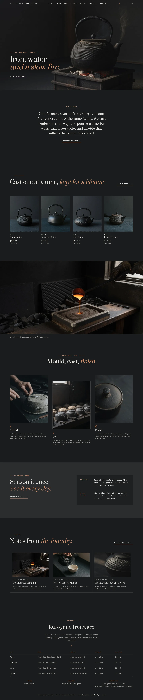
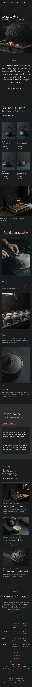

# Kurogane Ironware

A crafted, sculptural block theme for a **small cast-iron kettle foundry** and its online shop. A ShipPress **store** theme: WooCommerce templates styled to match, eight sample products in four categories, and a shop that still works without WooCommerce.

The demo foundry is fictional: the Ubukata family (Genzo, Mio) and Toma Kise, casting iron tea kettles in sand and clay moulds in the hill town of Kanayama since 1931.

## Concept: steam and iron

- **Palette.** Cast-iron charcoal `#1B1C1D` pages, graphite `#2B2D2F` panels, pale stone `#E4E1DB` text (13.1:1 on charcoal) and one muted rust accent `#9A5B3C`, plus cast-iron cards `#222325` and an iron hairline `#3A3C3F`. Muted rust (3.2:1) is kept to rules, numerals and the colophon diamond; links, small labels and italic accents use ember `#C98E6E` (6.2:1 on charcoal, 5.0:1 on graphite), secondary text ash `#A8A49D` (6.9:1 / 5.6:1). Buttons are stone with charcoal text.
- **Type.** Prata (display; the wordmark in spaced capitals) and Radio Canada (text, labels in spaced capitals, tabular figures in the specs).
- **Kettle specs as product attributes.** Line, capacity, weight, size, heat and finish are attributes of each product; capacity and weight print under every price ("1.2 l · 1.8 kg"), from that one source.

## Header, footer, layout (ROADMAP codes)

- **H8 transparent header.** On the home page the header (Prata wordmark, core navigation, account and mini cart when WooCommerce is active) lies transparent over the low-light kettle photograph, with a charcoal scrim from the left, and turns solid charcoal with a hairline as the page scrolls (CSS scroll timeline; `assets/js/header.js` for other browsers; solid at once for reduced motion). Inner pages start solid.
- **F9 colophon footer.** Set like the last page of a book, centred on charcoal: the wordmark, a short statement, a rust diamond, the kettle lines as a ruled table (mould, casting, weight and capacity per line; stacked with small labels on phones), the maker, the foundry and the shop hours as three centred credits, and a fine print line.
- **L1 full-bleed photograph + long pauses.** One kettle on a charcoal brazier, a thin line of steam rising; then, with generous space: the foundry idea in one paragraph, a shelf of four kettles, the pour as a second full-bleed photograph, how a kettle is made (mould, cast, finish), seasoning and care, and the latest journal.

## One source for shared details

| What | Source | Shown on |
| --- | --- | --- |
| Maker, foundry address, shop hours, telephone, email | `inc/info/foundry.html` (synced pattern) | Footer colophon (maker, foundry, hours), The foundry, Contact |
| Seasoning and care note (first use, every day, after use, rust, the outside) | `inc/info/care.html` (synced pattern) | Home (short form), Seasoning & care (full), every product page |
| Kettle lines (mould, casting, weight, capacity) | `inc/info/lines.html` (synced pattern) | Footer colophon, The foundry |
| Capacity and weight line | each product's `Capacity` and `Weight` attributes | Product cards and product page |

## Pages and templates

Demo pages: Home, Shop, The foundry (makers, the casting week, the kettle lines, the shop and tea room), Seasoning & care (the synced care note, what iron does not like, sending a kettle), Journal (posts page), Newsletter and Contact. Six sample posts in three categories (At the foundry, Iron at the table, Notes from Kanayama) with six tags.

Templates: front page, page, wide page, single post, journal, archive, category, tag, search, 404, plus WooCommerce shop, product category and tag archives, product, cart, checkout, my account, order confirmation and product search.

## WooCommerce

Optional. With it active, `inc/woo-import.php` adds four product categories (Kettles, Teapots, Braziers & trivets, Kitchen iron), five tags and eight products with photographs, prices and attributes; run twice it creates nothing new. Without it the home shelf and the Shop page show a static shelf that links to Contact, and orders go by email.

## Licence

GPL-2.0-or-later. Fonts OFL-1.1 (see `assets/fonts/`): Prata and Radio Canada, both subset to Latin (no Reserved Font Name). Photographs AI-generated for this theme with Grok Build, released under GPL-2.0-or-later / CC0.

<!-- screenshots:start -->
## Screenshots

<table>
<tr>
<td valign="top"></td>
<td valign="top"></td>
</tr>
</table>

- Shop: [desktop](screenshots/shop-desktop.webp) · [mobile](screenshots/shop-mobile.webp)
- Product: [desktop](screenshots/product-desktop.webp) · [mobile](screenshots/product-mobile.webp)
- About: [desktop](screenshots/about-desktop.webp) · [mobile](screenshots/about-mobile.webp)
- Seasoning and care: [desktop](screenshots/seasoning-and-care-desktop.webp) · [mobile](screenshots/seasoning-and-care-mobile.webp)
- Contact: [desktop](screenshots/contact-desktop.webp) · [mobile](screenshots/contact-mobile.webp)
- News: [desktop](screenshots/news-desktop.webp) · [mobile](screenshots/news-mobile.webp)
- Article: [desktop](screenshots/article-desktop.webp) · [mobile](screenshots/article-mobile.webp)
- Category: [desktop](screenshots/category-desktop.webp) · [mobile](screenshots/category-mobile.webp)
- Tag: [desktop](screenshots/tag-desktop.webp) · [mobile](screenshots/tag-mobile.webp)
- Newsletter: [desktop](screenshots/newsletter-desktop.webp) · [mobile](screenshots/newsletter-mobile.webp)
- Search: [desktop](screenshots/search-desktop.webp) · [mobile](screenshots/search-mobile.webp)
<!-- screenshots:end -->
