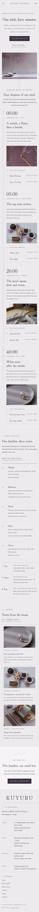

# Kuyuru Incense

A serene, restrained block theme for a **small incense house** that sells hand-rolled sticks and cones. A ShipPress **store** theme: WooCommerce templates styled to match, eight sample products in five scent families, and a shop page that still works without WooCommerce.

*Kuyuru* (to smoulder). The demo house is a fictional narrow shop in Higashiyama, Kyoto, run by Haru Ōmine and Sei Tachibana.

## Concept: one stick, forty minutes

- **Wisteria smoke, mist, ink plum.** Ground `#EDEAEE`, mist `#CFC8D2` for panels and rules, ink plum `#3B3340` for text and the dark band. One muted plum accent `#7A6483` only for small marks, nodes, the smoke hairlines and active states; links and accent text use the deeper `#614D69` (6.4:1 on the ground), quiet text `#5F5664` (5.9:1); the accent itself is 4.4:1, so it never carries small text.
- **Type.** Hina Mincho (display: headings, minute marks, the wordmark, product names) and Red Hat Text (text, labels, menu, buttons). Both OFL-1.1 from google/fonts, Latin WOFF2 subsets bundled, no CDN.
- **Signature: the burn-time timeline.** The home page follows ONE stick through its forty minutes as a chaptered scroll — 00:00 Lit, 05:00 First note, 20:00 Heart, 40:00 Ash — each chapter with a sticky minute mark, short copy, a photograph and the blends that fit that minute. A thin smoke-curl hairline (inline SVG, 1px, non-scaling stroke) runs down the axis between the chapters and drifts a couple of pixels; under `prefers-reduced-motion` it is still.
- No entrance animations, no hand-drawn illustrations.

## Header, footer, layout (ROADMAP codes)

- **H2 centred split header.** The wordmark sits on the page axis; the menu is split, three links left and three right, with the account link and mini cart at the right end when WooCommerce is active (Block Hooks). Between 600 and 1099 px the wordmark takes its own centred row over the menu; on phones: menu button left, wordmark centre, cart right, the core overlay on the smoke ground.
- **F1 giant wordmark footer.** KUYURU set large in Hina Mincho (an editable paragraph) over a ruled grid with a one-line note, the synced house details and a small vertical sitemap.
- **L12 timeline / chaptered scroll.** See above. The combination H2 + F1 + L12 is not used by any other theme.

## One source for shared details

| Synced pattern | Source | Shown on |
|---|---|---|
| House address, hours, shipping note, email | `inc/info/house.html` | footer (every page), contact (and the optional visit-band pattern) |
| Scent-notes legend (top, heart, base) | `inc/info/notes.html` | home (families), scent guide |
| The shelf: eight products, prices, the editable "House favourite" badge | `inc/info/shelf.html` | shop (without WooCommerce) |

Each is a synced pattern (`wp_block`) created on activation by `inc/shared-info.php`, tagged `_kuyuru_incense_info` and never created twice.

## Pages and templates

Demo pages: Home, Shop, Scent guide (five families, the notes legend), How to burn (four steps, safety), About, Journal (posts page) and Contact. Six sample posts in three categories (Rituals, Materials, From the house) with six tags.

Templates: front-page, page, page-wide, home, index, single, archive, category, tag, search and 404; for WooCommerce archive-product, single-product, page-cart, page-checkout, page-my-account, order-confirmation and product-search-results (search via core/search limited to products), plus a checkout header part.

## WooCommerce

Optional. With it active, `inc/woo-import.php` adds five product categories (Woody, Resinous, Floral, Spice, Green), seven tags and eight products with photographs, prices and top/heart/base notes; run twice it creates nothing new. Without it the Shop page shows the synced shelf and orders go by email.

## Licence

GPL-2.0-or-later. Fonts OFL-1.1 (see `assets/fonts/`). Photographs AI-generated for this theme, released under GPL-2.0-or-later / CC0.

<!-- screenshots:start -->
## Screenshots

<table>
<tr>
<td valign="top"></td>
<td valign="top"></td>
</tr>
</table>

- Shop: [desktop](screenshots/shop-desktop.webp) · [mobile](screenshots/shop-mobile.webp)
- Product: [desktop](screenshots/product-desktop.webp) · [mobile](screenshots/product-mobile.webp)
- Scent guide: [desktop](screenshots/scent-guide-desktop.webp) · [mobile](screenshots/scent-guide-mobile.webp)
- How to burn: [desktop](screenshots/how-to-burn-desktop.webp) · [mobile](screenshots/how-to-burn-mobile.webp)
- About: [desktop](screenshots/about-desktop.webp) · [mobile](screenshots/about-mobile.webp)
- Contact: [desktop](screenshots/contact-desktop.webp) · [mobile](screenshots/contact-mobile.webp)
- News: [desktop](screenshots/news-desktop.webp) · [mobile](screenshots/news-mobile.webp)
- Article: [desktop](screenshots/article-desktop.webp) · [mobile](screenshots/article-mobile.webp)
- Category: [desktop](screenshots/category-desktop.webp) · [mobile](screenshots/category-mobile.webp)
- Tag: [desktop](screenshots/tag-desktop.webp) · [mobile](screenshots/tag-mobile.webp)
- Newsletter: [desktop](screenshots/newsletter-desktop.webp) · [mobile](screenshots/newsletter-mobile.webp)
- Search: [desktop](screenshots/search-desktop.webp) · [mobile](screenshots/search-mobile.webp)
<!-- screenshots:end -->
