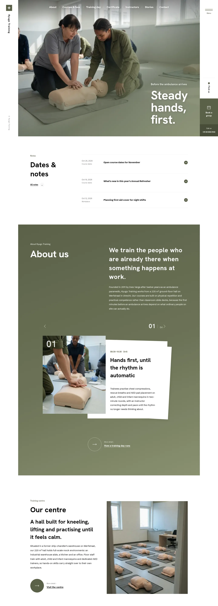

# Kyugo Training

A calm block theme (type business) for a workplace first-aid training centre or vocational school. Home page and plain inner pages (English) in this release; fuller inner pages and other languages follow.

## Signature
- Two fixed white side rails (vertical name, menu lines, Book a group tile) frame a 1200px photo stage.
- Three-photo crossfade hero with an olive corner wash and a three-line statement.
- Stacked-paper card stack telling the training day in four stages.

## Patterns
- `header-rails`, `header-book`, `footer-main`
- `home-hero`, `home-notes`, `home-about`, `home-centre`, `home-courses`, `home-data`, `home-instructors`, `home-stories`, `home-book`

## Fonts
Hanken Grotesk and Schibsted Grotesk (SIL OFL 1.1, licences in assets/fonts).

## Images (AI-generated for this theme, no text or logos; assets/images/)
p01–p18 (.webp), notes use assets/images/demo/.

<!-- screenshots:start -->
## Screenshots

<table>
<tr>
<td valign="top"></td>
<td valign="top"></td>
</tr>
</table>

- About: [desktop](screenshots/about-desktop.webp) · [mobile](screenshots/about-mobile.webp)
- Courses: [desktop](screenshots/courses-desktop.webp) · [mobile](screenshots/courses-mobile.webp)
- Training day: [desktop](screenshots/training-day-desktop.webp) · [mobile](screenshots/training-day-mobile.webp)
- Certificate: [desktop](screenshots/certificate-desktop.webp) · [mobile](screenshots/certificate-mobile.webp)
- Instructors: [desktop](screenshots/instructors-desktop.webp) · [mobile](screenshots/instructors-mobile.webp)
- Stories: [desktop](screenshots/stories-desktop.webp) · [mobile](screenshots/stories-mobile.webp)
- Faq: [desktop](screenshots/faq-desktop.webp) · [mobile](screenshots/faq-mobile.webp)
- Contact: [desktop](screenshots/contact-desktop.webp) · [mobile](screenshots/contact-mobile.webp)
- Book a group: [desktop](screenshots/book-a-group-desktop.webp) · [mobile](screenshots/book-a-group-mobile.webp)
- Notes: [desktop](screenshots/notes-desktop.webp) · [mobile](screenshots/notes-mobile.webp)
- News: [desktop](screenshots/news-desktop.webp) · [mobile](screenshots/news-mobile.webp)
- Article: [desktop](screenshots/article-desktop.webp) · [mobile](screenshots/article-mobile.webp)
- Category: [desktop](screenshots/category-desktop.webp) · [mobile](screenshots/category-mobile.webp)
- Tag: [desktop](screenshots/tag-desktop.webp) · [mobile](screenshots/tag-mobile.webp)
- Newsletter: [desktop](screenshots/newsletter-desktop.webp) · [mobile](screenshots/newsletter-mobile.webp)
- Other languages (home page): [zh-TW](screenshots/zh-TW/home-desktop.webp) · [ja](screenshots/ja/home-desktop.webp) · [fr](screenshots/fr/home-desktop.webp) · [de](screenshots/de/home-desktop.webp)
<!-- screenshots:end -->
