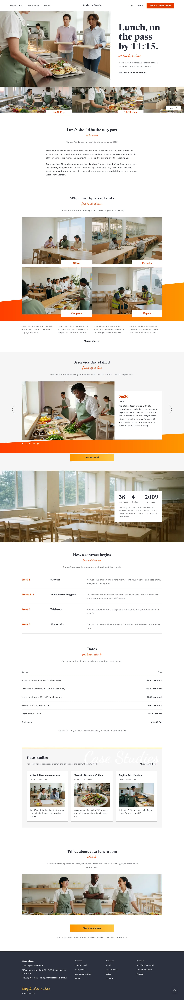

# Mahora Foods

A calm serif WordPress theme for a staff-cafeteria contractor: a photo-led hero with a tabbed strip beneath it, abutting workplace photo tiles with overlapping white label tabs over an orange wedge, a service-day slideshow panel, contract rows and a plain rate table.

## Structure
- `patterns/front-*.php`: the home sections (hero and strip, welcome, workplace tiles, service-day slideshow, floor band, contract rows, rates, case studies, close).
- `patterns/page-*.php`: the eleven inner pages (How we work, Workplaces, Menus, Lunchroom sites, Case studies, Starting a contract, Rates, About, Notes, Contact, Privacy), shown with the `page-inner` template; the main menu links to real pages.
- `templates/`: block templates; `parts/`: header and footer.
- `demo-content.json`: sample content (en).
- Photos: `assets/images/` (AI-generated, GPL-2.0-or-later / CC0).
- Scroll effects: `assets/sp-scroll.css`, `assets/sp-scroll.js`; slideshow: `assets/mahora-slides.js`.

Newsreader is bundled as a variable font covering weights 300–800 (Latin subset).

Design notes: `brand.md`, `brand/design-spec.md`, `brand/reference.md`.

License: GPL-2.0-or-later.

<!-- screenshots:start -->
## Screenshots

<table>
<tr>
<td valign="top"></td>
<td valign="top"></td>
</tr>
</table>

- How we work: [desktop](screenshots/how-we-work-desktop.webp) · [mobile](screenshots/how-we-work-mobile.webp)
- Workplaces: [desktop](screenshots/workplaces-desktop.webp) · [mobile](screenshots/workplaces-mobile.webp)
- Menus: [desktop](screenshots/menus-desktop.webp) · [mobile](screenshots/menus-mobile.webp)
- Sites: [desktop](screenshots/sites-desktop.webp) · [mobile](screenshots/sites-mobile.webp)
- Case studies: [desktop](screenshots/case-studies-desktop.webp) · [mobile](screenshots/case-studies-mobile.webp)
- Starting: [desktop](screenshots/starting-desktop.webp) · [mobile](screenshots/starting-mobile.webp)
- Rates: [desktop](screenshots/rates-desktop.webp) · [mobile](screenshots/rates-mobile.webp)
- About: [desktop](screenshots/about-desktop.webp) · [mobile](screenshots/about-mobile.webp)
- Notes: [desktop](screenshots/notes-desktop.webp) · [mobile](screenshots/notes-mobile.webp)
- Contact: [desktop](screenshots/contact-desktop.webp) · [mobile](screenshots/contact-mobile.webp)
- Privacy: [desktop](screenshots/privacy-desktop.webp) · [mobile](screenshots/privacy-mobile.webp)
- News: [desktop](screenshots/news-desktop.webp) · [mobile](screenshots/news-mobile.webp)
- Article: [desktop](screenshots/article-desktop.webp) · [mobile](screenshots/article-mobile.webp)
- Category: [desktop](screenshots/category-desktop.webp) · [mobile](screenshots/category-mobile.webp)
- Tag: [desktop](screenshots/tag-desktop.webp) · [mobile](screenshots/tag-mobile.webp)
- Newsletter: [desktop](screenshots/newsletter-desktop.webp) · [mobile](screenshots/newsletter-mobile.webp)
- Other languages (home page): [zh-TW](screenshots/zh-TW/home-desktop.webp) · [ja](screenshots/ja/home-desktop.webp) · [fr](screenshots/fr/home-desktop.webp) · [de](screenshots/de/home-desktop.webp)
<!-- screenshots:end -->
