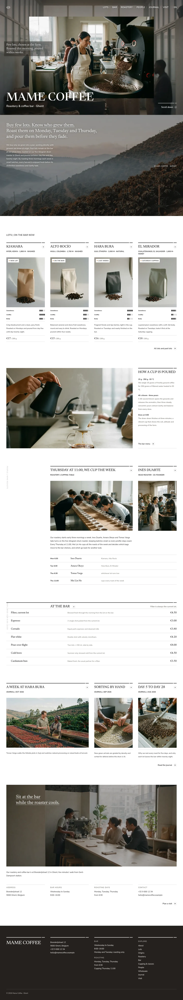

# Mame Coffee

An editorial block theme for a **small specialty coffee roastery and bar**: one 5 kg drum roaster, six green lots a year, four on the bar at a time, each poured between day 5 and day 28 after roasting.

The demo roastery is fictional (Ghent, founded 2019 by Ines Duarte and Tomas Varga). The whole brand is written down in [`brand.md`](brand.md); every page's copy comes from it. Type: hospitality. The English home page and ten inner pages (about, lots, bar, roastery, origins, people, cupping, wholesale, visit, journal) plus a sample article are in; zh-TW, ja, fr and de follow.

## Concept: a window onto the roastery

- **Framed window.** A sharp, square-cornered photograph (68 % of the width, 982 : 640) floats over a full-bleed photograph of the roastery hall; the wordmark crosses its lower-left corner. The backdrop drifts slower than the page (`sp-parallax`, 10 %), and on scroll (≥960 px, CSS scroll-driven) the window grows to 1.08× and rises 50 px so the backdrop fills the screen.
- **Rule-topped columns.** A 3 px `#1D1D1D` rule with a small break near its right end, a caps Newsreader title with a 24 px round outline arrow, a `#E8E8E8` panel with a white chip, and Sweetness / Acidity / Body block bars.
- **Side label and hairlines.** A rotated grey label in its own column, a wide photograph over three of four columns beside a narrow ruled stanza column, and 1 px `#C8C8C8` rows for schedules, prices and visiting details.
- **Palette.** White page, ink `#1D1D1D`, panel `#E8E8E8`, hairline `#C8C8C8`, black oak `#3F3834` for UI, deep roast `#26211E` for overlays and the footer, copper `#B8793E` only as a chip dot. The photographs carry the colour.
- **Type.** Newsreader (headings, wordmark, prices) over Nunito Sans (text), both OFL-1.1, bundled as Latin WOFF2.

## Front page

1. **Hero**: the framed window, the wordmark, an underlined lede on a dark translucent backing for legibility, and a scroll cue.
2. **Statement**: the origin slope at dawn with an underlined three-line statement (parallax).
3. **Lots**: four rule-topped columns with bag panels, chips, rating bars and prices.
4. **Pour**: the recipe in three stanzas beside a wide photograph (wipe reveal).
5. **People**: who roasts which morning, a wide cupping-table card and a narrow head-roaster card, with schedule rows.
6. **Bar**: the full-width hairline price list.
7. **Stories**: one wide and two narrow journal columns.
8. **Visit**: a contained photograph with a statement and four info columns.

## Inner pages

Each page opens with the smaller framed window (`mc_pagehead()`: backdrop photograph, a sharp 56 % frame offset right, the title crossing its lower-left corner) and ends with a rule, one line and a round arrow link. Bodies reuse the rule-topped columns (lots, origins, people, cupping, wholesale), the rotated side label with hairline story, price, spec and schedule rows (about, bar, past lots, origins, people, wholesale, visit) and full-width `sp-parallax` photograph bands (Lots, Roastery). The journal index and archives use `home.html` / `archive.html` with a post grid (one wide card, then narrow ones); a single post sits on a deep-roast band with its photograph as a frame and the title crossing it. Price lists use a fixed price column at ≥782 px and stack on phones.

## Scroll effects

`assets/sp-scroll.css` and `assets/sp-scroll.js` (ShipPress sp-scroll): `sp-parallax` on the hero and statement backdrops and on the Roastery and Lots photograph bands, `sp-stagger` + `sp-reveal--up` on the card columns, `sp-reveal--wipe` on the pour photograph. Off with reduced motion, without JavaScript, in the editor and with `?sp-static`.

## Files

`theme.json`, `style.css`, `functions.php`, `parts/` (header, footer), `templates/`, `patterns/` (`front-*` home sections, `page-*` inner pages, `journal-*`), `inc/` (demo import, strings, helpers), `demo-content.json`, `brand/` (reference notes and design spec).

<!-- screenshots:start -->
## Screenshots

<table>
<tr>
<td valign="top"></td>
<td valign="top"></td>
</tr>
</table>

- About: [desktop](screenshots/about-desktop.webp) · [mobile](screenshots/about-mobile.webp)
- Lots: [desktop](screenshots/lots-desktop.webp) · [mobile](screenshots/lots-mobile.webp)
- Bar: [desktop](screenshots/bar-desktop.webp) · [mobile](screenshots/bar-mobile.webp)
- Roastery: [desktop](screenshots/roastery-desktop.webp) · [mobile](screenshots/roastery-mobile.webp)
- Origins: [desktop](screenshots/origins-desktop.webp) · [mobile](screenshots/origins-mobile.webp)
- People: [desktop](screenshots/people-desktop.webp) · [mobile](screenshots/people-mobile.webp)
- Cupping: [desktop](screenshots/cupping-desktop.webp) · [mobile](screenshots/cupping-mobile.webp)
- Wholesale: [desktop](screenshots/wholesale-desktop.webp) · [mobile](screenshots/wholesale-mobile.webp)
- Visit: [desktop](screenshots/visit-desktop.webp) · [mobile](screenshots/visit-mobile.webp)
- Journal: [desktop](screenshots/journal-desktop.webp) · [mobile](screenshots/journal-mobile.webp)
- News: [desktop](screenshots/news-desktop.webp) · [mobile](screenshots/news-mobile.webp)
- Article: [desktop](screenshots/article-desktop.webp) · [mobile](screenshots/article-mobile.webp)
- Category: [desktop](screenshots/category-desktop.webp) · [mobile](screenshots/category-mobile.webp)
- Tag: [desktop](screenshots/tag-desktop.webp) · [mobile](screenshots/tag-mobile.webp)
- Newsletter: [desktop](screenshots/newsletter-desktop.webp) · [mobile](screenshots/newsletter-mobile.webp)
- Contact: [desktop](screenshots/contact-desktop.webp) · [mobile](screenshots/contact-mobile.webp)
- Other languages (home page): [zh-TW](screenshots/zh-TW/home-desktop.webp) · [ja](screenshots/ja/home-desktop.webp) · [fr](screenshots/fr/home-desktop.webp) · [de](screenshots/de/home-desktop.webp)
<!-- screenshots:end -->
