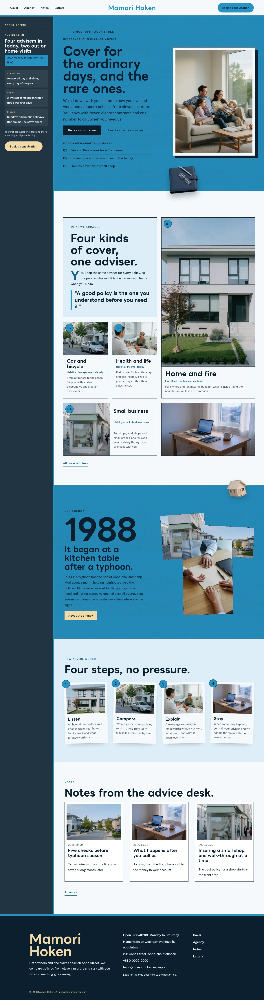

# Mamori Hoken

Mamori Hoken — an independent insurance agency theme laid out like an app: under a formal top header, a night-ink sidebar holds the synced office board (advisers in today, hours, claims line, reply time, closed days and a Book a consultation button) and stays beside the page while it scrolls. The header splits the menu around the centred agency name, with the Book a consultation button at its end. Hanada (#2792C3), the clear indigo-washed blue of traditional Japanese dyeing, is the main colour: the hero, the story band and every page head are hanada fields set in night ink, textured with a faint linen texture. The hero is text left, art right: the title, lead, buttons and this month's questions on the field, a framed photograph of a young family on a sofa on the right, and a cut-out document folder with pen and glasses (transparent WebP) that breaks out over the frame and the hero bottom edge; a cut-out house model breaks over the story band and every page head. Every picture is a realistic, neutral photograph. LINE Seed JP for display, Public Sans for reading, Noto Sans TC for Traditional Chinese headings. Sample content in English, Traditional Chinese, Japanese, French and German; vertical labels only in Chinese and Japanese. WCAG AA colours; no entrance animations.

- Design plan row b5-1: sidebar-app, text-left-art-right hero, split nav, pattern-texture (real-photography), hanada #2792C3, LINE Seed JP + Public Sans.
- Sample content languages: en, zh-TW, ja, fr, de.
- Contrast: night ink #0B1F2E on hanada #2792C3 4.8:1 (all text on the hero, the story band, every page head, the hanada overlay menu and hanada buttons; the linen texture is lightened 45% so it stays a faint texture); paper #F5F9FC on night ink 15.9:1 (sidebar, footer, ink buttons); sand #F2D9A6 on night ink 12.2:1 (sidebar and footer labels); deep hanada #155F87 on paper 6.6:1 (links, eyebrows); slate #46586A on paper 6.9:1 (secondary text); white on hanada 3.5:1 is used for nothing.
- Break-frame: the cut-out document folder (transparent WebP) breaks out over the framed hero photo and the hero bottom edge; the cut-out house model breaks over the story band and page heads.

<!-- screenshots:start -->
## Screenshots

<table>
<tr>
<td valign="top"></td>
<td valign="top"></td>
</tr>
</table>

- Services: [desktop](screenshots/services-desktop.webp) · [mobile](screenshots/services-mobile.webp)
- About: [desktop](screenshots/about-desktop.webp) · [mobile](screenshots/about-mobile.webp)
- News: [desktop](screenshots/news-desktop.webp) · [mobile](screenshots/news-mobile.webp)
- Article: [desktop](screenshots/article-desktop.webp) · [mobile](screenshots/article-mobile.webp)
- Category: [desktop](screenshots/category-desktop.webp) · [mobile](screenshots/category-mobile.webp)
- Tag: [desktop](screenshots/tag-desktop.webp) · [mobile](screenshots/tag-mobile.webp)
- Newsletter: [desktop](screenshots/newsletter-desktop.webp) · [mobile](screenshots/newsletter-mobile.webp)
- Contact: [desktop](screenshots/contact-desktop.webp) · [mobile](screenshots/contact-mobile.webp)
- Search: [desktop](screenshots/search-desktop.webp) · [mobile](screenshots/search-mobile.webp)
- Other languages (home page): [zh-TW](screenshots/zh-TW/home-desktop.webp) · [ja](screenshots/ja/home-desktop.webp) · [fr](screenshots/fr/home-desktop.webp) · [de](screenshots/de/home-desktop.webp)
<!-- screenshots:end -->
