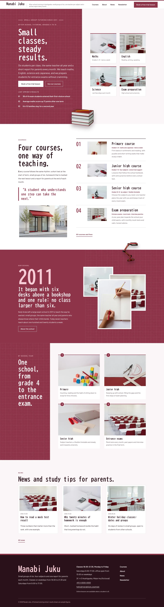
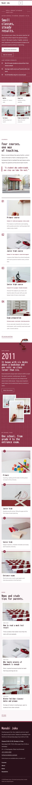

# Manabi Juku

Manabi Juku — a theme for an after-school tutoring school (cram school), laid out as split screens under a formal white top header with a suou rule: the school name and tagline on the left, the menu across the middle of the bar and a Book a free trial lesson button on the right (an overlay menu on phones). Suou crimson (#8E354A) is the main colour, textured with a fine white grid-paper pattern: the left half of the hero, the school-year half, the story band and every page head are crimson fields in white type. The hero is a product grid in a split screen: the title, lead, buttons and last spring's results on the crimson half, four course tiles (maths, English, science, exam preparation) on the paper half, and a cut-out stack of books (transparent WebP) sitting on the seam and breaking past the hero bottom edge; a cut-out desk lamp breaks over the story band and every page head. The courses run as ruled rows beside a sticky intro, and the school years as a grid beside a crimson heading half. Every picture is a realistic high-key photograph of a modern, international school setting. BIZ UDGothic for display, Barlow for reading, Noto Sans TC for Traditional Chinese headings. Sample content in English, Traditional Chinese, Japanese, French and German; vertical labels only in Chinese and Japanese. WCAG AA colours; no entrance animations.

- Design plan row b5-4: split-screen, product-grid-hero, top-bar nav, pattern-texture, illustration 3d-clay converted to high-key photographs, suou #8E354A, BIZ UDGothic + Barlow.
- Sample content languages: en, zh-TW, ja, fr, de.
- Contrast: white on suou #8E354A 7.6:1 (all text on the hero half, the school-year half, the story band, every page head, the overlay menu and crimson buttons); pale pink #F6CCD6 on suou 5.3:1 (eyebrows, the issue line, the opening year); suou on white 7.6:1 and on paper #FBF6F7 7.1:1 (row numbers, the pull quote, links in the menu); ink #2A1219 on paper 16.4:1 and on white 17.5:1; deep crimson #6E2236 on paper 10.1:1 and on mist #F4E6EA 8.9:1 (links, labels, facts); quiet #5E474D on paper 7.9:1 and on white 8.5:1 (tile meta, secondary text); pale pink on ink 12.1:1 and white on ink 17.5:1 (footer, vertical label); ink on suou only 2.3:1, never used for text.
- Break-frame: the cut-out stack of books (transparent WebP) sits on the split-screen seam and breaks past the hero bottom edge; the cut-out desk lamp breaks over the story band and page heads.

<!-- screenshots:start -->
## Screenshots

<table>
<tr>
<td valign="top"></td>
<td valign="top"></td>
</tr>
</table>

- Services: [desktop](screenshots/services-desktop.webp) · [mobile](screenshots/services-mobile.webp)
- About: [desktop](screenshots/about-desktop.webp) · [mobile](screenshots/about-mobile.webp)
- News: [desktop](screenshots/news-desktop.webp) · [mobile](screenshots/news-mobile.webp)
- Article: [desktop](screenshots/article-desktop.webp) · [mobile](screenshots/article-mobile.webp)
- Category: [desktop](screenshots/category-desktop.webp) · [mobile](screenshots/category-mobile.webp)
- Tag: [desktop](screenshots/tag-desktop.webp) · [mobile](screenshots/tag-mobile.webp)
- Newsletter: [desktop](screenshots/newsletter-desktop.webp) · [mobile](screenshots/newsletter-mobile.webp)
- Contact: [desktop](screenshots/contact-desktop.webp) · [mobile](screenshots/contact-mobile.webp)
- Search: [desktop](screenshots/search-desktop.webp) · [mobile](screenshots/search-mobile.webp)
- Other languages (home page): [zh-TW](screenshots/zh-TW/home-desktop.webp) · [ja](screenshots/ja/home-desktop.webp) · [fr](screenshots/fr/home-desktop.webp) · [de](screenshots/de/home-desktop.webp)
<!-- screenshots:end -->
