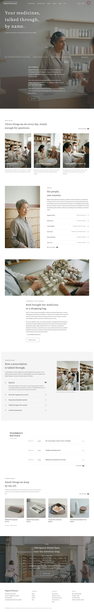

# Megumi Pharmacy

A calm block theme (type store, WooCommerce-compatible, works without it) for an independent community pharmacy. English in this release; zh-TW, ja, fr and de follow.

## Signature
- One full-bleed film-grain photograph is the stage for the hero and the introduction; the white page slides up over it (sp-parallax).
- Three 0.77 portrait link cards with the label inside the photograph, bottom left.
- Numbered rows 01-05 with hairlines on a pale inset panel beside a 3:4 photograph.
- Inner pages reuse them: a photograph band with the title, numbered rows on the panel, hairline fee lists.

## Pages (demo content)
Home, Prescriptions, Services & fees, Medicine reviews, Vaccinations & travel, People, About, Visit, Shop, Stories (posts page). The header menu links to Prescriptions, Services & fees, People, Stories, Shop and Visit.

## Patterns
`front-stage`, `front-ways`, `front-people`, `front-story`, `front-process`, `front-notices`, `front-shelf`, `front-visit`.

## Fonts
Literata and Public Sans (SIL OFL 1.1, licences in assets/fonts).

## Images
AI-generated for this theme (no text or logos): see readme.txt.

<!-- screenshots:start -->
## Screenshots

<table>
<tr>
<td valign="top"></td>
<td valign="top"></td>
</tr>
</table>

- Prescriptions: [desktop](screenshots/prescriptions-desktop.webp) · [mobile](screenshots/prescriptions-mobile.webp)
- Services: [desktop](screenshots/services-desktop.webp) · [mobile](screenshots/services-mobile.webp)
- Medicine reviews: [desktop](screenshots/medicine-reviews-desktop.webp) · [mobile](screenshots/medicine-reviews-mobile.webp)
- Vaccinations: [desktop](screenshots/vaccinations-desktop.webp) · [mobile](screenshots/vaccinations-mobile.webp)
- People: [desktop](screenshots/people-desktop.webp) · [mobile](screenshots/people-mobile.webp)
- About: [desktop](screenshots/about-desktop.webp) · [mobile](screenshots/about-mobile.webp)
- Visit: [desktop](screenshots/visit-desktop.webp) · [mobile](screenshots/visit-mobile.webp)
- Shop: [desktop](screenshots/shop-desktop.webp) · [mobile](screenshots/shop-mobile.webp)
- Stories: [desktop](screenshots/stories-desktop.webp) · [mobile](screenshots/stories-mobile.webp)
- News: [desktop](screenshots/news-desktop.webp) · [mobile](screenshots/news-mobile.webp)
- Article: [desktop](screenshots/article-desktop.webp) · [mobile](screenshots/article-mobile.webp)
- Category: [desktop](screenshots/category-desktop.webp) · [mobile](screenshots/category-mobile.webp)
- Tag: [desktop](screenshots/tag-desktop.webp) · [mobile](screenshots/tag-mobile.webp)
- Newsletter: [desktop](screenshots/newsletter-desktop.webp) · [mobile](screenshots/newsletter-mobile.webp)
- Contact: [desktop](screenshots/contact-desktop.webp) · [mobile](screenshots/contact-mobile.webp)
- Other languages (home page): [zh-TW](screenshots/zh-TW/home-desktop.webp) · [ja](screenshots/ja/home-desktop.webp) · [fr](screenshots/fr/home-desktop.webp) · [de](screenshots/de/home-desktop.webp)
<!-- screenshots:end -->
