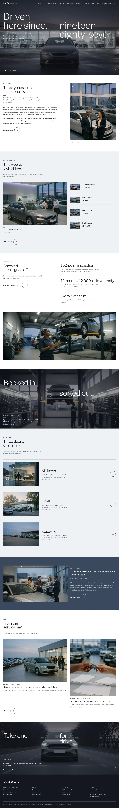

# Michi Motors

Michi Motors — a WooCommerce store theme for a family car dealership. Full-bleed dimmed front-on car photographs under a transparent, wide-tracked uppercase menu with a divider before TEST DRIVE; a big light four-line headline staggered across the left and right halves; a short crimson rule with a three-line lead; and a 66 px outline ring arrow ending every section. Graphite, steel and mist with one signal crimson used only for tiny marks. The home page runs from the dimmed cover through the family story, a featured-car forecourt ledger, three approved-used statements, a full-bleed service band, three location rows, the team on a steel band and the journal to a test-drive close. The same three techniques head every inner page: New Cars, single vehicle, Approved Used, Service, Locations, Our Team, Finance and Warranty, Test Drive, Contact, About, the journal, cart, checkout and account. Libre Franklin and Gelasio. Sample content and vehicles in English, Traditional Chinese, Japanese, French and German. Works without WooCommerce. WCAG AA colours; no entrance animations.

## Structure
- `patterns/front-*.php`: the nine home sections (cover, family, forecourt, checked, service, locations, floor, journal, close).
- `patterns/*-head.php`, `*-main.php`: the inner pages (New Cars, Approved Used, Service, Locations, Our Team, Finance, Test Drive, Contact, About, Journal); `tpl-*.php`: store, archive, search, 404 and single-entry heads.
- `templates/`: block templates including the WooCommerce ones (archive-product, single-product, cart, checkout, my account, order confirmation, product search).
- `inc/i18n/<lang>.php`: theme strings in five languages; `demo-content*.json`: sample content and vehicles in five languages.
- Photos: `assets/images/demo/` (AI-generated, GPL-2.0-or-later / CC0). See `readme.txt` for the list.

Design notes: `brand.md`, `brand/design-spec.md`, `brand/reference.md`.

License: GPL-2.0-or-later.

<!-- screenshots:start -->
## Screenshots

<table>
<tr>
<td valign="top"></td>
<td valign="top"></td>
</tr>
</table>

- New cars: [desktop](screenshots/new-cars-desktop.webp) · [mobile](screenshots/new-cars-mobile.webp)
- Vehicle: [desktop](screenshots/vehicle-desktop.webp) · [mobile](screenshots/vehicle-mobile.webp)
- Approved used: [desktop](screenshots/approved-used-desktop.webp) · [mobile](screenshots/approved-used-mobile.webp)
- Service: [desktop](screenshots/service-desktop.webp) · [mobile](screenshots/service-mobile.webp)
- Locations: [desktop](screenshots/locations-desktop.webp) · [mobile](screenshots/locations-mobile.webp)
- Team: [desktop](screenshots/team-desktop.webp) · [mobile](screenshots/team-mobile.webp)
- Finance: [desktop](screenshots/finance-desktop.webp) · [mobile](screenshots/finance-mobile.webp)
- Test drive: [desktop](screenshots/test-drive-desktop.webp) · [mobile](screenshots/test-drive-mobile.webp)
- Contact: [desktop](screenshots/contact-desktop.webp) · [mobile](screenshots/contact-mobile.webp)
- About: [desktop](screenshots/about-desktop.webp) · [mobile](screenshots/about-mobile.webp)
- News: [desktop](screenshots/news-desktop.webp) · [mobile](screenshots/news-mobile.webp)
- Article: [desktop](screenshots/article-desktop.webp) · [mobile](screenshots/article-mobile.webp)
- Category: [desktop](screenshots/category-desktop.webp) · [mobile](screenshots/category-mobile.webp)
- Search: [desktop](screenshots/search-desktop.webp) · [mobile](screenshots/search-mobile.webp)
- Tag: [desktop](screenshots/tag-desktop.webp) · [mobile](screenshots/tag-mobile.webp)
- Newsletter: [desktop](screenshots/newsletter-desktop.webp) · [mobile](screenshots/newsletter-mobile.webp)
- Other languages (home page): [zh-TW](screenshots/zh-TW/home-desktop.webp) · [ja](screenshots/ja/home-desktop.webp) · [fr](screenshots/fr/home-desktop.webp) · [de](screenshots/de/home-desktop.webp)
<!-- screenshots:end -->
