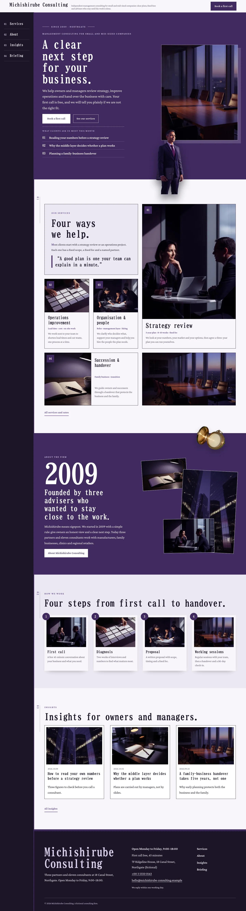
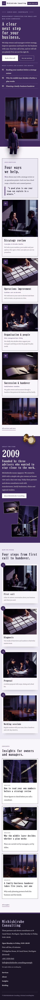

# Michishirube Consulting

Michishirube Consulting — a management consulting firm theme set as a vertical scroll in the tategaki manner: under a formal top header (firm name, tagline and a Book a first call button), the menu leaves the bar on wide screens and becomes a fixed night-violet side rail down the left edge with numbered entries (in Chinese and Japanese the entries and section titles run top to bottom; English, French and German always run horizontally). Shikon (#3F2A5E), the deep blue-violet of traditional Japanese dyeing, is the main colour: the hero, the story band and every page head are shikon fields set in white. The hero is a cut-out object breaking its frame: the title, lead and buttons on the left, a framed low-key photograph of an empty boardroom at dusk on the right, and a cut-out consultant (transparent WebP) standing over the frame's corner and dropping past the hero bottom edge; a cut-out brass compass breaks over the story band and every page head. Every picture is a realistic low-key photograph (50mm f/1.4, one hard window light, deep shadows) of a modern, international office. BIZ UDMincho for display, Crimson Pro for reading, Noto Serif TC for Traditional Chinese headings. Sample content in English, Traditional Chinese, Japanese, French and German. WCAG AA colours; no entrance animations.

- Design plan row b5-7: tategaki-vertical-scroll, cutout-break-frame-object hero, side-rail nav, real-photography (low-key), shikon #3F2A5E, BIZ UDMincho + Crimson Pro (Noto Serif TC for zh-TW headings), business-services.
- Sample content languages: en, zh-TW, ja, fr, de.
- Contrast: white on shikon #3F2A5E 12.3:1 (all text on the hero, story band and page heads); pale lilac #D8CDEB on shikon 8.1:1 (labels); ink #1B1426 on paper #F7F5FA 16.5:1; violet #5A3F86 on paper 7.8:1 (links); white on violet 8.4:1 (buttons); quiet #56506A on paper 7.1:1; pale lilac on ink 11.8:1; ink never on shikon (1.45:1).
- Break-frame: the cut-out consultant (transparent WebP) breaks out of the framed hero photo and the hero bottom edge; the cut-out brass compass breaks over the story band and page heads.

<!-- screenshots:start -->
## Screenshots

<table>
<tr>
<td valign="top"></td>
<td valign="top"></td>
</tr>
</table>

- Services: [desktop](screenshots/services-desktop.webp) · [mobile](screenshots/services-mobile.webp)
- About: [desktop](screenshots/about-desktop.webp) · [mobile](screenshots/about-mobile.webp)
- News: [desktop](screenshots/news-desktop.webp) · [mobile](screenshots/news-mobile.webp)
- Article: [desktop](screenshots/article-desktop.webp) · [mobile](screenshots/article-mobile.webp)
- Category: [desktop](screenshots/category-desktop.webp) · [mobile](screenshots/category-mobile.webp)
- Tag: [desktop](screenshots/tag-desktop.webp) · [mobile](screenshots/tag-mobile.webp)
- Newsletter: [desktop](screenshots/newsletter-desktop.webp) · [mobile](screenshots/newsletter-mobile.webp)
- Contact: [desktop](screenshots/contact-desktop.webp) · [mobile](screenshots/contact-mobile.webp)
- Search: [desktop](screenshots/search-desktop.webp) · [mobile](screenshots/search-mobile.webp)
- Other languages (home page): [zh-TW](screenshots/zh-TW/home-desktop.webp) · [ja](screenshots/ja/home-desktop.webp) · [fr](screenshots/fr/home-desktop.webp) · [de](screenshots/de/home-desktop.webp)
<!-- screenshots:end -->
