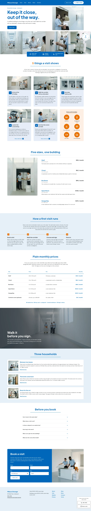

# Mikura Storage

Mikura Storage is a landing theme for a household self-storage building in Lindenport, opened in 2014. It presents five unit sizes, plain monthly prices, a twenty-minute staffed visit, and a single way to book. Desk hours, key-card access and the people who run the building are written into the page.

## Pages
Home (long conversion page with anchor menu), Sizes, Visit, About, News, Waitlist, Contact, Privacy, Terms and Thanks.

## Signature
A drifting strip of touching square photographs under a split hero with a blue three-fact bar straddling its edge, numbered photo cards with an orange round-disc panel, and a dock card that slides in from the right edge. Photographs are AI-generated for this theme; fonts are Plus Jakarta Sans and DM Sans (OFL).

## Menu
The top bar links to the Sizes, Visit, About, News and Contact pages; the Book a visit pill and the dock card point to the reservation anchor on the home page.

## Fonts
Plus Jakarta Sans (headings) and DM Sans (body), both OFL-1.1, bundled as Latin variable subsets.

<!-- screenshots:start -->
## Screenshots

<table>
<tr>
<td valign="top"></td>
<td valign="top"></td>
</tr>
</table>

- About: [desktop](screenshots/about-desktop.webp) · [mobile](screenshots/about-mobile.webp)
- News: [desktop](screenshots/news-desktop.webp) · [mobile](screenshots/news-mobile.webp)
- Article: [desktop](screenshots/article-desktop.webp) · [mobile](screenshots/article-mobile.webp)
- Category: [desktop](screenshots/category-desktop.webp) · [mobile](screenshots/category-mobile.webp)
- Tag: [desktop](screenshots/tag-desktop.webp) · [mobile](screenshots/tag-mobile.webp)
- Newsletter: [desktop](screenshots/newsletter-desktop.webp) · [mobile](screenshots/newsletter-mobile.webp)
- Contact: [desktop](screenshots/contact-desktop.webp) · [mobile](screenshots/contact-mobile.webp)
- Sizes: [desktop](screenshots/sizes-desktop.webp) · [mobile](screenshots/sizes-mobile.webp)
- Visit: [desktop](screenshots/visit-desktop.webp) · [mobile](screenshots/visit-mobile.webp)
- Privacy: [desktop](screenshots/privacy-desktop.webp) · [mobile](screenshots/privacy-mobile.webp)
- Terms: [desktop](screenshots/terms-desktop.webp) · [mobile](screenshots/terms-mobile.webp)
- Thanks: [desktop](screenshots/thanks-desktop.webp) · [mobile](screenshots/thanks-mobile.webp)
- Other languages (home page): [zh-TW](screenshots/zh-TW/home-desktop.webp) · [ja](screenshots/ja/home-desktop.webp) · [fr](screenshots/fr/home-desktop.webp) · [de](screenshots/de/home-desktop.webp)
<!-- screenshots:end -->
